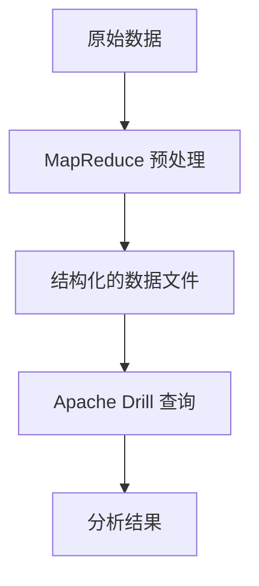

## 介绍

Apache Drill 是一个开源的分布式 SQL 查询引擎，专为大规模数据分析而设计。它能够直接查询多种数据源，包括 Hadoop 分布式文件系统（HDFS）、NoSQL 数据库和云存储。MapReduce 是 Hadoop 生态系统中的核心编程模型，用于处理大规模数据集。本文将探讨 Apache Drill 如何与 MapReduce 集成，以及它们如何协同工作以高效处理数据。

## Apache Drill 与 MapReduce 的关系

Apache Drill 和 MapReduce 都是用于处理大规模数据的工具，但它们的工作方式有所不同。MapReduce 是一种编程模型，通过将任务分解为多个小任务并在集群中并行执行来处理数据。而 Apache Drill 则是一个 SQL 查询引擎，允许用户使用标准的 SQL 语句查询数据，而无需编写复杂的 MapReduce 程序。

尽管 Apache Drill 和 MapReduce 有不同的工作方式，但它们可以协同工作。Apache Drill 可以利用 MapReduce 的分布式计算能力来执行查询，从而提高查询性能。

## 如何使用 Apache Drill 查询 MapReduce 生成的数据

假设我们有一个存储在 HDFS 上的数据集，该数据集是通过 MapReduce 生成的。我们可以使用 Apache Drill 来查询这些数据。

### 示例：查询 MapReduce 生成的日志数据

假设我们有一个 MapReduce 作业生成的日志文件，存储在 HDFS 的 `/logs` 目录中。我们可以使用 Apache Drill 来查询这些日志文件。

```sql
SELECT * FROM dfs.`/logs` WHERE level = 'ERROR';
```

在这个示例中，`dfs` 是 Apache Drill 中的一个存储插件，用于访问 HDFS 上的文件。`/logs` 是存储日志文件的目录。我们使用 SQL 语句查询所有日志级别为 `ERROR` 的记录。

### 输入和输出

**输入：** HDFS 上的日志文件，格式如下：

```
2023-10-01 12:00:00 INFO Application started
2023-10-01 12:01:00 ERROR Failed to connect to database
2023-10-01 12:02:00 INFO Application stopped
```

**输出：** 查询结果将返回所有日志级别为 `ERROR` 的记录：

```
2023-10-01 12:01:00 ERROR Failed to connect to database
```

## Apache Drill 与 MapReduce 的协同工作

Apache Drill 可以与 MapReduce 协同工作，以提高数据处理的效率。例如，Apache Drill 可以将复杂的 SQL 查询分解为多个 MapReduce 任务，并在集群中并行执行这些任务。

### 实际案例：分析电商网站的用户行为数据

假设我们有一个电商网站的用户行为数据，存储在 HDFS 上。我们可以使用 MapReduce 对这些数据进行预处理，然后使用 Apache Drill 进行进一步的分析。

1. **MapReduce 预处理：** 使用 MapReduce 对原始数据进行清洗和转换，生成结构化的数据文件。
2. **Apache Drill 查询：** 使用 Apache Drill 查询预处理后的数据，分析用户行为。

```sql
SELECT user_id, COUNT(*) AS page_views 
FROM dfs.`/user_behavior` 
GROUP BY user_id 
ORDER BY page_views DESC 
LIMIT 10;
```

在这个示例中，我们查询了每个用户的页面浏览量，并按浏览量降序排列，返回前 10 个用户。

## 总结

Apache Drill 和 MapReduce 是 Hadoop 生态系统中两个强大的工具，它们可以协同工作以处理大规模数据。Apache Drill 提供了简单易用的 SQL 接口，而 MapReduce 提供了强大的分布式计算能力。通过结合使用这两个工具，用户可以更高效地处理和分析大数据。

## 附加资源

- [Apache Drill 官方文档](https://drill.apache.org/docs/)
- [Hadoop MapReduce 教程](https://hadoop.apache.org/docs/current/hadoop-mapreduce-client/hadoop-mapreduce-client-core/MapReduceTutorial.html)
- [HDFS 入门指南](https://hadoop.apache.org/docs/stable/hadoop-project-dist/hadoop-hdfs/HdfsUserGuide.html)

## 练习

1. 使用 Apache Drill 查询一个存储在 HDFS 上的 CSV 文件，并返回前 10 行数据。
2. 编写一个 MapReduce 程序，对日志文件进行预处理，然后使用 Apache Drill 查询预处理后的数据。


