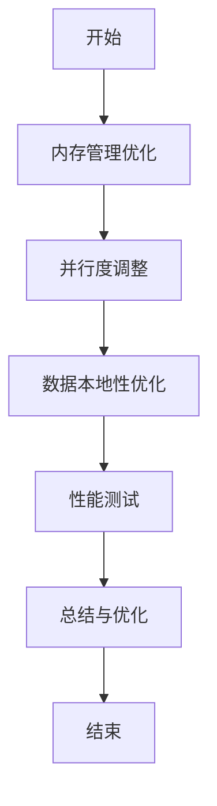

## 介绍

Hadoop是一个用于处理大规模数据的分布式计算框架。为了充分发挥其性能，合理的配置优化至关重要。Hadoop的配置优化涉及多个方面，包括内存管理、并行度调整、数据本地性优化等。本文将逐步介绍这些关键点，并通过实际案例帮助初学者理解如何优化Hadoop配置。

## 1. 内存管理优化

Hadoop的内存管理主要涉及`mapreduce.map.memory.mb`和`mapreduce.reduce.memory.mb`两个参数。这些参数分别控制Map任务和Reduce任务的内存分配。

### 示例配置

```xml
<property>
  <name>mapreduce.map.memory.mb</name>
  <value>2048</value>
</property>
<property>
  <name>mapreduce.reduce.memory.mb</name>
  <value>4096</value>
</property>
```

:::tip
确保为每个任务分配足够的内存，以避免频繁的磁盘交换（swap），从而提升任务执行效率。
:::

## 2. 并行度调整

并行度是影响Hadoop性能的另一个重要因素。通过调整`mapreduce.tasktracker.map.tasks.maximum`和`mapreduce.tasktracker.reduce.tasks.maximum`参数，可以控制每个节点上同时运行的Map和Reduce任务数量。

### 示例配置

```xml
<property>
  <name>mapreduce.tasktracker.map.tasks.maximum</name>
  <value>4</value>
</property>
<property>
  <name>mapreduce.tasktracker.reduce.tasks.maximum</name>
  <value>2</value>
</property>
```

:::caution
过高的并行度可能导致资源竞争，反而降低性能。建议根据集群的实际资源情况进行调整。
:::

## 3. 数据本地性优化

数据本地性是指任务在数据所在的节点上执行，从而减少数据传输的开销。Hadoop会自动尝试将任务调度到数据所在的节点，但可以通过调整`dfs.replication`参数来进一步优化。

### 示例配置

```xml
<property>
  <name>dfs.replication</name>
  <value>3</value>
</property>
```

:::note
增加数据副本数可以提高数据本地性的概率，但也会增加存储开销。建议根据数据的重要性和访问频率进行调整。
:::

## 4. 实际案例

假设我们有一个包含100个节点的Hadoop集群，每个节点有32GB内存和16个CPU核心。我们需要处理一个1TB的数据集。

### 优化步骤

1. **内存管理**：为每个Map任务分配2GB内存，每个Reduce任务分配4GB内存。
2. **并行度调整**：每个节点最多运行4个Map任务和2个Reduce任务。
3. **数据本地性优化**：将数据副本数设置为3，以提高数据本地性。

### 优化后的配置

```xml
<property>
  <name>mapreduce.map.memory.mb</name>
  <value>2048</value>
</property>
<property>
  <name>mapreduce.reduce.memory.mb</name>
  <value>4096</value>
</property>
<property>
  <name>mapreduce.tasktracker.map.tasks.maximum</name>
  <value>4</value>
</property>
<property>
  <name>mapreduce.tasktracker.reduce.tasks.maximum</name>
  <value>2</value>
</property>
<property>
  <name>dfs.replication</name>
  <value>3</value>
</property>
```

:::warning
在实际应用中，建议通过性能测试来验证配置优化的效果，并根据测试结果进行进一步调整。
:::

## 总结

通过合理的内存管理、并行度调整和数据本地性优化，可以显著提升Hadoop集群的性能。本文介绍了这些优化的关键点，并通过实际案例展示了如何应用这些优化策略。

## 附加资源

- [Hadoop官方文档](https://hadoop.apache.org/docs/current/)
- [Hadoop性能调优指南](https://www.oreilly.com/library/view/hadoop-the-definitive/9781491901687/)

## 练习

1. 尝试在你的Hadoop集群中应用本文介绍的优化策略，并观察性能变化。
2. 通过调整`dfs.replication`参数，观察数据本地性对任务执行时间的影响。


