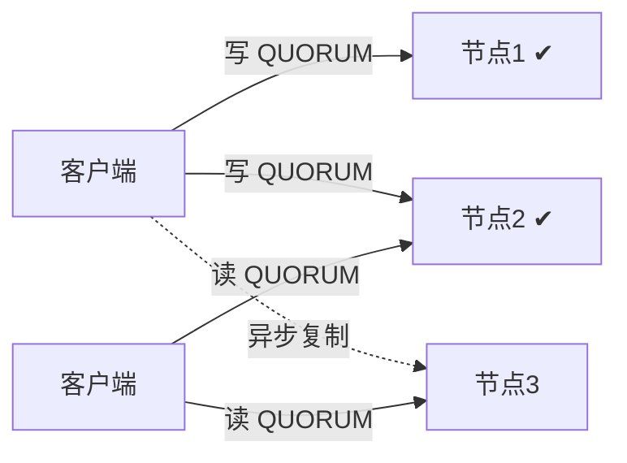

# Cassandra 一致性保证

Cassandra是一个分布式NoSQL数据库，设计用于处理大规模数据和高可用性场景。在分布式系统中，数据的一致性和可用性是一个重要的权衡问题。Cassandra通过一致性级别（Consistency Level）和复制策略（Replication Strategy）来保证数据的一致性和高可用性。

## 什么是Cassandra的一致性保证？

在分布式系统中，数据通常会被复制到多个节点上以提高可用性和容错能力。然而，这也带来了数据一致性的挑战。Cassandra通过一致性级别来控制读写操作时数据的一致性程度。一致性级别决定了在读写操作中需要多少个副本节点确认操作成功，才能认为操作是成功的。

### 一致性级别

Cassandra提供了多种一致性级别，常见的有：

- **ONE**：只需要一个副本节点确认操作即可。
- **QUORUM**：需要大多数副本节点（通常是 `(副本数 / 2) + 1`）确认操作。
- **ALL**：需要所有副本节点确认操作。

### 复制策略

Cassandra的复制策略决定了数据如何在集群中分布。常见的复制策略有：

- **SimpleStrategy**：适用于单数据中心，数据在集群中均匀分布。
- **NetworkTopologyStrategy**：适用于多数据中心，数据根据数据中心的拓扑结构进行分布。

## 一致性级别的实际应用

假设我们有一个Cassandra集群，包含3个节点，数据复制因子为3。我们使用 `QUORUM` 一致性级别进行写操作。

```cql
CONSISTENCY QUORUM;
INSERT INTO my_keyspace.my_table (id, name) VALUES (1, 'Alice');
```

在这个例子中，复制因子为3，因此 `QUORUM` 需要 `3 / 2 + 1 = 2` 个副本节点确认写入成功。即使其中一个节点宕机，写操作仍然可以成功完成。

同样，我们也可以使用 `QUORUM` 一致性级别进行读操作：

```cql
CONSISTENCY QUORUM;
SELECT * FROM my_keyspace.my_table WHERE id = 1;
```

读操作会向至少2个副本节点请求数据，并返回其中时间戳最新的版本。

### 强一致性的条件

Cassandra中有一个经典的公式，用于判断读写操作是否能保证强一致性：

```text
R + W > N
```

其中：

- **N**：复制因子（副本数量）。
- **W**：写操作需要确认的副本数。
- **R**：读操作需要确认的副本数。

当 `R + W > N` 时，读操作涉及的副本集合与写操作涉及的副本集合必然存在交集，因此读操作一定能读取到最新写入的数据。

以复制因子 `N = 3` 为例：

| 写一致性级别 | 读一致性级别 | R + W | 是否强一致 |
| --- | --- | --- | --- |
| `ONE` (W=1) | `ONE` (R=1) | 2 | 否 |
| `QUORUM` (W=2) | `QUORUM` (R=2) | 4 | 是 |
| `ALL` (W=3) | `ONE` (R=1) | 4 | 是 |
| `ONE` (W=1) | `ALL` (R=3) | 4 | 是 |



在上图中，写操作在节点1和节点2上确认，读操作访问节点2和节点3。由于节点2同时参与了读写，读操作一定能获取到最新的数据。

:::tip
`QUORUM` 读 + `QUORUM` 写是最常用的组合，它在一致性和可用性之间取得了良好的平衡：在复制因子为3的情况下，可以容忍1个节点故障。
:::

### 多数据中心中的一致性级别

在多数据中心部署中，Cassandra还提供了以下一致性级别：

- **LOCAL_QUORUM**：只需要本地数据中心中的大多数副本确认，避免跨数据中心的网络延迟。
- **EACH_QUORUM**：每个数据中心都需要大多数副本确认（仅适用于写操作）。
- **LOCAL_ONE**：只需要本地数据中心的一个副本确认。

例如，创建一个跨两个数据中心的键空间，并在本地数据中心内保证强一致性：

```cql
CREATE KEYSPACE my_keyspace
WITH replication = {
  'class': 'NetworkTopologyStrategy',
  'dc1': 3,
  'dc2': 3
};

CONSISTENCY LOCAL_QUORUM;
INSERT INTO my_keyspace.my_table (id, name) VALUES (2, 'Bob');
```

## 一致性修复机制

由于Cassandra允许在部分副本未确认的情况下完成操作，副本之间可能暂时出现不一致。Cassandra通过以下机制让数据最终达到一致：

- **提示移交（Hinted Handoff）**：当目标副本节点不可用时，协调节点会暂存一条"提示"，在该节点恢复后将写入重新发送给它。
- **读修复（Read Repair）**：在读操作中，如果协调节点发现副本之间的数据不一致，会将最新的数据写回到过期的副本中。
- **反熵修复（Anti-Entropy Repair）**：通过 `nodetool repair` 命令手动或定期触发，使用Merkle树比较副本之间的数据差异并进行同步。

```bash
# 对指定键空间执行修复
nodetool repair my_keyspace
```

:::caution
在生产环境中，应定期执行 `nodetool repair`（建议间隔小于 `gc_grace_seconds`，默认10天），否则已删除的数据可能会因墓碑（tombstone）过期而"复活"。
:::

## 实际案例：电商订单系统

假设一个电商平台使用Cassandra存储订单数据，不同的业务场景对一致性的要求不同：

- **下单和支付**：订单状态必须准确，使用 `QUORUM`（或多数据中心下的 `LOCAL_QUORUM`）进行读写，确保强一致性。
- **商品浏览记录**：允许短暂的不一致，使用 `ONE` 进行读写，以获得更低的延迟和更高的可用性。

```cql
-- 写入订单（要求强一致）
CONSISTENCY LOCAL_QUORUM;
INSERT INTO shop.orders (order_id, user_id, status) VALUES (uuid(), 1001, 'PAID');

-- 记录浏览历史（允许最终一致）
CONSISTENCY ONE;
INSERT INTO shop.view_history (user_id, product_id, viewed_at) VALUES (1001, 2002, toTimestamp(now()));
```

通过为不同的操作选择合适的一致性级别，系统可以在保证关键数据正确性的同时，兼顾性能和可用性。

## 总结

- Cassandra通过**可调一致性**（Tunable Consistency）让开发者为每个读写操作选择一致性级别。
- 当 `R + W > N` 时，可以实现强一致性；否则系统提供最终一致性。
- 多数据中心部署中，`LOCAL_QUORUM` 是兼顾一致性和延迟的常用选择。
- 提示移交、读修复和反熵修复共同保证副本最终达到一致。

## 附加资源

- [Cassandra官方文档](https://cassandra.apache.org/doc/latest/)

## 练习

1. 在复制因子为5的集群中，`QUORUM` 需要多少个副本确认？如果写使用 `QUORUM`，读至少需要使用哪个一致性级别才能保证强一致性？
2. 使用 `cqlsh` 分别以 `ONE` 和 `ALL` 一致性级别执行读写操作，然后停止一个节点，观察两种级别下的操作结果有何不同。
3. 对你的测试键空间执行 `nodetool repair`，并查看日志中的修复过程。
