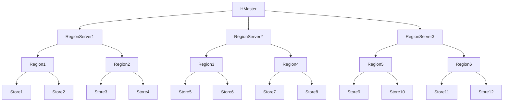

## 介绍

HBase是一个分布式的、面向列的数据库，设计用于处理大规模数据集。它是基于Google的Bigtable论文实现的，并且是Apache Hadoop生态系统的一部分。HBase的主要特点是高可用性、高扩展性和强一致性。它非常适合存储和处理海量数据，尤其是在需要快速随机读写的场景中。

在本节中，我们将深入探讨HBase的架构，了解其核心组件以及它们如何协同工作来提供高效的数据存储和访问。

## HBase 架构的核心组件

HBase的架构主要由以下几个核心组件组成：

1. **HMaster**：HBase的主服务器，负责管理表的元数据、Region的分配以及负载均衡。
2. **RegionServer**：负责存储和管理实际的数据。每个RegionServer管理多个Region。
3. **Region**：表的分区，每个Region存储表的一部分数据。
4. **ZooKeeper**：用于协调分布式系统中的各个节点，确保它们能够协同工作。
5. **HDFS**：Hadoop分布式文件系统，HBase的数据最终存储在HDFS上。

### HMaster

HMaster是HBase的主服务器，负责管理表的元数据、Region的分配以及负载均衡。它不直接处理客户端的读写请求，而是负责协调RegionServer的工作。HMaster的主要职责包括：

- 管理表的创建、删除和修改。
- 分配Region到RegionServer。
- 监控RegionServer的状态，并在RegionServer失效时重新分配Region。

### RegionServer

RegionServer是HBase中负责存储和管理实际数据的组件。每个RegionServer管理多个Region，每个Region存储表的一部分数据。RegionServer的主要职责包括：

- 处理客户端的读写请求。
- 管理Region的拆分和合并。
- 执行数据的压缩和合并操作。

### Region

Region是HBase表的分区，每个Region存储表的一部分数据。当表的数据量增大时，HBase会自动将Region拆分为更小的Region，以保持数据的均衡分布。每个Region由一个或多个Store组成，每个Store对应表中的一个列族。

### Zookeeper

ZooKeeper是HBase的协调服务，用于管理集群中的各个节点。它负责维护集群的元数据、监控RegionServer的状态，并在RegionServer失效时通知HMaster进行故障恢复。

### HDFS

HDFS是Hadoop分布式文件系统，HBase的数据最终存储在HDFS上。HDFS提供了高可靠性和高吞吐量的数据存储，使得HBase能够处理大规模数据集。

## HBase 的数据存储方式

HBase的数据存储方式是基于列族（Column Family）的。每个表可以包含多个列族，每个列族包含多个列。数据在HBase中是以键值对的形式存储的，每个键值对包含一个行键（Row Key）、列族、列限定符（Column Qualifier）和时间戳（Timestamp）。

以下是一个简单的HBase表结构示例：

| Row Key | Column Family:cf1 | Column Family:cf2 |
|---------|-------------------|-------------------|
| row1    | cf1:col1=value1   | cf2:col2=value2   |
| row2    | cf1:col1=value3   | cf2:col2=value4   |

在这个示例中，表包含两个列族`cf1`和`cf2`，每个列族包含一个列`col1`和`col2`。

## HBase 的高可用性和扩展性

HBase通过以下机制实现高可用性和扩展性：

1. **Region的自动拆分和合并**：当Region的大小超过一定阈值时，HBase会自动将其拆分为更小的Region。反之，当Region的大小过小时，HBase会将其合并为更大的Region。
2. **RegionServer的负载均衡**：HMaster会监控RegionServer的负载情况，并在必要时将Region重新分配到负载较低的RegionServer上。
3. **数据的多副本存储**：HBase的数据存储在HDFS上，HDFS会自动将数据复制到多个节点上，以确保数据的高可用性。

## 实际应用场景

HBase广泛应用于需要处理大规模数据集的场景，例如：

- **日志存储和分析**：HBase可以高效地存储和查询大量的日志数据。
- **实时数据存储**：HBase支持快速的随机读写，适合存储实时生成的数据。
- **推荐系统**：HBase可以存储用户行为数据，并为推荐系统提供实时查询服务。

## 总结

HBase是一个强大的分布式数据库，具有高可用性、高扩展性和强一致性的特点。它的架构设计使得它能够高效地处理大规模数据集，非常适合需要快速随机读写的场景。

通过了解HBase的核心组件和数据存储方式，您可以更好地理解其工作原理，并在实际应用中发挥其优势。

## 附加资源

- [HBase官方文档](https://hbase.apache.org/)
- [HBase in Action](https://www.manning.com/books/hbase-in-action) - 一本深入讲解HBase的书籍。
- [HBase Tutorial](https://www.tutorialspoint.com/hbase/index.htm) - 一个适合初学者的HBase教程。

## 练习

1. 创建一个HBase表，并插入一些数据。
2. 使用HBase Shell查询表中的数据。
3. 尝试将HBase与Hadoop集成，并分析存储在HDFS上的数据。

