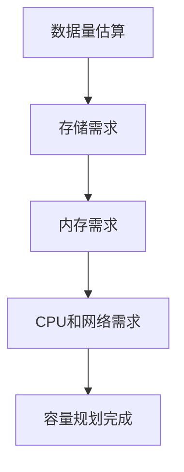

# HBase 容量规划

HBase是一个分布式、面向列的数据库，设计用于处理大规模数据集。为了确保HBase集群的高性能和可扩展性，容量规划是至关重要的。本文将逐步介绍HBase容量规划的关键概念，并通过实际案例帮助您理解如何应用这些概念。

## 什么是HBase容量规划？

HBase容量规划是指根据预期的数据量、访问模式和性能需求，预先计算和分配集群资源的过程。这包括存储容量、内存、CPU和网络带宽的规划。良好的容量规划可以避免资源浪费、性能瓶颈和系统崩溃。

## 容量规划的关键因素

### 1. 数据量估算

首先，您需要估算将要存储在HBase中的数据量。这包括：

- **行数**：预计存储的总行数。
- **列数**：每行的平均列数。
- **数据大小**：每列的平均数据大小。

例如，假设您有一个表，预计存储1亿行数据，每行有10列，每列平均大小为100字节。那么总数据量可以估算为：

```
总数据量 = 行数 × 列数 × 每列大小
总数据量 = 100,000,000 × 10 × 100 = 100 GB
```

### 2. 存储需求

HBase数据存储在HDFS（Hadoop分布式文件系统）上。您需要考虑以下因素：

- **数据副本**：HDFS默认存储3个副本，因此实际存储需求为数据量的3倍。
- **压缩**：HBase支持数据压缩，可以减少存储需求。常见的压缩算法包括Snappy和GZIP。

继续上面的例子，假设使用Snappy压缩，压缩比为2:1，那么实际存储需求为：

```
实际存储需求 = 总数据量 × 副本数 / 压缩比
实际存储需求 = 100 GB × 3 / 2 = 150 GB
```

### 3. 内存需求

HBase使用内存来缓存数据（BlockCache）和存储元数据（MemStore）。内存需求取决于：

- **BlockCache大小**：通常设置为堆内存的20%-30%。
- **MemStore大小**：通常设置为堆内存的40%。

假设您有16 GB的堆内存，那么：

```
BlockCache大小 = 16 GB × 25% = 4 GB
MemStore大小 = 16 GB × 40% = 6.4 GB
```

### 4. CPU和网络需求

CPU和网络需求取决于读写操作的频率和数据量。高吞吐量的应用需要更多的CPU核心和更高的网络带宽。

## 实际案例

假设您正在为一个电商网站设计HBase集群，该网站每天产生1亿条订单记录，每条记录大小为1 KB。您需要存储30天的数据，并且需要支持每秒1000次的读写操作。

### 数据量估算

```
总数据量 = 1亿条/天 × 30天 × 1 KB = 3 TB
```

### 存储需求

假设使用Snappy压缩，压缩比为2:1，HDFS副本数为3：

```
实际存储需求 = 3 TB × 3 / 2 = 4.5 TB
```

### 内存需求

假设每个RegionServer有32 GB堆内存：

```
BlockCache大小 = 32 GB × 25% = 8 GB
MemStore大小 = 32 GB × 40% = 12.8 GB
```

### CPU和网络需求

根据每秒1000次的读写操作，您可能需要至少8核CPU和10 Gbps网络带宽。

## 总结

HBase容量规划是确保集群性能和可扩展性的关键步骤。通过估算数据量、存储需求、内存需求以及CPU和网络需求，您可以有效地规划HBase集群的资源。实际案例展示了如何将这些概念应用到真实场景中。

:::tip
在进行容量规划时，务必考虑未来的增长需求，并为系统预留一定的资源余量。
:::

## 附加资源

- [HBase官方文档](https://hbase.apache.org/)
- [HBase性能调优指南](https://hbase.apache.org/book.html#performance)
- [HDFS存储管理](https://hadoop.apache.org/docs/current/hadoop-project-dist/hadoop-hdfs/HdfsDesign.html)

## 练习

1. 估算一个社交网络应用的HBase存储需求，假设每天产生10亿条消息，每条消息大小为500字节，存储60天。
2. 设计一个HBase集群，支持每秒5000次的读写操作，并计算所需的内存、CPU和网络资源。


