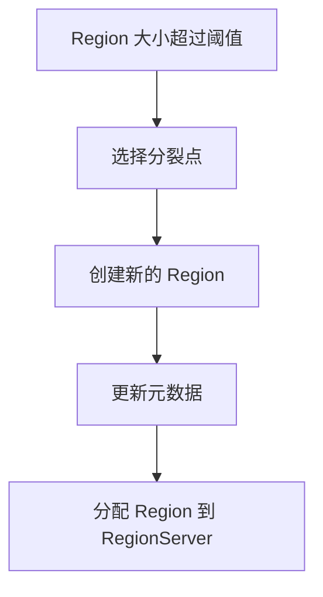

# HBase Region分裂

HBase 是一个分布式的、面向列的数据库，它基于 Google 的 Bigtable 设计。在 HBase 中，数据被分割成多个 **Region**，每个 Region 负责存储一部分数据。随着数据的增长，Region 的大小也会增加。为了保持高效的读写性能，HBase 会自动将过大的 Region 分裂成两个较小的 Region。这个过程称为 **Region 分裂**。

## 什么是 Region 分裂？

Region 分裂是 HBase 中一种自动化的数据管理机制。当一个 Region 的大小超过预设的阈值时，HBase 会将其分裂成两个新的 Region。分裂后的 Region 会被分配到不同的 RegionServer 上，从而实现负载均衡。

### 为什么需要 Region 分裂？

- **性能优化**：过大的 Region 会导致读写性能下降，分裂后可以分散负载，提高性能。
- **负载均衡**：分裂后的 Region 可以被分配到不同的 RegionServer 上，避免单个 RegionServer 过载。
- **数据管理**：分裂后的 Region 更容易管理，HBase 可以更高效地进行数据压缩和清理。

## Region 分裂的过程

Region 分裂的过程可以分为以下几个步骤：

1. **检测 Region 大小**：HBase 会定期检查每个 Region 的大小，如果某个 Region 的大小超过了预设的阈值（默认是 10GB），就会触发分裂。
2. **选择分裂点**：HBase 会根据 Region 中的数据分布选择一个合适的分裂点。通常，分裂点会选择在 Region 的中间位置。
3. **创建新的 Region**：在分裂点处，HBase 会创建两个新的 Region，并将原始 Region 的数据分割到这两个新的 Region 中。
4. **更新元数据**：HBase 会更新元数据表（`hbase:meta`），记录新的 Region 信息。
5. **分配 Region**：新的 Region 会被分配到不同的 RegionServer 上，完成负载均衡。

### 代码示例

以下是一个简单的代码示例，展示如何手动触发 Region 分裂：

```java
// 获取 HBase 表的 Region 信息
HTableDescriptor tableDescriptor = admin.getTableDescriptor(TableName.valueOf("my_table"));
List<HRegionInfo> regions = admin.getTableRegions(TableName.valueOf("my_table"));

// 手动触发 Region 分裂
for (HRegionInfo region : regions) {
    admin.split(region.getRegionName());
}
```

:::note
在实际生产环境中，HBase 会自动处理 Region 分裂，通常不需要手动干预。
:::

## Region 分裂的实际应用场景

### 场景 1：数据增长过快

假设你有一个电商网站，每天都会产生大量的订单数据。随着数据的增长，存储订单数据的 Region 会变得越来越大。如果不进行分裂，单个 Region 的读写性能会显著下降。通过 Region 分裂，HBase 可以将数据分散到多个 Region 中，从而提高系统的整体性能。

### 场景 2：负载均衡

在一个分布式系统中，负载均衡是非常重要的。如果某个 RegionServer 上的 Region 过大，会导致该 RegionServer 的负载过高，影响系统的稳定性。通过 Region 分裂，HBase 可以将负载分散到多个 RegionServer 上，从而实现负载均衡。

## Region 分裂的注意事项

- **分裂阈值**：默认情况下，HBase 的 Region 分裂阈值是 10GB。你可以根据实际需求调整这个阈值。
- **分裂性能**：Region 分裂是一个相对耗时的操作，可能会对系统的性能产生短暂的影响。因此，在高负载的情况下，建议谨慎调整分裂阈值。
- **数据一致性**：在 Region 分裂过程中，HBase 会确保数据的一致性。分裂完成后，新的 Region 会立即生效，旧 Region 会被标记为不可用。

## 总结

Region 分裂是 HBase 中一个重要的机制，它通过将过大的 Region 分裂成较小的 Region 来提高系统的性能和负载均衡能力。理解 Region 分裂的过程和原理，对于优化 HBase 的性能和管理大规模数据非常重要。

## 附加资源

- [HBase 官方文档](https://hbase.apache.org/book.html)
- [HBase Region 分裂机制详解](https://hbase.apache.org/apidocs/org/apache/hadoop/hbase/regionserver/HRegion.html)

## 练习

1. 尝试在本地 HBase 环境中手动触发 Region 分裂，并观察分裂前后的 Region 分布情况。
2. 调整 HBase 的 Region 分裂阈值，观察对系统性能的影响。
3. 研究 HBase 的负载均衡机制，了解 Region 分裂如何与负载均衡协同工作。


