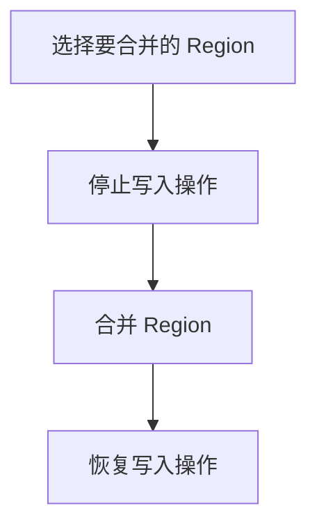

# HBase Region 合并

## 介绍

在 HBase 中，数据被分割成多个 **Region**，每个 Region 负责存储一部分数据。随着数据的不断写入，Region 的数量可能会增加，导致系统性能下降。为了优化性能，HBase 提供了 **Region 合并** 的功能，即将多个小 Region 合并成一个更大的 Region。本文将详细介绍 HBase Region 合并的概念、工作原理以及如何在实际应用中使用它。

## Region 合并的工作原理

Region 合并的主要目的是减少 Region 的数量，从而降低 HBase 的管理开销。合并过程通常由 HBase 自动触发，但也可以手动执行。以下是 Region 合并的基本步骤：

1. **选择要合并的 Region**：HBase 会根据一定的策略选择需要合并的 Region，通常是那些大小较小或访问频率较低的 Region。
2. **停止写入操作**：在合并过程中，HBase 会暂时停止对目标 Region 的写入操作，以确保数据的一致性。
3. **合并 Region**：HBase 会将选中的 Region 合并成一个更大的 Region，并更新元数据。
4. **恢复写入操作**：合并完成后，HBase 会恢复对合并后 Region 的写入操作。

## 手动合并 Region

虽然 HBase 会自动合并 Region，但在某些情况下，你可能需要手动触发合并操作。以下是一个手动合并 Region 的示例：

```bash
hbase shell
```

在 HBase Shell 中，你可以使用以下命令手动合并 Region：

```bash
merge_region 'region1', 'region2'
```

其中，`region1` 和 `region2` 是要合并的两个 Region 的名称。

:::note
手动合并 Region 时，请确保这两个 Region 是相邻的，否则合并操作将失败。
:::

## 实际应用场景

### 场景 1：优化查询性能

假设你有一个 HBase 表，其中包含大量小 Region。由于 Region 数量过多，查询性能可能会受到影响。通过合并这些小 Region，你可以减少 Region 的数量，从而提高查询性能。

### 场景 2：减少管理开销

在大规模 HBase 集群中，管理大量小 Region 会带来额外的开销。通过定期合并 Region，你可以减少 HBase 的管理开销，从而提高系统的整体稳定性。

## 总结

HBase Region 合并是一个重要的优化手段，它可以帮助你减少 Region 的数量，从而提高查询性能并降低管理开销。无论是自动合并还是手动合并，理解其工作原理和应用场景对于优化 HBase 集群至关重要。

## 附加资源

- [HBase 官方文档](https://hbase.apache.org/)
- [HBase Region 管理指南](https://hbase.apache.org/book.html#regions)

## 练习

1. 在你的 HBase 集群中，尝试手动合并两个相邻的 Region，并观察合并前后的性能变化。
2. 研究 HBase 的自动合并策略，并尝试调整相关参数以优化合并效果。


