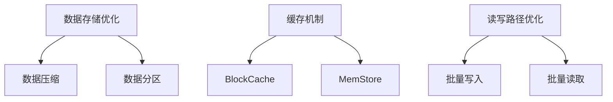

# HBase IO优化

HBase是一个分布式的、面向列的数据库，广泛应用于大数据领域。由于其设计初衷是为了处理海量数据，IO性能的优化显得尤为重要。本文将详细介绍如何通过优化HBase的IO性能来提升系统效率。

## 介绍

HBase的IO性能直接影响到数据的读写速度，进而影响整个系统的响应时间和吞吐量。IO优化主要涉及以下几个方面：

1. **数据存储优化**：包括数据压缩、数据分区等。
2. **缓存机制**：利用缓存减少磁盘IO。
3. **读写路径优化**：优化数据的读写路径，减少不必要的IO操作。

## 数据存储优化

### 数据压缩

HBase支持多种数据压缩算法，如GZIP、Snappy、LZO等。压缩可以减少存储空间，同时减少磁盘IO。

```java
// 设置表的压缩算法为Snappy
HTableDescriptor tableDescriptor = new HTableDescriptor(TableName.valueOf("myTable"));
tableDescriptor.setCompressionType(Algorithm.SNAPPY);
admin.createTable(tableDescriptor);
```

### 数据分区

合理的数据分区可以减少单个Region的负载，避免热点问题。可以通过预分区（Pre-splitting）来实现。

```java
// 预分区示例
byte[][] splits = new byte[][] {
    Bytes.toBytes("A"),
    Bytes.toBytes("B"),
    Bytes.toBytes("C")
};
admin.createTable(tableDescriptor, splits);
```

## 缓存机制

### BlockCache

HBase使用BlockCache来缓存数据块，减少磁盘IO。可以通过调整BlockCache的大小来优化性能。

```xml
<!-- hbase-site.xml 配置 -->
<property>
  <name>hfile.block.cache.size</name>
  <value>0.4</value> <!-- 40%的堆内存用于BlockCache -->
</property>
```

### MemStore

MemStore是HBase的内存写缓存，用于暂存写入的数据。可以通过调整MemStore的大小来优化写性能。

```xml
<!-- hbase-site.xml 配置 -->
<property>
  <name>hbase.hregion.memstore.flush.size</name>
  <value>134217728</value> <!-- 128MB -->
</property>
```

## 读写路径优化

### 批量写入

批量写入可以减少IO操作次数，提升写性能。

```java
// 批量写入示例
List<Put> puts = new ArrayList<>();
for (int i = 0; i < 1000; i++) {
    Put put = new Put(Bytes.toBytes("row" + i));
    put.addColumn(Bytes.toBytes("cf"), Bytes.toBytes("col"), Bytes.toBytes("value" + i));
    puts.add(put);
}
table.put(puts);
```

### 批量读取

批量读取可以减少IO操作次数，提升读性能。

```java
// 批量读取示例
List<Get> gets = new ArrayList<>();
for (int i = 0; i < 1000; i++) {
    Get get = new Get(Bytes.toBytes("row" + i));
    gets.add(get);
}
Result[] results = table.get(gets);
```

## 实际案例

假设我们有一个电商网站，需要存储用户的购物记录。通过优化HBase的IO性能，我们可以显著提升系统的响应速度。

1. **数据压缩**：使用Snappy压缩算法，减少存储空间和磁盘IO。
2. **数据分区**：根据用户ID进行预分区，避免热点问题。
3. **缓存机制**：调整BlockCache和MemStore的大小，提升读写性能。
4. **批量操作**：使用批量写入和批量读取，减少IO操作次数。

## 总结

通过优化HBase的IO性能，我们可以显著提升系统的响应速度和吞吐量。本文介绍了数据存储优化、缓存机制和读写路径优化的方法，并通过实际案例展示了这些方法的应用。

## 附加资源

- [HBase官方文档](https://hbase.apache.org/)
- [HBase性能调优指南](https://hbase.apache.org/book.html#performance)

## 练习

1. 尝试在你的HBase集群中启用数据压缩，并观察存储空间和IO性能的变化。
2. 调整BlockCache和MemStore的大小，测试不同配置下的读写性能。
3. 实现批量写入和批量读取，比较与单条操作的性能差异。


