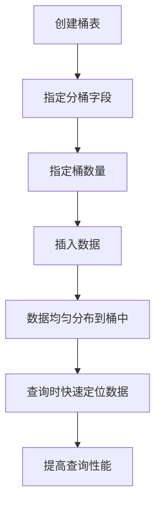

# 桶表设计

在 Hive 中，桶表（Bucketed Table）是一种通过将数据分桶（Bucket）来优化数据存储和查询性能的技术。桶表设计可以帮助我们更高效地处理大规模数据，尤其是在进行连接（Join）操作时。

## 什么是桶表？

桶表是 Hive 中的一种表类型，它将数据按照某个字段的哈希值进行分桶存储。每个桶对应一个文件，数据被均匀分布到这些桶中。通过这种方式，Hive 可以在查询时快速定位到所需的数据，从而提高查询效率。

:::tip
桶表特别适用于需要频繁进行连接操作的场景，因为连接操作可以在桶级别进行，而不需要扫描整个表。
:::

## 如何创建桶表？

要创建一个桶表，我们需要在创建表时指定分桶的字段和桶的数量。以下是一个创建桶表的示例：

```sql
CREATE TABLE bucketed_table (
    id INT,
    name STRING,
    age INT
)
CLUSTERED BY (id) INTO 4 BUCKETS;
```

在这个示例中，我们创建了一个名为 `bucketed_table` 的表，并按照 `id` 字段进行分桶，共分为 4 个桶。

:::caution
在创建桶表时，必须确保数据已经按照分桶字段进行了排序，否则分桶效果可能不理想。
:::

## 桶表的优势

1. **查询性能优化**：通过分桶，Hive 可以在查询时快速定位到所需的数据，减少扫描的数据量。
2. **连接操作优化**：在连接操作中，Hive 可以在桶级别进行连接，而不需要扫描整个表，从而提高连接操作的效率。
3. **数据均匀分布**：分桶可以确保数据在桶之间均匀分布，避免数据倾斜问题。

## 实际案例

假设我们有一个用户表 `users` 和一个订单表 `orders`，我们希望通过 `user_id` 字段将这两个表连接起来。为了提高连接操作的效率，我们可以将这两个表都按照 `user_id` 字段进行分桶。

```sql
-- 创建分桶的用户表
CREATE TABLE bucketed_users (
    user_id INT,
    name STRING,
    age INT
)
CLUSTERED BY (user_id) INTO 8 BUCKETS;

-- 创建分桶的订单表
CREATE TABLE bucketed_orders (
    order_id INT,
    user_id INT,
    order_date STRING
)
CLUSTERED BY (user_id) INTO 8 BUCKETS;
```

在查询时，Hive 可以在桶级别进行连接操作，而不需要扫描整个表：

```sql
SELECT u.name, o.order_id, o.order_date
FROM bucketed_users u
JOIN bucketed_orders o
ON u.user_id = o.user_id;
```

## 总结

桶表设计是 Hive 中一种重要的优化技术，它通过将数据分桶存储来提高查询和连接操作的效率。通过合理设计桶表，我们可以显著提升大规模数据处理的性能。

:::note
在实际应用中，选择合适的分桶字段和桶数量非常重要。通常，分桶字段应该是查询中经常使用的字段，而桶数量则应根据数据量和集群资源进行合理设置。
:::

## 附加资源

- [Hive 官方文档](https://hive.apache.org/)
- [Hive 分桶表详解](https://cwiki.apache.org/confluence/display/Hive/LanguageManual+DDL#LanguageManualDDL-BucketedTables)

## 练习

1. 创建一个分桶表，并插入一些数据，观察数据是如何分布到各个桶中的。
2. 尝试在两个分桶表之间进行连接操作，比较分桶表和非分桶表的查询性能差异。


