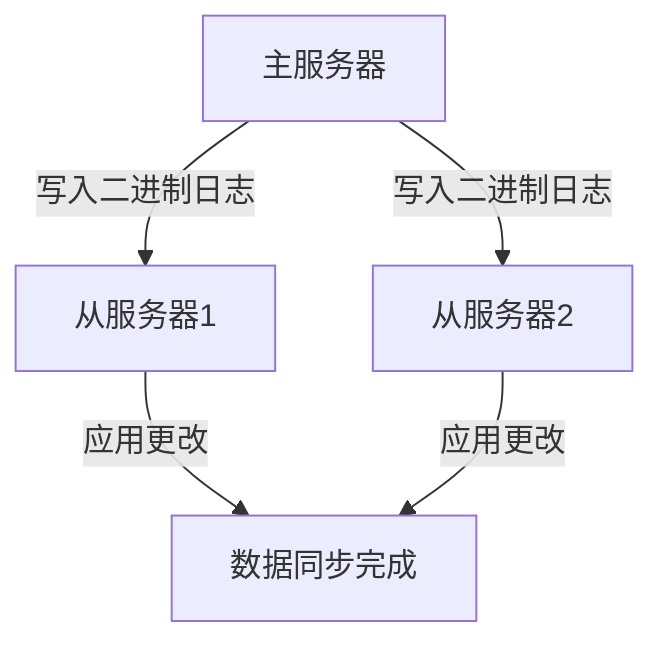

# MySQL 复制类型

MySQL复制是一种将数据从一个MySQL数据库服务器（主服务器）复制到一个或多个MySQL数据库服务器（从服务器）的技术。复制的主要目的是提高数据的可用性、可靠性和性能。MySQL支持多种复制类型，每种类型都有其特定的应用场景和优势。

## 1. 异步复制（Asynchronous Replication）

异步复制是MySQL中最常见的复制类型。在这种模式下，主服务器将数据更改记录到二进制日志（Binary Log）中，从服务器异步地读取这些日志并应用更改。由于是异步的，主服务器不需要等待从服务器的确认，因此性能较高。

### 1.1 工作原理

1. 主服务器将数据更改写入二进制日志。
2. 从服务器连接到主服务器并请求二进制日志。
3. 从服务器读取二进制日志并应用更改。

### 1.2 代码示例

```sql
-- 在主服务器上启用二进制日志
SET GLOBAL log_bin = ON;

-- 在从服务器上配置主服务器信息
CHANGE MASTER TO
    MASTER_HOST='master_host_name',
    MASTER_USER='replication_user',
    MASTER_PASSWORD='replication_password',
    MASTER_LOG_FILE='mysql-bin.000001',
    MASTER_LOG_POS=4;

-- 启动从服务器的复制进程
START SLAVE;
```

### 1.3 实际应用场景

异步复制适用于对数据一致性要求不高的场景，例如报表生成、数据分析等。由于主服务器不需要等待从服务器的确认，因此在高并发场景下性能表现较好。

## 2. 半同步复制（Semi-Synchronous Replication）

半同步复制是异步复制和同步复制的折中方案。在这种模式下，主服务器在提交事务之前，至少需要等待一个从服务器确认已接收到二进制日志。这样可以确保在主服务器发生故障时，至少有一个从服务器拥有最新的数据。

### 2.1 工作原理

1. 主服务器将数据更改写入二进制日志。
2. 主服务器等待至少一个从服务器确认已接收到二进制日志。
3. 从服务器应用更改并发送确认。

### 2.2 代码示例

```sql
-- 在主服务器上启用半同步复制
INSTALL PLUGIN rpl_semi_sync_master SONAME 'semisync_master.so';
SET GLOBAL rpl_semi_sync_master_enabled = 1;

-- 在从服务器上启用半同步复制
INSTALL PLUGIN rpl_semi_sync_slave SONAME 'semisync_slave.so';
SET GLOBAL rpl_semi_sync_slave_enabled = 1;
```

### 2.3 实际应用场景

半同步复制适用于对数据一致性要求较高的场景，例如金融交易、在线支付等。由于主服务器需要等待从服务器的确认，因此在性能上会有一定的损失，但数据一致性得到了更好的保障。

## 3. 组复制（Group Replication）

组复制是MySQL 5.7引入的一种新型复制技术，基于Paxos协议实现。在这种模式下，多个MySQL服务器组成一个复制组，每个服务器都可以接收写请求，并且数据更改会在组内自动同步。

### 3.1 工作原理

1. 多个MySQL服务器组成一个复制组。
2. 每个服务器都可以接收写请求。
3. 数据更改通过Paxos协议在组内同步。

### 3.2 代码示例

```sql
-- 在服务器上启用组复制
SET GLOBAL group_replication_bootstrap_group=ON;
START GROUP_REPLICATION;
SET GLOBAL group_replication_bootstrap_group=OFF;
```

### 3.3 实际应用场景

组复制适用于需要高可用性和自动故障转移的场景，例如分布式数据库、多主复制等。由于每个服务器都可以接收写请求，因此在写性能上会有一定的提升。

## 4. 总结

MySQL复制类型包括异步复制、半同步复制和组复制，每种类型都有其特定的应用场景和优势。异步复制适用于对数据一致性要求不高的场景，半同步复制适用于对数据一致性要求较高的场景，而组复制适用于需要高可用性和自动故障转移的场景。

## 5. 附加资源

- [MySQL官方文档](https://dev.mysql.com/doc/)
- [MySQL复制技术详解](https://www.mysql.com/cn/why-mysql/replication/)
- [MySQL组复制实战](https://www.mysql.com/cn/why-mysql/group-replication/)

## 6. 练习

1. 配置一个MySQL异步复制环境，并测试数据同步。
2. 尝试将异步复制升级为半同步复制，并观察性能变化。
3. 搭建一个MySQL组复制环境，并测试自动故障转移功能。


