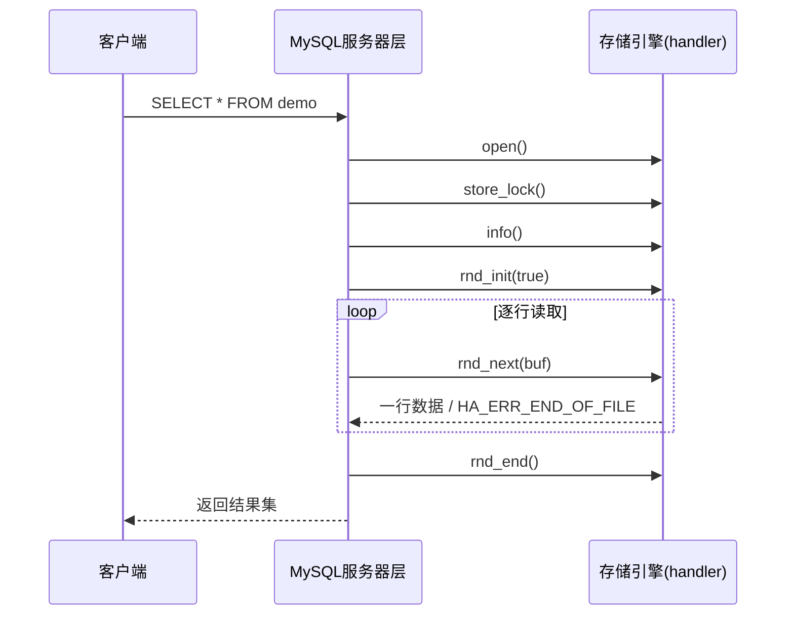

# MySQL 自定义存储引擎

MySQL是一个功能强大的关系型数据库管理系统，支持多种存储引擎，如InnoDB、MyISAM等。然而，在某些特定场景下，默认的存储引擎可能无法满足需求。这时，自定义存储引擎（Custom Storage Engine）就派上了用场。本文将详细介绍MySQL自定义存储引擎的概念、实现方法以及实际应用场景。

## 什么是自定义存储引擎？

存储引擎是MySQL中负责数据的存储、检索和管理的组件。MySQL默认提供了多种存储引擎，每种引擎都有其特定的优势和适用场景。自定义存储引擎允许开发者根据特定需求，实现自己的存储逻辑，从而扩展MySQL的功能。

:::note
自定义存储引擎需要开发者具备一定的C/C++编程能力，因为MySQL的存储引擎接口是用C语言编写的。
:::

## 为什么需要自定义存储引擎？

在某些情况下，默认的存储引擎可能无法满足特定需求。例如：

- 需要实现特定的数据压缩算法。
- 需要将数据存储到非传统介质（如内存、分布式文件系统）。
- 需要实现特定的数据加密或解密逻辑。

在这些场景下，自定义存储引擎可以提供更高的灵活性和控制力。

## 如何实现自定义存储引擎？

实现自定义存储引擎需要遵循MySQL的存储引擎API。以下是实现自定义存储引擎的基本步骤：

### 1. 定义存储引擎结构

首先，需要定义一个存储引擎结构体，并实现必要的接口函数。以下是一个简单的示例：


MySQL的存储引擎接口是以C++类的形式提供的：每个存储引擎都需要继承 `handler` 基类，并通过一个 `handlerton` 结构向服务器注册自己。MySQL源代码中的 `storage/example` 目录提供了一个官方示例引擎（`ha_example.h` 和 `ha_example.cc`），是学习存储引擎开发的最佳起点。

下面是一个基于MySQL 8.0示例引擎简化后的头文件：

```cpp
// ha_myengine.h
#include "sql/handler.h"
#include "thr_lock.h"

// 每张表共享的锁信息
class Myengine_share : public Handler_share {
 public:
  THR_LOCK lock;
  Myengine_share() { thr_lock_init(&lock); }
  ~Myengine_share() override { thr_lock_delete(&lock); }
};

class ha_myengine : public handler {
  THR_LOCK_DATA lock;       // MySQL表级锁数据
  Myengine_share *share;    // 共享的锁信息
  Myengine_share *get_share();

 public:
  ha_myengine(handlerton *hton, TABLE_SHARE *table_arg);
  ~ha_myengine() override = default;

  // 存储引擎名称与能力声明
  const char *table_type() const override { return "MYENGINE"; }
  ulonglong table_flags() const override { return HA_BINLOG_STMT_CAPABLE; }
  ulong index_flags(uint, uint, bool) const override { return 0; }

  // 表的打开、关闭与创建
  int open(const char *name, int mode, uint test_if_locked,
           const dd::Table *table_def) override;
  int close(void) override;
  int create(const char *name, TABLE *form, HA_CREATE_INFO *create_info,
             dd::Table *table_def) override;

  // 写入数据
  int write_row(uchar *buf) override;

  // 全表扫描
  int rnd_init(bool scan) override;
  int rnd_next(uchar *buf) override;
  int rnd_pos(uchar *buf, uchar *pos) override;
  void position(const uchar *record) override;

  // 统计信息与锁
  int info(uint flag) override;
  THR_LOCK_DATA **store_lock(THD *thd, THR_LOCK_DATA **to,
                             enum thr_lock_type lock_type) override;
};
```

`handler` 类中的大多数方法都有默认实现（通常返回 `HA_ERR_WRONG_COMMAND`，表示不支持该操作），所以一个最小的存储引擎只需要实现上面这些核心方法。

### 2. 实现核心方法

接下来在 `ha_myengine.cc` 中实现这些方法。下面的示例展示了一个"只读空表"引擎的骨架，它可以创建表、接受查询，但不保存任何数据：

```cpp
// ha_myengine.cc（节选）
#include "ha_myengine.h"
#include "my_dbug.h"
#include "mysql/plugin.h"
#include "sql/sql_class.h"

static handlerton *myengine_hton;

// 由服务器调用，用来为每张表创建handler实例
static handler *myengine_create_handler(handlerton *hton, TABLE_SHARE *table,
                                        bool, MEM_ROOT *mem_root) {
  return new (mem_root) ha_myengine(hton, table);
}

ha_myengine::ha_myengine(handlerton *hton, TABLE_SHARE *table_arg)
    : handler(hton, table_arg) {}

Myengine_share *ha_myengine::get_share() {
  Myengine_share *tmp_share;
  lock_shared_ha_data();
  if (!(tmp_share = static_cast<Myengine_share *>(get_ha_share_ptr()))) {
    tmp_share = new Myengine_share;
    set_ha_share_ptr(static_cast<Handler_share *>(tmp_share));
  }
  unlock_shared_ha_data();
  return tmp_share;
}

int ha_myengine::open(const char *, int, uint, const dd::Table *) {
  if (!(share = get_share())) return 1;
  thr_lock_data_init(&share->lock, &lock, nullptr);
  return 0;
}

int ha_myengine::close(void) { return 0; }

int ha_myengine::create(const char *, TABLE *, HA_CREATE_INFO *, dd::Table *) {
  // 在这里创建引擎自己的数据文件，例如在磁盘上新建一个文件
  return 0;
}

int ha_myengine::write_row(uchar *) {
  // 本示例不保存数据，直接返回"不支持"
  return HA_ERR_WRONG_COMMAND;
}

int ha_myengine::rnd_init(bool) { return 0; }

int ha_myengine::rnd_next(uchar *) {
  // 返回HA_ERR_END_OF_FILE表示扫描结束（这里表始终为空）
  return HA_ERR_END_OF_FILE;
}

int ha_myengine::rnd_pos(uchar *, uchar *) { return HA_ERR_WRONG_COMMAND; }

void ha_myengine::position(const uchar *) {}

int ha_myengine::info(uint) {
  stats.records = 0;  // 提供给优化器的行数估计
  return 0;
}

THR_LOCK_DATA **ha_myengine::store_lock(THD *, THR_LOCK_DATA **to,
                                        enum thr_lock_type lock_type) {
  if (lock_type != TL_IGNORE && lock.type == TL_UNLOCK) lock.type = lock_type;
  *to++ = &lock;
  return to;
}
```

各方法的作用如下：

| 方法 | 调用时机 | 作用 |
|------|----------|------|
| `create` | 执行 `CREATE TABLE` 时 | 创建引擎自己的存储结构（如数据文件） |
| `open` / `close` | 打开或关闭表时 | 初始化或释放表级资源 |
| `write_row` | 执行 `INSERT` 时 | 把MySQL内部格式的行写入存储 |
| `rnd_init` / `rnd_next` | 全表扫描时 | 逐行读取数据，读完返回 `HA_ERR_END_OF_FILE` |
| `position` / `rnd_pos` | 排序、更新等操作需要回到某行时 | 记录并定位行的位置 |
| `info` | 优化器需要统计信息时 | 提供行数等统计数据 |
| `store_lock` | 加锁时 | 告诉服务器引擎需要哪种表锁 |

如果要支持 `UPDATE` 和 `DELETE`，还需要实现 `update_row` 和 `delete_row`；如果要支持索引，则需要实现 `index_read_map`、`index_next` 等方法，并在 `index_flags` 中声明索引能力。

### 3. 注册存储引擎插件

存储引擎本质上是一种MySQL插件，需要通过插件声明告诉服务器如何初始化它：

```cpp
// ha_myengine.cc（续）
static int myengine_init_func(void *p) {
  myengine_hton = static_cast<handlerton *>(p);
  myengine_hton->state = SHOW_OPTION_YES;
  myengine_hton->create = myengine_create_handler;
  myengine_hton->flags = HTON_CAN_RECREATE;
  return 0;
}

static struct st_mysql_storage_engine myengine_storage_engine = {
    MYSQL_HANDLERTON_INTERFACE_VERSION};

mysql_declare_plugin(myengine){
    MYSQL_STORAGE_ENGINE_PLUGIN,  // 插件类型
    &myengine_storage_engine,     // 类型相关描述
    "MYENGINE",                   // 引擎名称
    "Your Name",                  // 作者
    "A minimal custom storage engine",  // 描述
    PLUGIN_LICENSE_GPL,           // 许可证
    myengine_init_func,           // 初始化函数
    nullptr,                      // 卸载检查函数
    nullptr,                      // 反初始化函数
    0x0001,                       // 版本号 0.1
    nullptr,                      // 状态变量
    nullptr,                      // 系统变量
    nullptr,                      // 保留字段
    0,                            // 标志
} mysql_declare_plugin_end;
```

### 4. 编译存储引擎

最简单的编译方式是把引擎放进MySQL源代码树中，与官方引擎一起构建。在源代码的 `storage` 目录下新建 `myengine` 目录，放入源文件和一个 `CMakeLists.txt`：

```cmake
# storage/myengine/CMakeLists.txt
MYSQL_ADD_PLUGIN(myengine ha_myengine.cc STORAGE_ENGINE MODULE_ONLY)
```

`MODULE_ONLY` 表示把引擎编译成可动态加载的共享库（`ha_myengine.so`），而不是静态链接进 `mysqld`。然后按常规方式构建：

```bash
# 在MySQL源代码根目录之外创建构建目录
mkdir build && cd build
cmake ../mysql-server -DWITH_BOOST=../boost -DDOWNLOAD_BOOST=1
make myengine
```

:::caution
插件必须使用与目标MySQL服务器**完全相同的版本**的源代码编译，否则可能因为接口不兼容而无法加载，甚至导致服务器崩溃。
:::

### 5. 安装并使用存储引擎

把生成的 `ha_myengine.so` 复制到服务器的插件目录中（可以用 `SHOW VARIABLES LIKE 'plugin_dir';` 查看位置），然后在MySQL中安装：

```sql
INSTALL PLUGIN myengine SONAME 'ha_myengine.so';

-- 确认引擎已经可用
SHOW ENGINES;
```

`SHOW ENGINES` 的输出中会出现新引擎：

```text
+----------+---------+----------------------------------+--------------+------+------------+
| Engine   | Support | Comment                          | Transactions | XA   | Savepoints |
+----------+---------+----------------------------------+--------------+------+------------+
| MYENGINE | YES     | A minimal custom storage engine  | NULL         | NULL | NULL       |
| InnoDB   | DEFAULT | Supports transactions, ...       | YES          | YES  | YES        |
...
```

现在就可以用它创建表了：

```sql
CREATE TABLE demo (
    id   INT,
    name VARCHAR(50)
) ENGINE = MYENGINE;

SELECT * FROM demo;
-- Empty set

INSERT INTO demo VALUES (1, 'test');
-- 由于write_row返回HA_ERR_WRONG_COMMAND，插入会报错
```

不再需要时可以卸载引擎（需要先删除使用该引擎的表）：

```sql
DROP TABLE demo;
UNINSTALL PLUGIN myengine;
```

## 查询执行流程

理解服务器与存储引擎之间的调用关系，有助于决定需要实现哪些方法：



服务器层负责SQL解析、优化和结果处理，存储引擎只需要回答"如何存取一行数据"这个问题。这种分层设计正是MySQL能够支持多种存储引擎的原因。

## 实际应用场景

自定义存储引擎在实际中有不少成功案例，许多知名引擎最初都是以第三方引擎的形式出现的：

- **列式存储与分析**：为分析型查询设计的列式引擎，按列压缩存储数据，大幅减少扫描量。
- **写密集型场景**：MyRocks把RocksDB的LSM树存储接入MySQL，在写入量大的场景下比InnoDB更节省空间。
- **外部数据访问**：MySQL自带的 `CSV` 引擎把表存为CSV文件，`FEDERATED` 引擎把查询转发到远程MySQL服务器，它们都是通过存储引擎接口实现的。
- **特殊用途**：`BLACKHOLE` 引擎接收写入但丢弃数据，可用于复制中继或性能测试。

在开发自己的引擎之前，建议先阅读这些现有引擎（尤其是 `storage/example` 和 `storage/csv`）的源代码，它们代码量较小，结构清晰。

## 注意事项

- **开发成本高**：一个可用于生产的存储引擎需要处理事务、崩溃恢复、索引、并发控制等复杂问题。
- **版本兼容性**：存储引擎接口会随MySQL版本变化，升级MySQL时通常需要修改并重新编译引擎。
- **稳定性风险**：引擎代码运行在 `mysqld` 进程内部，任何内存错误都可能导致整个数据库崩溃。
- **优先考虑现有方案**：很多需求可以通过InnoDB的特性（压缩、加密、分区）或应用层逻辑实现，应在确认现有方案无法满足后再考虑自定义引擎。

## 总结

本文介绍了MySQL自定义存储引擎的基本知识：

- 存储引擎负责数据的存储与检索，服务器层通过统一的 `handler` 接口与各种引擎交互。
- 自定义存储引擎需要继承 `handler` 类，实现 `open`、`create`、`write_row`、`rnd_init`、`rnd_next` 等核心方法。
- 引擎通过 `handlerton` 和 `mysql_declare_plugin` 注册为插件，可以编译为动态库，再用 `INSTALL PLUGIN` 加载。
- 创建表时通过 `ENGINE = 引擎名` 指定使用自定义引擎。
- 自定义引擎功能强大，但开发和维护成本较高，应在充分评估后使用。

## 附加资源

- [MySQL源代码文档（Doxygen）](https://dev.mysql.com/doc/dev/mysql-server/latest/)
- [MySQL官方文档 - 存储引擎](https://dev.mysql.com/doc/refman/8.0/en/storage-engines.html)
- [MySQL源代码](https://github.com/mysql/mysql-server)

## 练习

1. 下载MySQL源代码，阅读 `storage/example` 目录下的示例引擎，列出它实现了哪些 `handler` 方法。
2. 按照本文步骤编译并安装一个最小存储引擎，用 `SHOW ENGINES` 确认安装成功。
3. 修改 `rnd_next`，让引擎在每次全表扫描时返回固定的三行数据（提示：参考 `storage/csv` 中如何把字段值写入 `buf`）。
4. 为引擎实现 `write_row`，把插入的行追加写入一个文件，并在 `rnd_next` 中读取出来。
5. 比较 `CSV`、`MEMORY` 和 `BLACKHOLE` 三种引擎的特点，思考它们分别适合哪些场景。
