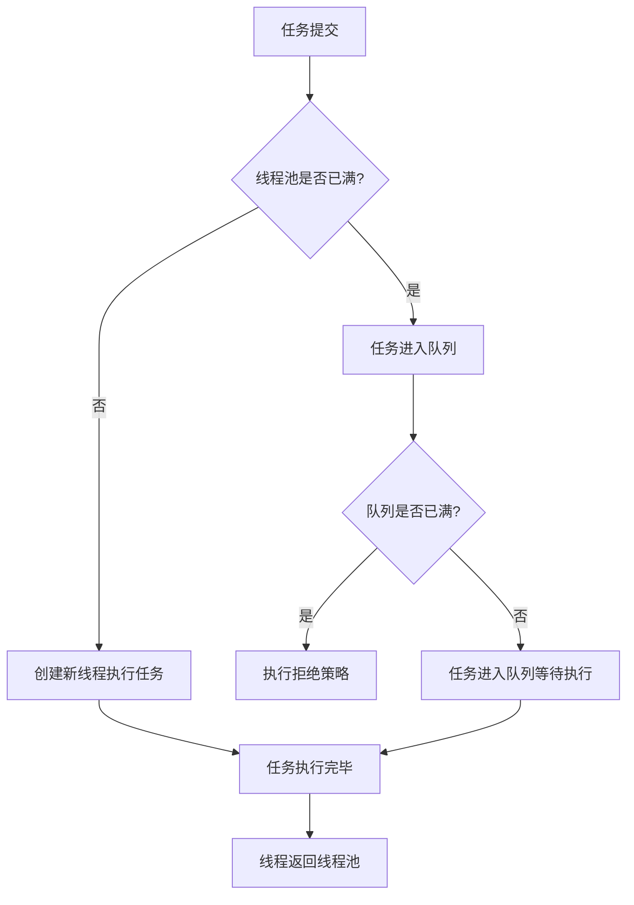

# Android ThreadPool

在 Android 开发中，异步编程是一个非常重要的主题。为了高效地处理并发任务，Android 提供了多种异步编程工具，其中线程池（ThreadPool）是一个非常强大的机制。本文将详细介绍线程池的概念、工作原理以及如何在 Android 中使用线程池来优化异步任务的处理。

## 什么是线程池？

线程池是一种管理多个线程的机制，它允许我们复用线程，而不是为每个任务都创建一个新的线程。通过使用线程池，我们可以减少线程创建和销毁的开销，从而提高应用程序的性能。

在 Android 中，线程池通常用于处理后台任务，例如网络请求、数据库操作、文件读写等。通过合理地使用线程池，我们可以避免主线程被阻塞，从而保证应用的流畅运行。

## 线程池的工作原理

线程池的核心思想是预先创建一定数量的线程，并将这些线程放入一个池中。当有任务需要执行时，线程池会从池中取出一个空闲的线程来执行任务。任务执行完毕后，线程不会被销毁，而是返回到池中，等待执行下一个任务。

线程池的主要组成部分包括：

- **核心线程数（Core Pool Size）**：线程池中始终保持的线程数量。
- **最大线程数（Maximum Pool Size）**：线程池中允许的最大线程数量。
- **任务队列（Work Queue）**：用于存放待执行的任务。
- **线程工厂（Thread Factory）**：用于创建新线程。
- **拒绝策略（Rejected Execution Handler）**：当线程池无法处理新任务时的处理策略。

## 如何使用线程池

在 Android 中，我们可以使用 `java.util.concurrent` 包中的 `ThreadPoolExecutor` 类来创建和管理线程池。以下是一个简单的示例，展示了如何创建一个线程池并使用它来执行任务。

```java
import java.util.concurrent.ExecutorService;
import java.util.concurrent.Executors;

public class ThreadPoolExample {
    public static void main(String[] args) {
        // 创建一个固定大小的线程池
        ExecutorService executor = Executors.newFixedThreadPool(3);

        // 提交任务到线程池
        for (int i = 0; i < 10; i++) {
            Runnable task = new Task(i);
            executor.execute(task);
        }

        // 关闭线程池
        executor.shutdown();
    }
}

class Task implements Runnable {
    private int taskId;

    public Task(int taskId) {
        this.taskId = taskId;
    }

    @Override
    public void run() {
        System.out.println("Task " + taskId + " is running on thread " + Thread.currentThread().getName());
    }
}
```

在这个示例中，我们创建了一个固定大小为 3 的线程池，并提交了 10 个任务。线程池会从池中取出 3 个线程来执行这些任务，任务执行完毕后，线程会返回到池中，继续执行其他任务。

:::note
注意：在实际开发中，我们应该根据任务的性质和数量来选择合适的线程池大小。如果线程池过大，可能会导致资源浪费；如果线程池过小，可能会导致任务积压。
:::

## 线程池的实际应用场景

线程池在 Android 开发中有广泛的应用场景，以下是一些常见的例子：

1. **网络请求**：在进行网络请求时，我们通常不希望阻塞主线程。通过使用线程池，我们可以在后台线程中执行网络请求，并在请求完成后更新 UI。

2. **数据库操作**：数据库操作通常比较耗时，如果直接在主线程中执行，可能会导致应用卡顿。通过使用线程池，我们可以在后台线程中执行数据库操作，从而提高应用的响应速度。

3. **文件读写**：文件读写操作也属于耗时操作，使用线程池可以避免阻塞主线程。

## 线程池的优化

为了进一步优化线程池的性能，我们可以考虑以下几点：

1. **合理设置线程池大小**：线程池的大小应根据任务的性质和数量来设置。对于 CPU 密集型任务，线程池的大小可以设置为 CPU 核心数；对于 I/O 密集型任务，线程池的大小可以适当增大。

2. **使用合适的任务队列**：线程池的任务队列可以选择 `LinkedBlockingQueue`、`ArrayBlockingQueue` 或 `SynchronousQueue` 等。不同的队列适用于不同的场景。

3. **设置合理的拒绝策略**：当线程池无法处理新任务时，可以选择抛出异常、丢弃任务或调用者自己执行任务等策略。

## 总结

线程池是 Android 异步编程中非常重要的工具，它可以帮助我们高效地管理并发任务，避免资源浪费和任务积压。通过合理地使用线程池，我们可以提高应用的性能和响应速度。

在实际开发中，我们应该根据任务的性质和数量来选择合适的线程池大小和配置，并注意线程池的优化。希望本文能帮助你更好地理解和使用线程池。

## 附加资源

- [Java 并发编程实战](https://book.douban.com/subject/10484692/)
- [Android 开发文档 - 线程和线程池](https://developer.android.com/guide/background/threading)
- [深入理解 Java 线程池](https://www.ibm.com/developerworks/cn/java/j-jtp0730/index.html)

## 练习

1. 尝试修改上面的代码示例，将线程池的大小设置为 5，并观察任务执行的顺序。
2. 编写一个 Android 应用，使用线程池来执行多个网络请求，并在请求完成后更新 UI。
3. 研究 `ThreadPoolExecutor` 的其他配置参数，并尝试在实际项目中使用它们。


