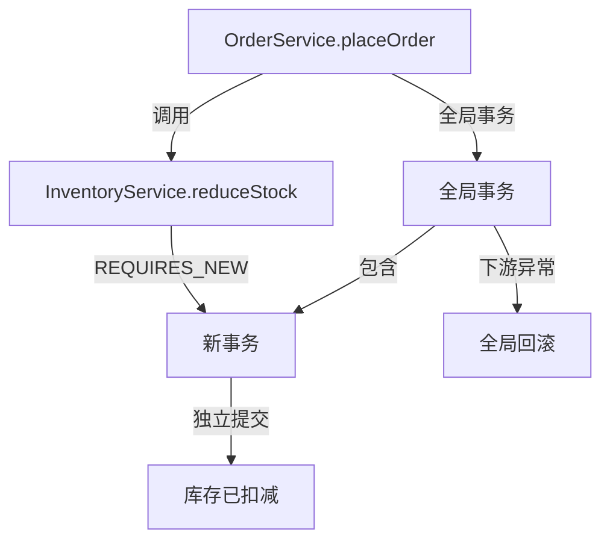

# Seata事务传播

## 介绍

在分布式系统中，事务传播（Transaction Propagation）是一个重要的概念，它定义了事务方法之间如何相互影响。Seata作为一款开源的分布式事务解决方案，提供了强大的事务传播机制，帮助开发者在复杂的分布式环境中管理事务。

事务传播机制决定了当一个事务方法调用另一个事务方法时，事务的行为。例如，是否需要在现有事务中运行，或者是否需要创建一个新的事务。Seata支持多种事务传播行为，类似于Spring的事务传播机制。

## 事务传播类型

Seata支持以下事务传播类型：

1. **REQUIRED（默认）**：如果当前存在事务，则加入该事务；如果当前没有事务，则创建一个新的事务。
2. **REQUIRES_NEW**：无论当前是否存在事务，都会创建一个新的事务。
3. **SUPPORTS**：如果当前存在事务，则加入该事务；如果当前没有事务，则以非事务方式执行。
4. **NOT_SUPPORTED**：以非事务方式执行操作，如果当前存在事务，则挂起该事务。
5. **MANDATORY**：如果当前存在事务，则加入该事务；如果当前没有事务，则抛出异常。
6. **NEVER**：以非事务方式执行操作，如果当前存在事务，则抛出异常。
7. **NESTED**：如果当前存在事务，则在嵌套事务中执行；如果当前没有事务，则创建一个新的事务。

## 代码示例

以下是一个使用Seata事务传播的简单示例。假设我们有两个服务：`OrderService` 和 `InventoryService`，它们分别负责处理订单和库存。

```java
@Service
public class OrderService {

    @Autowired
    private InventoryService inventoryService;

    @GlobalTransactional
    public void placeOrder(Order order) {
        // 创建订单
        createOrder(order);
        // 调用库存服务，减少库存
        inventoryService.reduceStock(order.getProductId(), order.getQuantity());
    }

    private void createOrder(Order order) {
        // 订单创建逻辑
    }
}

@Service
public class InventoryService {

    @Transactional(propagation = Propagation.REQUIRES_NEW)
    public void reduceStock(String productId, int quantity) {
        // 减少库存逻辑
    }
}
```

在这个示例中，`OrderService` 的 `placeOrder` 方法使用了 `@GlobalTransactional` 注解，表示这是一个全局事务。当 `placeOrder` 方法调用 `InventoryService` 的 `reduceStock` 方法时，`reduceStock` 方法的事务传播行为是 `REQUIRES_NEW`，这意味着无论 `placeOrder` 方法是否已经在一个事务中，`reduceStock` 方法都会在一个新的事务中执行。

## 实际应用场景

假设我们有一个电商系统，用户下单后需要同时更新订单和库存。如果订单创建成功但库存更新失败，我们希望回滚整个操作。这时，Seata的事务传播机制就派上了用场。

1. **订单创建**：在 `OrderService` 中创建一个订单。
2. **库存更新**：在 `InventoryService` 中减少库存，使用 `REQUIRES_NEW` 传播行为，确保库存更新在一个独立的事务中执行。
3. **事务回滚**：如果库存更新失败，Seata会自动回滚订单创建和库存更新的操作，确保数据一致性。

## 总结

Seata的事务传播机制为分布式事务管理提供了灵活性和可靠性。通过合理配置事务传播行为，开发者可以确保在复杂的分布式环境中，事务能够按照预期的方式执行和回滚。

## 附加资源

- [Seata官方文档](https://seata.io/zh-cn/docs/overview/what-is-seata.html)
- [Spring事务传播机制](https://docs.spring.io/spring-framework/docs/current/reference/html/data-access.html#tx-propagation)

## 练习

1. 尝试在本地环境中配置Seata，并使用不同的传播行为测试事务的执行和回滚。
2. 修改上述代码示例，使用 `NESTED` 传播行为，观察事务的行为变化。



上图展示了示例中两个方法之间的事务关系：`placeOrder` 开启全局事务，`reduceStock` 以 `REQUIRES_NEW` 方式在新的本地事务中执行。需要注意，`REQUIRES_NEW` 的本地事务会独立提交，如果希望库存扣减在全局事务失败时也能一起回滚，应让它参与同一个全局事务（使用默认的 `REQUIRED` 传播行为），由 Seata 的 undo log 统一回滚。
