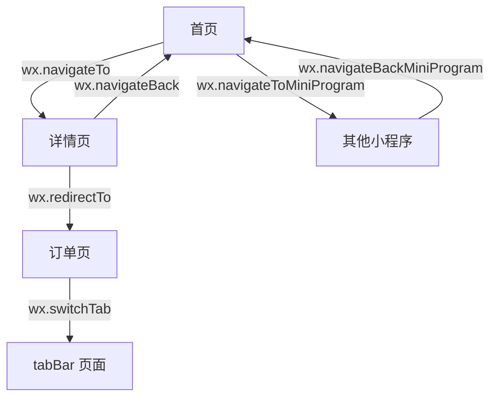

## 介绍

在小程序开发中，页面之间的跳转是非常常见的需求。无论是从首页跳转到详情页，还是从详情页返回到首页，都需要使用到跳转链接。小程序提供了多种方式来实现页面之间的跳转，包括 `navigateTo`、`redirectTo`、`switchTab` 等。本文将详细介绍这些方法的使用场景和实现方式。

## 基本跳转方法

### 1. `wx.navigateTo`

`wx.navigateTo` 是最常用的跳转方法之一，它用于跳转到非 tabBar 页面，并且会保留当前页面，用户可以通过返回按钮返回到上一个页面。

```javascript
wx.navigateTo({
  url: '/pages/detail/detail'
});
```

**输入：**
- `url`: 目标页面的路径。

**输出：**
- 跳转到指定页面，并保留当前页面。

### 2. `wx.redirectTo`

`wx.redirectTo` 用于关闭当前页面，并跳转到非 tabBar 页面。与 `navigateTo` 不同，`redirectTo` 不会保留当前页面。

```javascript
wx.redirectTo({
  url: '/pages/detail/detail'
});
```

**输入：**
- `url`: 目标页面的路径。

**输出：**
- 关闭当前页面，并跳转到指定页面。

### 3. `wx.switchTab`

`wx.switchTab` 用于跳转到 tabBar 页面，并且会关闭所有非 tabBar 页面。

```javascript
wx.switchTab({
  url: '/pages/index/index'
});
```

**输入：**
- `url`: 目标 tabBar 页面的路径。

**输出：**
- 跳转到指定的 tabBar 页面，并关闭所有非 tabBar 页面。

## 实际案例

### 案例 1：从首页跳转到详情页

假设我们有一个电商小程序，用户可以在首页点击商品，跳转到商品详情页。我们可以使用 `wx.navigateTo` 来实现这一功能。

```javascript
// 首页页面
Page({
  goToDetail: function() {
    wx.navigateTo({
      url: '/pages/detail/detail'
    });
  }
});
```

### 案例 2：从详情页返回到首页

在详情页中，我们可以提供一个返回按钮，使用 `wx.navigateBack` 返回到首页。

```javascript
// 详情页页面
Page({
  goBack: function() {
    wx.navigateBack({
      delta: 1
    });
  }
});
```

`delta` 表示返回的页面层数，`1` 表示返回上一页。如果 `delta` 大于当前页面栈中的页面数，则会返回到首页。

### 案例 3：跳转时传递参数

页面跳转时，经常需要携带参数，例如商品 ID。参数可以拼接在 `url` 后面，并在目标页面的 `onLoad` 生命周期中获取。

```javascript
// 首页：携带商品 ID 跳转
Page({
  goToDetail: function(event) {
    const id = event.currentTarget.dataset.id;
    wx.navigateTo({
      url: `/pages/detail/detail?id=${id}&from=index`
    });
  }
});
```

```javascript
// 详情页：在 onLoad 中读取参数
Page({
  data: {
    goodsId: ''
  },
  onLoad: function(options) {
    console.log(options.id, options.from);
    this.setData({ goodsId: options.id });
  }
});
```

:::caution
`wx.switchTab` 的 `url` 不支持携带参数。如果需要向 tabBar 页面传递数据，可以使用全局变量（`getApp().globalData`）或本地缓存（`wx.setStorageSync`）。
:::

## 小程序之间的跳转

除了小程序内部的页面跳转，有时还需要从当前小程序跳转到另一个小程序，例如跳转到合作方的小程序完成支付或领取优惠券。微信提供了 `wx.navigateToMiniProgram` 和 `wx.navigateBackMiniProgram` 两个接口。

### 打开另一个小程序

```javascript
wx.navigateToMiniProgram({
  appId: 'wx1234567890abcdef', // 目标小程序的 AppID
  path: 'pages/index/index?source=partner', // 打开的页面路径，可带参数
  extraData: {
    userId: '10086'
  },
  envVersion: 'release', // develop（开发版）、trial（体验版）、release（正式版）
  success(res) {
    console.log('打开成功');
  },
  fail(err) {
    console.error('打开失败', err);
  }
});
```

也可以使用 `navigator` 组件在页面中直接声明跳转：

```xml
<navigator
  target="miniProgram"
  open-type="navigate"
  app-id="wx1234567890abcdef"
  path="pages/index/index"
  version="release">
  打开合作方小程序
</navigator>
```

### 返回上一个小程序

被打开的小程序可以在 `App` 的 `onLaunch` 或 `onShow` 中通过 `options.referrerInfo.extraData` 读取传入的数据，并在完成业务后返回：

```javascript
// 被打开的小程序
App({
  onShow(options) {
    if (options.referrerInfo && options.referrerInfo.extraData) {
      console.log('来源小程序传入的数据：', options.referrerInfo.extraData);
    }
  }
});

// 业务完成后返回来源小程序，并回传数据
wx.navigateBackMiniProgram({
  extraData: {
    result: 'success'
  }
});
```

:::note
`wx.navigateToMiniProgram` 需要由用户的点击等交互行为触发，并会在跳转前弹出确认提示。`wx.navigateBackMiniProgram` 只有在当前小程序是被另一个小程序打开时才能成功调用。
:::

## 页面跳转流程



## 总结

小程序提供了丰富的跳转方式：

- `wx.navigateTo`：保留当前页面，跳转到非 tabBar 页面。
- `wx.redirectTo`：关闭当前页面，跳转到非 tabBar 页面。
- `wx.switchTab`：跳转到 tabBar 页面，并关闭所有非 tabBar 页面。
- `wx.navigateBack`：返回上一页或多级页面。
- `wx.navigateToMiniProgram` / `wx.navigateBackMiniProgram`：在不同小程序之间跳转和返回。

在实际开发中，应根据是否需要保留当前页面、目标页面是否为 tabBar 页面等因素选择合适的方法。同时要注意页面栈的层数限制，避免无限制地使用 `navigateTo` 叠加页面。

## 附加资源

- [微信官方文档 - 路由](https://developers.weixin.qq.com/miniprogram/dev/api/route/wx.navigateTo.html)
- [微信官方文档 - 打开小程序](https://developers.weixin.qq.com/miniprogram/dev/api/navigate/wx.navigateToMiniProgram.html)

## 练习

1. 实现一个商品列表页，点击商品时携带商品 ID 跳转到详情页，并在详情页中显示该 ID。
2. 在详情页中添加“返回首页”按钮，分别使用 `wx.navigateBack` 和 `wx.reLaunch` 实现，比较两者的区别。
3. 使用 `navigator` 组件实现一个跳转到其他小程序的入口，并在目标小程序中读取 `extraData`。
