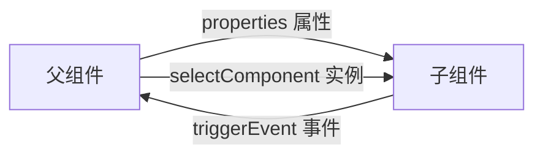

## 介绍

在小程序开发中，组件化是一种常见的开发模式。通过将功能拆分为独立的组件，可以提高代码的可维护性和复用性。然而，组件之间的数据传递是一个关键问题。本文将详细介绍如何在小程序中进行组件间的数据传递，包括父子组件之间的通信方式。

## 父子组件通信

在小程序中，父子组件之间的通信主要通过属性和事件来实现。父组件通过属性将数据传递给子组件，而子组件通过事件将数据传递回父组件。

### 1. 父组件向子组件传递数据

父组件可以通过属性（`properties`）将数据传递给子组件。子组件需要在 `properties` 中定义接收的属性。

#### 示例代码

**父组件 (parent.wxml):**
```xml
<child-component message="Hello from parent"></child-component>
```

**子组件 (child.js):**
```javascript
Component({
  properties: {
    message: {
      type: String,
      value: ''
    }
  }
});
```

**子组件 (child.wxml):**
```xml
<view>{{ message }}</view>
```

**输出:**
```
Hello from parent
```

在这个例子中，父组件通过 `message` 属性将字符串 `"Hello from parent"` 传递给子组件，子组件通过 `properties` 接收并在视图中显示。

### 2. 子组件向父组件传递数据

子组件可以通过触发事件将数据传递回父组件。父组件可以监听这些事件并处理数据。

#### 示例代码

**子组件 (child.js):**
```javascript
Component({
  methods: {
    sendMessageToParent() {
      this.triggerEvent('myevent', { message: 'Hello from child' });
    }
  }
});
```

**子组件 (child.wxml):**
```xml
<button bindtap="sendMessageToParent">Send Message to Parent</button>
```

**父组件 (parent.js):**
```javascript
Page({
  onChildEvent(event) {
    console.log(event.detail.message); // 输出: Hello from child
  }
});
```

**父组件 (parent.wxml):**
```xml
<child-component bindmyevent="onChildEvent"></child-component>
```

在这个例子中，子组件通过 `triggerEvent` 方法触发了一个名为 `myevent` 的事件，并将数据 `{ message: 'Hello from child' }` 传递给父组件。父组件通过 `bindmyevent` 监听该事件并处理数据。

## 实际应用场景

### 场景：表单组件

假设我们有一个表单组件，其中包含多个输入字段。每个输入字段都是一个独立的子组件，父组件需要收集所有子组件的数据并提交表单。

#### 示例代码

**父组件 (parent.wxml):**
```xml
<form-component bindsubmit="onFormSubmit"></form-component>
```

**父组件 (parent.js):**
```javascript
Page({
  onFormSubmit(event) {
    const formData = event.detail;
    console.log(formData); // 输出: { name: 'John', email: 'john@example.com' }
  }
});
```

**子组件 (form.js):**
```javascript
Component({
  data: {
    name: '',
    email: ''
  },
  methods: {
    onNameInput(event) {
      this.setData({ name: event.detail.value });
    },
    onEmailInput(event) {
      this.setData({ email: event.detail.value });
    },
    onSubmit() {
      this.triggerEvent('submit', { name: this.data.name, email: this.data.email });
    }
  }
});
```

**子组件 (form.wxml):**
```xml
<input placeholder="Name" bindinput="onNameInput" />
<input placeholder="Email" bindinput="onEmailInput" />
<button bindtap="onSubmit">Submit</button>
```

在这个例子中，子组件内部维护 `name` 和 `email` 两个字段，用户点击提交按钮时，通过 `triggerEvent('submit', ...)` 把表单数据一次性传给父组件。父组件只需要监听 `submit` 事件即可拿到完整的表单数据，无需关心表单内部的实现细节。

## 父组件直接获取子组件实例

除了属性和事件，父组件还可以通过 `this.selectComponent` 获取子组件实例，直接读取子组件的数据或调用子组件的方法。这种方式适合父组件需要主动控制子组件的场景，例如重置表单。

**父组件 (parent.wxml):**
```xml
<form-component id="myForm" bindsubmit="onFormSubmit"></form-component>
<button bindtap="resetForm">重置表单</button>
```

**子组件 (form.js) 中新增方法:**
```javascript
Component({
  data: {
    name: '',
    email: ''
  },
  methods: {
    reset() {
      this.setData({ name: '', email: '' });
    }
  }
});
```

**父组件 (parent.js):**
```javascript
Page({
  resetForm() {
    const form = this.selectComponent('#myForm');
    console.log(form.data.name); // 读取子组件当前的数据
    form.reset();                // 调用子组件的方法
  }
});
```

:::caution
`selectComponent` 会让父组件依赖子组件的内部实现，耦合度较高。优先使用属性和事件进行通信，只有在确实需要时才直接操作子组件实例。
:::

## 监听属性变化

当父组件传入的属性发生变化时，子组件可以使用 `observers` 字段进行监听，从而在数据更新时执行相应逻辑。

```javascript
Component({
  properties: {
    message: {
      type: String,
      value: ''
    }
  },
  observers: {
    'message': function(newValue) {
      console.log('message 已更新为：', newValue);
    }
  }
});
```

## 数据流向示意



## 总结

小程序组件之间的数据传递主要有以下几种方式：

1. **属性（properties）**：父组件向子组件传递数据，是最常用的方式。
2. **事件（triggerEvent）**：子组件向父组件传递数据，父组件通过 `bind事件名` 监听。
3. **组件实例（selectComponent）**：父组件直接获取子组件实例，读取数据或调用方法。
4. **数据监听（observers）**：子组件监听属性变化，及时响应父组件传入的新数据。

掌握这些方式后，就可以构建结构清晰、职责单一、易于复用的组件。

## 附加资源

- [微信官方文档 - 组件间通信与事件](https://developers.weixin.qq.com/miniprogram/dev/framework/custom-component/events.html)
- [微信官方文档 - 数据监听器](https://developers.weixin.qq.com/miniprogram/dev/framework/custom-component/observer.html)

## 练习

1. 编写一个计数器组件，父组件通过属性传入初始值，子组件每次点击按钮后通过事件将最新值传回父组件。
2. 在表单组件中增加校验逻辑：当邮箱格式不正确时，子组件触发一个 `error` 事件通知父组件。
3. 使用 `selectComponent` 在父页面中实现“一键清空”功能，清空多个子组件中的输入内容。
