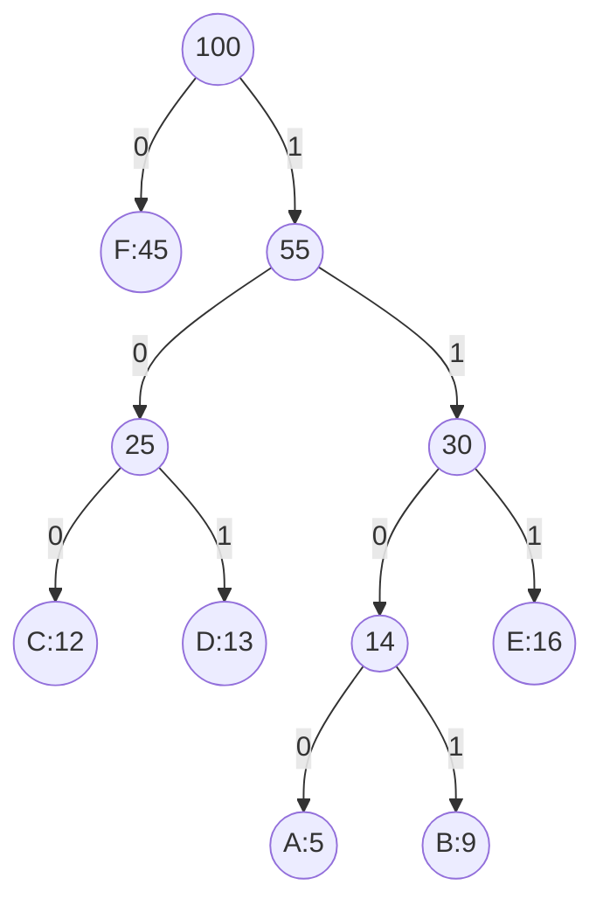

# 霍夫曼编码

霍夫曼编码（Huffman Coding）是一种用于无损数据压缩的贪心算法。它通过为每个字符分配一个可变长度的二进制编码来实现压缩，其中出现频率较高的字符使用较短的编码，而出现频率较低的字符使用较长的编码。这种方法可以有效地减少数据的存储空间或传输带宽。

## 基本概念

霍夫曼编码的核心思想是**贪心算法**，即在每一步选择中，都选择当前最优的局部解，最终得到全局最优解。具体来说，霍夫曼编码通过构建一棵**霍夫曼树**（Huffman Tree）来实现编码的分配。

### 霍夫曼树的构建

1. **统计字符频率**：首先统计待编码文本中每个字符的出现频率。
2. **构建优先队列**：将每个字符及其频率作为一个节点，放入优先队列（通常是最小堆）中。
3. **合并节点**：从优先队列中取出频率最小的两个节点，合并成一个新节点，新节点的频率为这两个节点的频率之和。将新节点重新放入优先队列中。
4. **重复合并**：重复上述步骤，直到队列中只剩一个节点，这个节点就是霍夫曼树的根节点。
5. **分配编码**：从根节点开始，向左子树走分配 `0`，向右子树走分配 `1`，直到叶子节点，得到每个字符的编码。

### 示例

假设我们有以下字符及其频率：

| 字符 | 频率 |
|------|------|
| A    | 5    |
| B    | 9    |
| C    | 12   |
| D    | 13   |
| E    | 16   |
| F    | 45   |

我们可以通过以下步骤构建霍夫曼树（每次从优先队列中取出频率最小的两个节点合并）：

1. 取出 A:5 和 B:9，合并为 AB:14
2. 取出 C:12 和 D:13，合并为 CD:25
3. 取出 AB:14 和 E:16，合并为 ABE:30
4. 取出 CD:25 和 ABE:30，合并为 CDABE:55
5. 取出 F:45 和 CDABE:55，合并为根节点 100



最终得到的霍夫曼编码表如下：

| 字符 | 编码 |
|------|------|
| A    | 1100 |
| B    | 1101 |
| C    | 100  |
| D    | 101  |
| E    | 111  |
| F    | 0    |

出现频率最高的 F 只用 1 位编码，而频率最低的 A 和 B 使用 4 位编码。总编码长度为 `45×1 + 12×3 + 13×3 + 16×3 + 5×4 + 9×4 = 224` 位，而使用 3 位定长编码则需要 `100×3 = 300` 位。

## 代码实现

以下是一个用 Python 实现的霍夫曼编码示例：

```python
import heapq
from collections import defaultdict, Counter

class HuffmanNode:
    def __init__(self, char, freq):
        self.char = char
        self.freq = freq
        self.left = None
        self.right = None

    def __lt__(self, other):
        return self.freq < other.freq

def build_huffman_tree(text):
    frequency = Counter(text)
    heap = [HuffmanNode(char, freq) for char, freq in frequency.items()]
    heapq.heapify(heap)

    while len(heap) > 1:
        left = heapq.heappop(heap)
        right = heapq.heappop(heap)
        merged = HuffmanNode(None, left.freq + right.freq)
        merged.left = left
        merged.right = right
        heapq.heappush(heap, merged)

    return heap[0]

def build_huffman_codes(node, prefix="", code=None):
    if code is None:
        code = {}
    if node:
        if node.char is not None:
            code[node.char] = prefix
        build_huffman_codes(node.left, prefix + "0", code)
        build_huffman_codes(node.right, prefix + "1", code)
    return code

def huffman_encoding(text):
    root = build_huffman_tree(text)
    codes = build_huffman_codes(root)
    encoded_text = ''.join([codes[char] for char in text])
    return encoded_text, codes

# 示例
text = "AABBBCCCCDDDDDEEEEEEFFFFFFFFFFF"
encoded_text, codes = huffman_encoding(text)
print("编码表:", codes)
print("编码后的文本:", encoded_text)
```

运行上述代码，输出如下：

```text
编码表: {'A': '000', 'B': '001', 'E': '01', 'C': '100', 'D': '101', 'F': '11'}
编码后的文本: 0000000010010011001001001001011011011011010101010101011111111111111111111111
```

示例文本共 31 个字符，如果每个字符用 8 位 ASCII 存储需要 `31 × 8 = 248` 位，而霍夫曼编码后只需要 76 位。

:::note
当多个节点频率相同时，合并顺序可能不同，因此得到的具体编码也可能不同。但无论如何选择，编码的**总长度**都是相同的，都是最优的。
:::

### 代码解析

- `HuffmanNode` 表示霍夫曼树中的节点。叶子节点保存字符，内部节点的 `char` 为 `None`。
- `__lt__` 方法让节点可以按频率比较，这样 `heapq` 才能把节点组织成最小堆。
- `build_huffman_tree` 不断弹出频率最小的两个节点并合并，这正是贪心选择的体现。
- `build_huffman_codes` 递归遍历霍夫曼树，向左走追加 `0`，向右走追加 `1`，到达叶子节点时记录编码。

## 解码

霍夫曼编码是一种**前缀码**（Prefix Code）：任何一个字符的编码都不是另一个字符编码的前缀。因为所有字符都位于树的叶子节点上，从根节点到某个叶子的路径不可能经过另一个叶子。这一性质保证了解码时不会产生歧义，不需要在编码之间插入分隔符。

解码时可以逐位读取比特，一旦当前累积的比特串与某个字符的编码匹配，就输出该字符并重新开始：

```python
def huffman_decoding(encoded_text, codes):
    # 将编码表反转为 编码 -> 字符
    reverse_codes = {v: k for k, v in codes.items()}
    decoded = []
    current = ""
    for bit in encoded_text:
        current += bit
        if current in reverse_codes:
            decoded.append(reverse_codes[current])
            current = ""
    return ''.join(decoded)

decoded_text = huffman_decoding(encoded_text, codes)
print("解码后的文本:", decoded_text)
print("与原文一致:", decoded_text == text)
```

输出：

```text
解码后的文本: AABBBCCCCDDDDDEEEEEEFFFFFFFFFFF
与原文一致: True
```

也可以直接沿着霍夫曼树解码：读到 `0` 走左子树，读到 `1` 走右子树，到达叶子节点时输出字符并回到根节点。这种方式在实际的压缩程序中更常见。

## 为什么贪心策略是正确的

霍夫曼算法之所以能得到最优前缀码，依赖于两个性质：

1. **贪心选择性质**：存在一棵最优编码树，其中频率最小的两个字符是最深层的兄弟节点。因此，先把频率最小的两个字符合并不会错过最优解。
2. **最优子结构**：把这两个字符合并为一个频率为二者之和的新字符后，原问题就变成了一个规模更小的同类问题。小问题的最优解再展开回去，就是原问题的最优解。

直观地理解：频率越低的字符越早被合并，在树中的位置就越深，编码就越长；频率越高的字符越晚被合并，离根节点越近，编码就越短。这样，加权路径长度（即总编码长度）达到最小。

## 复杂度分析

设不同字符的数量为 `n`，文本长度为 `m`：

| 步骤 | 时间复杂度 |
|------|-----------|
| 统计频率 | `O(m)` |
| 建堆 | `O(n)` |
| 合并节点（`n - 1` 次，每次堆操作 `O(log n)`） | `O(n log n)` |
| 生成编码表 | `O(n)` |
| 编码文本 | `O(m)` |

构建霍夫曼树的总时间复杂度为 `O(n log n)`，空间复杂度为 `O(n)`。

## 注意事项

- **只有一种字符的情况**：如果文本中只有一种字符（例如 `"AAAA"`），霍夫曼树只有一个根节点，上面的代码会为它生成空字符串编码 `""`，导致编码结果为空。实际实现中通常为这种情况单独指定编码 `"0"`。
- **需要保存编码表**：解码方必须知道编码表（或霍夫曼树），所以压缩文件中通常要一并存储编码表或字符频率。对于很短的文本，这部分开销可能超过压缩带来的收益。
- **比特与字节**：上面的示例用字符串 `"0"` 和 `"1"` 表示比特，仅用于演示。真正的压缩需要把比特打包成字节写入文件。

## 实际应用场景

霍夫曼编码是很多常见压缩格式的组成部分：

- **DEFLATE 算法**：ZIP、gzip 和 PNG 使用的 DEFLATE 压缩，先用 LZ77 消除重复数据，再用霍夫曼编码压缩结果。
- **JPEG 图像**：JPEG 在离散余弦变换和量化之后，使用霍夫曼编码对数据进行熵编码。
- **MP3 音频**：MP3 编码过程中也使用霍夫曼编码来压缩量化后的频谱数据。
- **通信传输**：在带宽有限的场景下，对频率分布已知的数据进行霍夫曼编码，可以减少传输的数据量。

## 总结

- 霍夫曼编码是一种基于贪心策略的无损压缩算法，为高频字符分配短编码，为低频字符分配长编码。
- 构建过程是反复合并频率最小的两个节点，直到只剩下一个根节点。
- 霍夫曼编码是前缀码，解码时不会产生歧义。
- 构建霍夫曼树的时间复杂度为 `O(n log n)`，在所有前缀码中，它得到的总编码长度最短。

## 附加资源与练习

- **练习 1**：手动为字符频率 `a:1, b:1, c:2, d:3, e:5` 构建霍夫曼树，并计算总编码长度。
- **练习 2**：修改 `build_huffman_codes`，使只有一种字符的文本也能被正确编码和解码。
- **练习 3**：编写一个函数，比较霍夫曼编码与 8 位定长编码的压缩率。
- **练习 4**：实现基于霍夫曼树（而非反转编码表）的解码函数。
- **进一步阅读**：了解 DEFLATE 算法如何把 LZ77 与霍夫曼编码结合起来，以及自适应霍夫曼编码如何在不预先统计频率的情况下进行压缩。

:::tip
霍夫曼编码是理解贪心算法的经典案例。建议在纸上手动构建几棵霍夫曼树，体会"每次合并最小的两个节点"为什么能得到最优结果。
:::
