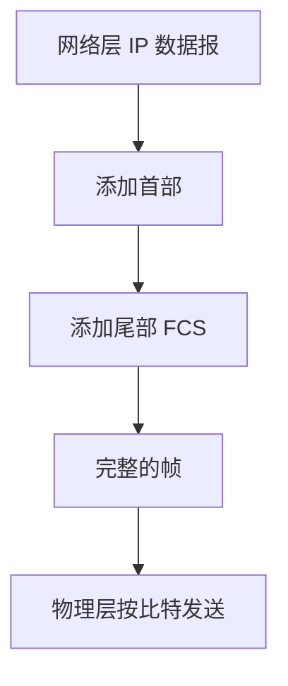

## 介绍

在计算机网络中，**数据链路层**是 OSI 模型的第二层，负责在相邻节点之间可靠地传输数据。为了实现这一目标，数据链路层将数据封装成**帧（Frame）**。帧是数据链路层的基本传输单位，它包含了数据以及用于控制和检测错误的附加信息。

帧的结构是数据链路层协议的核心部分，理解帧的概念和结构对于学习网络通信至关重要。本文将详细介绍帧的组成部分、帧的作用以及实际应用场景。

---

## 帧的结构

帧通常由以下几个部分组成：

1. **帧起始标志（Start Frame Delimiter, SFD）**：标识帧的开始。
2. **目的地址（Destination Address）**：指示帧的目标设备。
3. **源地址（Source Address）**：指示帧的发送设备。
4. **类型/长度字段（Type/Length Field）**：指示帧中数据的类型或长度。
5. **数据字段（Data Field）**：实际传输的数据。
6. **帧校验序列（Frame Check Sequence, FCS）**：用于检测传输过程中是否发生错误。
7. **帧结束标志（End Frame Delimiter, EFD）**：标识帧的结束。

以下是一个典型的帧结构示例：


### 1. 帧起始标志（SFD）
帧起始标志是一个特殊的比特序列，用于标识帧的开始。例如，在以太网中，帧起始标志是一个 8 比特的序列 `10101011`。

### 2. 目的地址与源地址
目的地址和源地址分别是帧的目标设备和发送设备的 MAC 地址。MAC 地址是一个 48 位的唯一标识符，用于在局域网中识别设备。

### 3. 类型/长度字段
类型字段指示帧中数据的协议类型（如 IPv4、IPv6），而长度字段指示数据字段的长度。具体使用类型还是长度取决于协议。

### 4. 数据字段
数据字段包含实际传输的数据，通常是来自上层协议（如网络层）的数据包。

### 5. 帧校验序列（FCS）
帧校验序列是一个用于检测传输错误的校验和。常见的校验算法包括 CRC（循环冗余校验）。

### 6. 帧结束标志（EFD）
帧结束标志标识帧的结束。在某些协议中，帧结束标志可能与帧起始标志相同。

---

## 实际案例

### 以太网帧
以太网是最常见的局域网技术，其帧结构如下：


- **前导码**：用于同步接收设备的时钟。
- **帧起始标志**：标识帧的开始。
- **目的地址与源地址**：6 字节的 MAC 地址。
- **类型/长度字段**：2 字节，指示数据字段的长度或协议类型。
- **数据字段**：46 到 1500 字节。
- **帧校验序列**：4 字节的 CRC 校验和。

### 示例代码
以下是一个简单的 Python 示例，模拟以太网帧的构造：

```python
class EthernetFrame:
    def __init__(self, destination, source, data):
        self.preamble = "10101010" * 7 + "10101011"  # 前导码 + 帧起始标志
        self.destination = destination
        self.source = source
        self.type_length = "0800"  # 假设为 IPv4 协议
        self.data = data
        self.fcs = self.calculate_crc()

    def calculate_crc(self):
        # 模拟 CRC 计算
        return "CRC1234"

    def __str__(self):
        return f"{self.preamble}{self.destination}{self.source}{self.type_length}{self.data}{self.fcs}"

# 示例
frame = EthernetFrame(destination="00:1A:2B:3C:4D:5E", source="00:1A:2B:3C:4D:5F", data="Hello, World!")
print(frame)
```

**输出：**

```text
101010101010101010101010101010101010101010101010101010101010101100:1A:2B:3C:4D:5E00:1A:2B:3C:4D:5F0800Hello, World!CRC1234
```

上面的示例只是把各个字段拼接成字符串，便于理解帧的组成顺序。真实的以太网帧是以字节为单位的二进制数据，并且 FCS 由 CRC-32 算法计算得出。下面是一个更接近实际的版本：

```python
import struct
import zlib

def mac_to_bytes(mac):
    return bytes(int(part, 16) for part in mac.split(":"))

def build_frame(dst, src, ethertype, payload):
    # 数据字段不足 46 字节时需要填充
    if len(payload) < 46:
        payload = payload + b"\x00" * (46 - len(payload))
    header = mac_to_bytes(dst) + mac_to_bytes(src) + struct.pack("!H", ethertype)
    body = header + payload
    fcs = struct.pack("<I", zlib.crc32(body))  # 以太网 FCS 使用 CRC-32
    return body + fcs

def check_frame(frame):
    body, fcs = frame[:-4], frame[-4:]
    return struct.pack("<I", zlib.crc32(body)) == fcs

frame = build_frame("00:1A:2B:3C:4D:5E", "00:1A:2B:3C:4D:5F", 0x0800, b"Hello, World!")
print("帧长度:", len(frame), "字节")
print("目的地址:", frame[0:6].hex(":"))
print("源地址:", frame[6:12].hex(":"))
print("类型字段:", hex(struct.unpack("!H", frame[12:14])[0]))
print("校验结果:", "正确" if check_frame(frame) else "错误")

# 模拟传输中发生 1 比特错误
corrupted = bytearray(frame)
corrupted[20] ^= 0x01
print("出错帧校验结果:", "正确" if check_frame(bytes(corrupted)) else "错误")
```

**输出：**

```text
帧长度: 64 字节
目的地址: 00:1a:2b:3c:4d:5e
源地址: 00:1a:2b:3c:4d:5f
类型字段: 0x800
校验结果: 正确
出错帧校验结果: 错误
```

可以看到：
- 数据 `Hello, World!` 只有 13 字节，被填充到 46 字节，因此整个帧（不含前导码和帧起始标志）恰好是以太网的最小帧长 64 字节。
- 接收方重新计算 CRC 并与 FCS 比较，就能发现传输过程中产生的比特错误。

:::note
前导码和帧起始标志由网卡硬件自动添加和去除，通常不计入以太网帧长度。因此以太网帧的长度范围一般表述为 64 到 1518 字节。
:::

---

## 帧的作用

数据链路层通过帧来完成以下三项基本任务：

1. **封装成帧**：在网络层交下来的数据前后分别加上首部和尾部，构成一个完整的帧。首部和尾部的一个重要作用就是**帧定界**，让接收方知道一个帧从哪里开始、到哪里结束。
2. **透明传输**：无论数据字段中包含什么样的比特组合，都能正确地传送到接收方，不会被误认为是帧的控制信息。
3. **差错检测**：通过帧校验序列，接收方可以判断帧在传输过程中是否出错，出错的帧会被丢弃。



### 最大传送单元（MTU）

每种数据链路层协议都规定了帧的数据部分的长度上限，称为**最大传送单元（Maximum Transmission Unit, MTU）**。以太网的 MTU 为 1500 字节。如果网络层的数据报超过 MTU，就需要在网络层进行分片。

---

## 帧定界的方法

接收方必须能够从连续的比特流中准确地识别出每一帧的边界。常见的帧定界方法有以下几种：

### 1. 字符计数法
在帧首部用一个字段表示该帧的字节数。接收方读取这个计数值就知道帧在哪里结束。缺点是一旦计数字段出错，后续所有帧的边界都会错乱，因此很少单独使用。

### 2. 字节填充法（字符填充）
用一个特殊的**标志字节**（例如 PPP 协议中的 `0x7E`）表示帧的开始和结束。如果数据中恰好出现了标志字节或转义字节，就在它前面插入一个**转义字节**（PPP 中为 `0x7D`），并将原字节与 `0x20` 异或。接收方收到后再做相反的处理，从而实现透明传输。

```python
FLAG = 0x7E
ESC = 0x7D

def byte_stuff(data):
    out = bytearray([FLAG])
    for b in data:
        if b in (FLAG, ESC):
            out += bytes([ESC, b ^ 0x20])
        else:
            out.append(b)
    out.append(FLAG)
    return bytes(out)

def byte_unstuff(frame):
    data = frame[1:-1]  # 去掉首尾标志
    out = bytearray()
    i = 0
    while i < len(data):
        if data[i] == ESC:
            out.append(data[i + 1] ^ 0x20)
            i += 2
        else:
            out.append(data[i])
            i += 1
    return bytes(out)

original = bytes([0x41, 0x7E, 0x42, 0x7D, 0x43])
stuffed = byte_stuff(original)
print("原始数据:", original.hex(" "))
print("填充后:  ", stuffed.hex(" "))
print("还原后:  ", byte_unstuff(stuffed).hex(" "))
```

**输出：**

```text
原始数据: 41 7e 42 7d 43
填充后:   7e 41 7d 5e 42 7d 5d 43 7e
还原后:   41 7e 42 7d 43
```

### 3. 零比特填充法
HDLC 等面向比特的协议使用标志序列 `01111110` 作为帧定界符。发送方在数据中每遇到连续 5 个 `1`，就自动插入一个 `0`；接收方每遇到连续 5 个 `1` 后面跟着的 `0`，就把它删除。这样数据中永远不会出现 6 个连续的 `1`，也就不会和标志序列混淆。

```text
原始数据： 0110 1111111111 00
填充后：   0110 11111 0 11111 0 00
```

原始数据中有 10 个连续的 `1`，填充后在每 5 个 `1` 之后各插入了一个 `0`。

### 4. 违规编码法
利用物理层编码中不会用于表示数据的"违规"信号来标识帧的边界。例如在曼彻斯特编码中，每个比特中间都有电平跳变，而"高-高"或"低-低"的组合不会出现在正常数据中，可以用来作为帧的起止标志。

:::tip
以太网使用前导码和帧起始标志来标识帧的开始，并依靠帧之间的最小间隔（帧间隙）来区分相邻的帧，因此以太网帧没有专门的帧结束标志。
:::

---

## 总结

- **帧**是数据链路层的基本传输单位，由首部、数据字段和尾部组成。
- 典型的帧包含帧起始标志、目的地址、源地址、类型/长度字段、数据字段和帧校验序列等部分。
- 以太网帧使用 6 字节的 MAC 地址，数据字段长度为 46 到 1500 字节，并使用 4 字节的 CRC-32 作为 FCS。
- 数据链路层通过帧实现**封装成帧**、**透明传输**和**差错检测**三项基本任务。
- 常见的帧定界方法包括字符计数法、字节填充法、零比特填充法和违规编码法。

理解帧的结构是学习差错检测、流量控制以及以太网等后续内容的基础。

---

## 附加资源与练习

### 练习

1. 以太网帧的数据字段为什么规定最小为 46 字节？这与 CSMA/CD 协议有什么关系？
2. 一个 IP 数据报长度为 20 字节，封装成以太网帧后需要填充多少字节？整个帧（不含前导码）的长度是多少？
3. 使用 PPP 的字节填充规则，对数据 `7E 01 7D 02` 进行填充，写出填充后的完整帧（包括首尾标志）。
4. 对比特串 `011111101111110` 进行零比特填充，写出填充后的结果。
5. 修改上面的 Python 示例，让它能解析一个收到的帧，并打印出各个字段的值。

### 推荐阅读

- 谢希仁《计算机网络》第 3 章"数据链路层"
- Andrew S. Tanenbaum《计算机网络》中关于成帧（Framing）的章节
- IEEE 802.3 以太网标准
