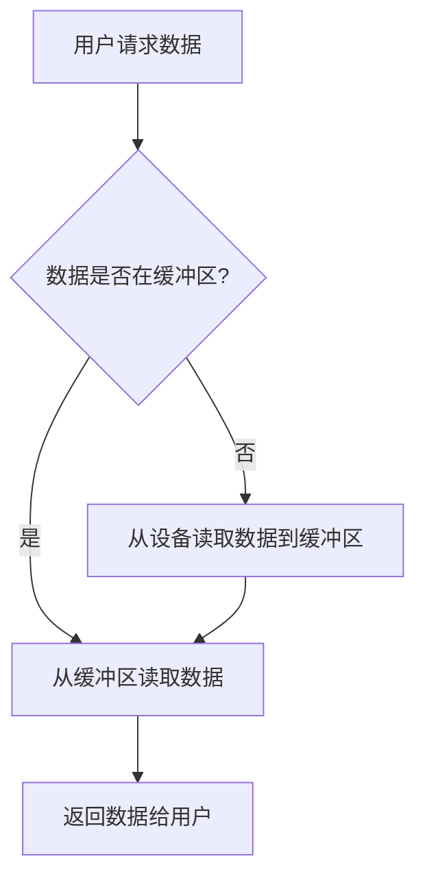

# 操作系统缓冲技术

## 介绍

在操作系统中，**缓冲技术**是一种用于优化输入输出（I/O）操作的重要机制。它通过在内存中创建一个临时存储区域（称为缓冲区），来减少 CPU 与 I/O 设备之间的速度差异带来的性能瓶颈。缓冲技术的主要目的是提高系统的整体效率，减少等待时间，并平衡不同设备之间的速度差异。

:::note
**缓冲区**：缓冲区是内存中的一块区域，用于临时存储数据。它可以是硬件缓冲区（如磁盘缓存）或软件缓冲区（如操作系统管理的缓冲区）。
:::

## 缓冲技术的工作原理

缓冲技术的核心思想是**减少 I/O 操作的频率**。当数据需要从设备读取或写入时，操作系统会先将数据存储在缓冲区中，而不是直接与设备交互。这样可以减少频繁的 I/O 操作，从而提高系统的性能。

### 缓冲区的类型

1. **单缓冲**：只有一个缓冲区，数据在缓冲区和设备之间交替传输。
2. **双缓冲**：使用两个缓冲区，一个用于读取数据，另一个用于写入数据。这样可以实现并行操作。
3. **循环缓冲**：多个缓冲区以循环方式使用，适用于连续的数据流处理。

### 缓冲技术的优势

- **减少 I/O 操作**：通过批量处理数据，减少与设备的交互次数。
- **提高 CPU 利用率**：CPU 不需要等待 I/O 操作完成，可以继续执行其他任务。
- **平衡速度差异**：缓冲技术可以平衡快速 CPU 和慢速 I/O 设备之间的速度差异。

## 缓冲技术的实际应用

### 案例 1：文件读写

在文件系统中，缓冲技术被广泛用于文件的读写操作。例如，当用户从磁盘读取文件时，操作系统会先将数据读取到缓冲区中，然后再将数据传输到用户空间。这样可以减少磁盘 I/O 操作的次数。

```python
# 示例：使用 Python 读取文件时的缓冲
with open('example.txt', 'r') as file:
    data = file.read()  # 数据首先被读取到缓冲区
    print(data)
```

### 案例 2：网络数据传输

在网络通信中，缓冲技术用于处理数据包的传输。发送方将数据存储在缓冲区中，然后通过网络发送；接收方将接收到的数据存储在缓冲区中，然后再进行处理。

```python
# 示例：使用 Python 进行网络数据传输
import socket

# 创建套接字
sock = socket.socket(socket.AF_INET, socket.SOCK_STREAM)
sock.connect(('example.com', 80))

# 发送数据
sock.send(b'GET / HTTP/1.1\r\nHost: example.com\r\n\r\n')

# 接收数据
data = sock.recv(4096)  # 数据首先被存储在缓冲区中
print(data.decode())
```

## 缓冲技术的优化

为了提高缓冲技术的效率，操作系统通常会采用以下优化策略：

1. **预读（Read-ahead）**：在用户请求数据之前，操作系统会预先将数据读取到缓冲区中。
2. **延迟写（Write-behind）**：将数据写入缓冲区后，操作系统不会立即将其写入设备，而是等待合适的时机批量写入。
3. **缓冲区大小调整**：根据系统的负载情况，动态调整缓冲区的大小。

:::tip
**优化建议**：在设计应用程序时，合理使用缓冲技术可以显著提高性能。例如，在文件处理或网络通信中，适当增加缓冲区大小可以减少 I/O 操作的频率。
:::

## 总结

缓冲技术是操作系统中用于优化 I/O 操作的重要机制。通过减少 I/O 操作的频率、提高 CPU 利用率以及平衡设备之间的速度差异，缓冲技术可以显著提升系统的性能。在实际应用中，缓冲技术被广泛用于文件系统、网络通信等领域。

:::caution
**注意事项**：虽然缓冲技术可以提高性能，但如果缓冲区设置过大，可能会导致内存资源的浪费。因此，在实际应用中需要根据具体场景进行合理配置。
:::

## 附加资源与练习

### 附加资源

- [操作系统缓冲区管理](https://en.wikipedia.org/wiki/Buffer_(computer_science))
- [Python 文件操作与缓冲](https://docs.python.org/3/library/io.html)

### 练习

1. 编写一个 Python 程序，使用缓冲技术读取一个大文件，并比较使用缓冲和不使用缓冲时的性能差异。
2. 研究操作系统中双缓冲技术的实现原理，并尝试在代码中模拟双缓冲的工作流程。



上图展示了带缓冲的读操作流程：如果请求的数据已经在缓冲区中（命中），操作系统直接从内存返回数据；否则先从设备把数据读入缓冲区，再返回给用户。命中率越高，访问慢速设备的次数就越少。
