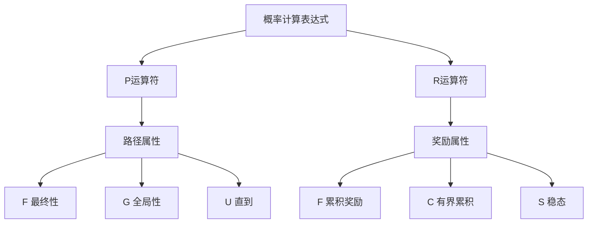

# PRISM 概率计算表达式

## 介绍

概率计算表达式是PRISM模型检查器中用于指定系统概率性行为的关键语法结构。它们允许你定义需要验证的定量属性，例如"系统在10步内达到目标状态的概率是多少？"或"长期运行下系统的平均能耗是多少？"。

在PRISM中，这些表达式基于**概率时序逻辑**（PCTL、CSL等）扩展而来，为建模随机系统提供了强大的规范语言。

## 基本语法结构

PRISM概率计算表达式的基本形式为：

```
P operator [ path-property ]
```

或

```
R operator [ reward-property ]
```

其中：
- `P` 表示概率计算
- `R` 表示奖励计算
- `operator` 是比较运算符（如 `>= 0.5`, `=?` 等）
- `path-property` 是路径属性表达式

### 概率运算符示例

```prism
P>=0.95 [ F<=100 "success" ]
```

这表示："系统在100个时间单位内达到'success'状态的概率至少为0.95"。

## 路径属性类型

PRISM支持多种路径属性：

1. **最终性（Eventually）**：`F phi`
   - 表示"最终phi会成立"
   - 示例：`P=? [ F x>5 ]`（x最终大于5的概率是多少？）

2. **全局性（Globally）**：`G phi`
   - 表示"phi总是成立"
   - 示例：`P>=0.99 [ G !fail ]`（系统永不失败的概率至少为0.99）

3. **直到（Until）**：`phi U psi`
   - 表示"phi一直成立，直到psi成立"
   - 示例：`P=? [ x<3 U x>7 ]`（x保持在3以下直到超过7的概率）

## 时间界限

可以为路径属性添加时间界限：

- `F<=T phi`：在T个时间单位内phi成立
- `G<=T phi`：在接下来的T个时间单位内phi一直成立
- `phi U<=T psi`：在T个时间单位内phi成立直到psi成立

```prism
// 系统在10秒内完成初始化的概率
P=? [ F<=10 initialized ]

// 前5步内系统不会崩溃的概率
P>=0.9 [ G<=5 !crash ]
```

## 奖励计算表达式

PRISM还支持基于奖励（或代价）的定量分析：

```
R operator [ reward-property ]
```

常见奖励属性：

- `F phi`：达到phi状态时的累积奖励
- `C<=T`：在时间T内的累积奖励
- `I=T`：在时间T的瞬时奖励
- `S`：长期平均奖励

```prism
// 系统达到目标状态前的平均能耗
R{"energy"}=? [ F target ]

// 前100小时内完成任务的平均时间
R{"time"}<=100 [ C<=100 ]
```

## 实际案例

### 案例1：通信协议可靠性

考虑一个消息传递协议，消息可能丢失（概率0.1）或成功传递（概率0.9）：

```prism
// 消息在3次重试内成功传递的概率
P=? [ F<=3 delivered ]

// 长期来看，平均每次传递尝试的能耗
R{"energy"}=? [ S ]
```

### 案例2：云计算系统

```prism
// 系统在24小时内至少保持95%可用性的概率
P>=0.99 [ G<=24 (availability>=0.95) ]

// 每月预期计算成本
R{"cost"}<=30 [ C<=720 ]  // 720小时=30天
```

## 高级特性

### 多目标属性

可以组合多个属性：

```prism
// 系统既快速又可靠的概率
P=? [ F<=10 complete & F<=20 !failure ]
```

### 过滤器

使用过滤器分析特定条件下的概率：

```prism
// 当初始队列长度>5时，系统过载的概率
filter(state, P=? [ F overload ], queue_length>5)
```

## 总结

PRISM的概率计算表达式提供了强大的方式来指定和验证随机系统的定量属性。关键要点：

1. 使用`P`和`R`分别表示概率和奖励计算
2. 路径属性（`F`、`G`、`U`）描述系统行为模式
3. 时间界限可以添加定量时间约束
4. 奖励属性允许分析资源消耗等指标

## 练习与进一步学习

建议练习：

1. 为简单的马尔可夫链模型编写不同概率属性
2. 尝试添加时间界限并观察结果变化
3. 组合多个属性和过滤器

进一步学习资源：

- PRISM官方文档的概率规范部分
- 概率时序逻辑（PCTL/CSL）理论基础
- 案例研究中的高级属性规范

:::tip 小技巧
使用`P=?`形式可以查询概率值而不做断言，这在探索性分析中非常有用。PRISM会计算出确切的概率值。
:::


