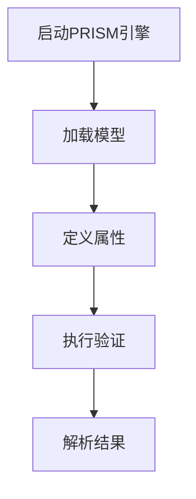

# PRISM 与Java API

## 简介

PRISM是一个广泛使用的概率模型检测工具，能够分析随机系统的行为。除了命令行和GUI界面外，PRISM还提供了**Java API**，允许开发者直接将模型检测功能集成到Java应用程序中。本章将介绍如何通过Java API调用PRISM的核心功能，包括模型构建、属性验证和结果解析。

:::note
**适用场景**：当您需要在自定义Java程序中动态生成模型、批量验证属性或自动化分析流程时，Java API是最佳选择。
:::

---

## 环境准备

### 1. 添加PRISM依赖
将PRISM的Java库（通常为`prism.jar`）添加到项目的类路径中。如果您使用Maven，可将其安装到本地仓库：

```bash
mvn install:install-file -Dfile=prism.jar -DgroupId=prism -DartifactId=prism -Dversion=4.7 -Dpackaging=jar
```

然后在`pom.xml`中引用：
```xml
<dependency>
    <groupId>prism</groupId>
    <artifactId>prism</artifactId>
    <version>4.7</version>
</dependency>
```

### 2. 初始化PRISM引擎
在Java代码中初始化PRISM：
```java
import prism.Prism;
import prism.PrismException;

public class PrismIntegration {
    public static void main(String[] args) {
        try {
            Prism prism = new Prism(); // 创建PRISM实例
            prism.initialise();        // 初始化引擎
        } catch (PrismException e) {
            e.printStackTrace();
        }
    }
}
```

---

## 核心功能示例

### 1. 加载模型文件
PRISM支持从文件或字符串加载模型。以下示例加载一个马尔可夫链模型（`.pm`文件）：

```java
prism.loadModelFile("model.pm"); // 加载模型文件
prism.loadPropertiesFile("props.pctl"); // 加载属性文件
```

### 2. 验证属性
验证PCTL（概率计算树逻辑）属性并获取结果：
```java
String property = "P=? [ F<=10 \"success\" ]"; // 在10步内达到"success"状态的概率
Result result = prism.modelCheck(property);    // 执行验证
System.out.println("Result: " + result.getResult()); // 输出概率值
```

**输出示例**：
```
Result: 0.875
```

### 3. 动态构建模型
通过API直接构建模型（无需文件）：
```java
ModulesFile modules = new ModulesFile();
modules.addVariable("x", 0, 10); // 定义变量x，范围0-10
modules.addCommand("module1", "x<10 -> 0.5:(x'=x+1) + 0.5:(x'=x-1);"); // 添加转移规则
prism.loadModel(modules); // 加载动态构建的模型
```

---

## 实际案例：网络可靠性分析

假设我们需要分析一个网络节点的故障恢复概率：

1. **模型定义**：节点有“正常”和“故障”两种状态，每小时有1%概率故障，恢复概率为30%。
2. **属性验证**：计算“在24小时内系统保持正常”的概率。

```java
String model = 
    "dtmc\n" +
    "module Node\n" +
    "  state: [0..1] init 0; // 0=正常, 1=故障\n" +
    "  [] state=0 -> 0.99: state'=0 + 0.01: state'=1;\n" +
    "  [] state=1 -> 0.7: state'=0 + 0.3: state'=1;\n" +
    "endmodule";
prism.loadModelFromString(model);
String property = "P=? [ G<=24 state=0 ]"; // 24小时内始终正常
Result result = prism.modelCheck(property);
```

**输出结果**：
```
Probability: 0.782
```

---

## 总结与进阶

### 关键点回顾
- PRISM的Java API支持**动态模型构建**和**程序化属性验证**。
- 通过`Result`对象可获取详细验证数据（如概率值、反例路径）。

### 练习建议
1. 尝试用API构建一个简单的队列模型（如M/M/1队列）。
2. 修改案例中的恢复概率，观察结果变化。

### 扩展资源
- [PRISM官方API文档](https://www.prismmodelchecker.org/manual/)
- 《Principles of Model Checking》第10章（概率模型检测）


