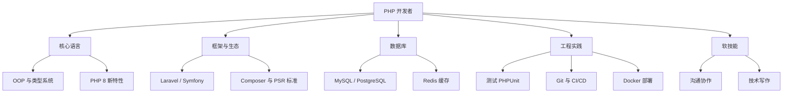

## 介绍

PHP 是一种广泛使用的服务器端脚本语言，特别适合 Web 开发。由于其易学性和强大的社区支持，PHP 成为了许多开发者的首选语言。然而，随着技术的不断发展，PHP 开发者的职业发展路径也在不断演变。本文将为你详细介绍 PHP 职业发展的各个方面，帮助你规划未来的职业道路。

## PHP 职业发展路径

### 1. 初级 PHP 开发者

作为初学者，你的主要任务是掌握 PHP 的基础知识，包括语法、变量、函数、数组、循环和条件语句等。你还需要了解基本的 Web 开发技术，如 HTML、CSS 和 JavaScript。

```php
<?php
// 示例：简单的 PHP 脚本
$name = "World";
echo "Hello, $name!";
?>
```

**输出：**
```
Hello, World!
```

:::tip
建议初学者从简单的项目开始，如个人博客或待办事项列表，以巩固基础知识。
:::

### 2. 中级 PHP 开发者

在中级阶段，你需要深入学习 PHP 的高级特性，如面向对象编程（OOP）、数据库交互（MySQL）、API 开发、框架使用（如 Laravel 或 Symfony）以及安全性最佳实践。

```php
<?php
// 示例：使用 PDO 连接数据库
try {
    $pdo = new PDO('mysql:host=localhost;dbname=test', 'username', 'password');
    echo "Connected successfully";
} catch (PDOException $e) {
    echo "Connection failed: " . $e->getMessage();
}
?>
```

**输出：**
```
Connected successfully
```

:::note
掌握框架的使用可以大大提高开发效率，并帮助你构建更复杂的应用程序。
:::

### 3. 高级 PHP 开发者

高级 PHP 开发者通常负责架构设计、性能优化、代码审查、团队管理以及技术决策。你需要具备深厚的 PHP 知识，同时了解其他相关技术，如 DevOps、云计算、微服务架构等。

```php
<?php
// 示例：使用 Redis 缓存数据
$redis = new Redis();
$redis->connect('127.0.0.1', 6379);
$redis->set('key', 'value');
echo $redis->get('key');
?>
```

**输出：**
```
value
```

:::caution
高级开发者需要不断学习新技术，以保持竞争力。
:::

## 实际案例

### 案例 1：电子商务网站

假设你正在开发一个电子商务网站，你需要使用 PHP 处理用户注册、登录、购物车管理、订单处理等功能。你可能会使用 Laravel 框架来加速开发，并使用 MySQL 存储用户和产品数据。

```php
<?php
// 示例：使用 Laravel 创建用户
use App\Models\User;

$user = new User();
$user->name = 'John Doe';
$user->email = 'john@example.com';
$user->password = bcrypt('password');
$user->save();
?>
```

**输出：**
```
用户 John Doe 已成功创建。
```

### 案例 2：API 开发

你可能需要开发一个 RESTful API，供移动应用程序使用。你可以使用 PHP 和 Laravel 来构建 API，并使用 JWT（JSON Web Token）进行身份验证。

```php
<?php
// 示例：使用 JWT 进行身份验证
use Firebase\JWT\JWT;

$key = "example_key";
$payload = array(
    "user_id" => 1,
    "username" => "johndoe"
);

$jwt = JWT::encode($payload, $key, 'HS256');
echo $jwt;
?>
```

**输出：**
```text
eyJ0eXAiOiJKV1QiLCJhbGciOiJIUzI1NiJ9.eyJ1c2VyX2lkIjoxLCJ1c2VybmFtZSI6ImpvaG5kb2UifQ.xxxxxxxx
```

:::note
在 `firebase/php-jwt` 6.x 版本中，`JWT::encode()` 必须显式传入签名算法，例如 `JWT::encode($payload, $key, 'HS256')`。实际项目中，密钥应当足够长并保存在环境变量中，而不是硬编码在代码里。
:::

### 案例 3：遗留系统现代化

很多公司仍在运行基于 PHP 5 时代编写的老系统。能够把这些系统逐步迁移到 PHP 8、引入 Composer 依赖管理、补充自动化测试，是一项非常有市场价值的能力。

```php
<?php
declare(strict_types=1);

// 旧写法：没有类型声明，返回值不明确
// function getPrice($product) { return $product['price'] * 1.1; }

// 新写法：使用类型声明和只读属性（PHP 8.1+）
final class Product
{
    public function __construct(
        public readonly string $name,
        public readonly float $price,
    ) {}
}

function getPriceWithTax(Product $product, float $taxRate = 0.1): float
{
    return round($product->price * (1 + $taxRate), 2);
}

echo getPriceWithTax(new Product('键盘', 100.0));
```

**输出：**
```text
110
```

## PHP 开发者的技能地图



## 常见的职业方向

| 方向 | 主要工作 | 需要补充的技能 |
| --- | --- | --- |
| 后端开发工程师 | 业务逻辑、API、数据库设计 | 框架、SQL 优化、缓存 |
| 全栈工程师 | 前后端一体化开发 | JavaScript、Vue/React |
| WordPress / CMS 开发 | 主题、插件开发与定制 | WordPress Hooks、前端基础 |
| 架构师 | 系统设计、技术选型 | 分布式系统、消息队列、微服务 |
| 技术负责人 | 团队管理、技术规划 | 项目管理、代码评审、沟通 |
| 自由职业者 | 外包项目、独立产品 | 需求沟通、报价、交付管理 |

## 如何规划你的职业成长

1. **打好基础**：熟练掌握 PHP 语法、面向对象编程和常用内置函数，理解 HTTP 协议的工作方式。
2. **精通至少一个框架**：深入学习 Laravel 或 Symfony，理解路由、中间件、依赖注入容器和 ORM 的原理。
3. **建立作品集**：在 GitHub 上维护几个完整的项目，包含 README、测试和部署说明。
4. **参与开源**：为你使用的开源库提交文档修正或 Bug 修复，这既能提升能力，也能积累可见的成果。
5. **拓展技术广度**：学习 Docker、Linux 运维、前端框架和云服务，让自己能够独立负责完整的功能交付。
6. **持续学习**：关注 PHP 每个新版本的变化（如枚举、只读属性、Fibers 等），及时更新自己的知识体系。

:::tip
面试时，能够清晰讲述你在项目中解决过的具体问题（例如"把某个接口的响应时间从 800ms 优化到 120ms"），往往比罗列技术名词更有说服力。
:::

## 总结

PHP 开发者的职业道路通常从掌握语言基础开始，经过框架应用和工程实践的积累，逐步走向架构设计和团队领导。在每个阶段，你都需要：

- 不断巩固核心语言能力，并跟进 PHP 新版本的特性
- 通过真实项目积累经验，并沉淀为可展示的作品
- 拓展数据库、缓存、部署、前端等周边技能
- 培养沟通、协作和技术写作等软技能

PHP 依然支撑着大量的 Web 应用，只要持续学习、主动实践，你就能在这条道路上不断成长。

## 附加资源

- [PHP 官方文档](https://www.php.net/manual/zh/)
- [Laravel 官方文档](https://laravel.com/docs)
- [Symfony 官方文档](https://symfony.com/doc/current/index.html)
- [PHP-FIG（PSR 标准）](https://www.php-fig.org/psr/)

## 练习

1. 列出你目前掌握的 PHP 相关技能，对照上面的技能地图，找出三个需要加强的方向。
2. 使用 Laravel 或 Symfony 构建一个带有用户注册、登录和 CRUD 功能的小项目，并发布到 GitHub。
3. 将一段旧的、没有类型声明的 PHP 代码改写为使用 `declare(strict_types=1)` 和类型声明的版本。
4. 制定一份为期六个月的学习计划，明确每个月的学习目标和要完成的项目。
