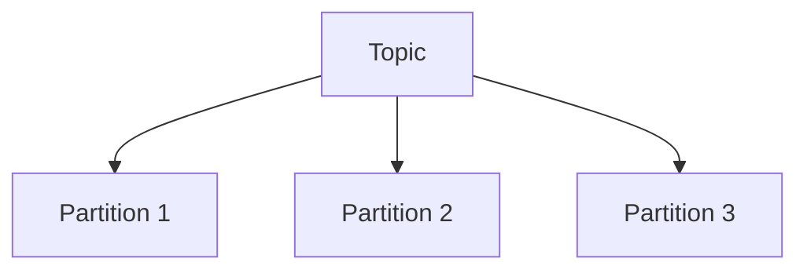
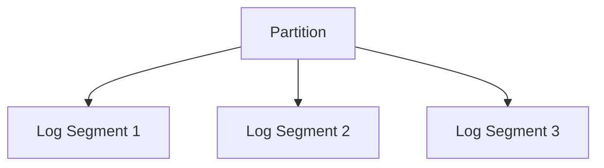
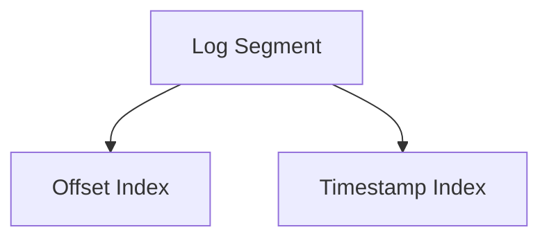

# Kafka 存储机制

Kafka是一个分布式流处理平台，广泛用于构建实时数据管道和流应用。其高效的存储机制是其核心优势之一。本文将详细介绍Kafka的存储机制，帮助你理解其内部工作原理。

## 介绍

Kafka的存储机制是其高性能和高可靠性的关键。Kafka将数据存储在磁盘上，并通过一系列优化技术确保数据的快速写入和读取。Kafka的存储机制主要包括分区、日志段、索引文件等概念。

## 分区（Partition）

Kafka中的每个主题（Topic）可以被分成多个分区（Partition）。分区是Kafka的基本存储单元，每个分区是一个有序的、不可变的记录序列。分区允许Kafka在多个服务器上分布数据，从而实现水平扩展。



## 日志段（Log Segment）

每个分区实际上是由多个日志段（Log Segment）组成的。日志段是Kafka存储数据的基本单位，每个日志段对应一个文件。当一个日志段达到一定大小或时间限制时，Kafka会创建一个新的日志段。

:::note
日志段的大小和时间限制可以通过Kafka的配置参数进行设置。
:::



## 索引文件（Index File）

为了快速定位消息，Kafka为每个日志段维护了两个索引文件：偏移量索引文件（Offset Index）和时间戳索引文件（Timestamp Index）。这些索引文件允许Kafka在读取数据时快速定位到特定的消息。

:::tip
索引文件是Kafka高效读取数据的关键，它们通过二分查找算法快速定位消息。
:::



## 实际案例

假设我们有一个名为`user_activity`的Kafka主题，该主题被分成3个分区。每个分区由多个日志段组成，每个日志段对应一个文件。当生产者向`user_activity`主题发送消息时，Kafka会根据分区策略将消息写入相应的分区和日志段。

```plaintext
user_activity-0/
  ├── 00000000000000000000.log
  ├── 00000000000000000000.index
  ├── 00000000000000000000.timeindex
  ├── 00000000000000012345.log
  ├── 00000000000000012345.index
  ├── 00000000000000012345.timeindex
user_activity-1/
  ├── 00000000000000000000.log
  ├── 00000000000000000000.index
  ├── 00000000000000000000.timeindex
user_activity-2/
  ├── 00000000000000000000.log
  ├── 00000000000000000000.index
  ├── 00000000000000000000.timeindex
```

在上面的目录结构中，每个分区对应一个目录，目录名由主题名和分区号组成。日志段文件以该段中第一条消息的偏移量（基准偏移量）命名，并补齐为20位数字。例如，`00000000000000012345.log`表示该日志段中第一条消息的偏移量是12345。

当消费者需要读取偏移量为12400的消息时，Kafka的查找过程如下：

1. 根据文件名中的基准偏移量，找到包含该偏移量的日志段（`00000000000000012345`）。
2. 在该日志段的`.index`文件中通过二分查找，找到不大于目标偏移量的最近索引项，得到其在`.log`文件中的物理位置。
3. 从该物理位置开始顺序扫描`.log`文件，直到找到偏移量为12400的消息。

:::note
Kafka的索引是稀疏索引，并不会为每条消息都建立索引项，而是每写入一定字节的数据（由`log.index.interval.bytes`控制，默认4096字节）才添加一条索引。这样可以让索引文件足够小，从而映射到内存中。
:::

## 相关配置参数

以下是与Kafka存储机制相关的常用Broker配置：

```properties
# 单个日志段文件的最大大小，默认1GB
log.segment.bytes=1073741824

# 即使日志段未写满，超过该时间也会滚动创建新的日志段，默认168小时（7天）
log.roll.hours=168

# 每写入多少字节的数据添加一条索引项，默认4096字节
log.index.interval.bytes=4096

# 日志保留时间，默认168小时（7天）
log.retention.hours=168

# 每个分区的最大保留大小，-1表示不限制
log.retention.bytes=-1

# 日志清理策略：delete（删除过期数据）或 compact（日志压缩）
log.cleanup.policy=delete
```

## 查看日志段内容

Kafka提供了`kafka-dump-log.sh`工具，可以查看日志段和索引文件的内容，便于理解和排查存储相关的问题：

```bash
# 查看日志段中的消息
bin/kafka-dump-log.sh --files /tmp/kafka-logs/user_activity-0/00000000000000000000.log --print-data-log

# 查看偏移量索引文件
bin/kafka-dump-log.sh --files /tmp/kafka-logs/user_activity-0/00000000000000000000.index
```

:::tip
日志目录的位置由Broker配置`log.dirs`决定，上面示例中的`/tmp/kafka-logs`只是一个常见的默认值，请根据实际环境替换。
:::

## 总结

Kafka的存储机制可以概括为以下几点：

- **分区**：主题被分成多个分区，每个分区是一个有序、不可变的消息序列，分区是数据分布和并行处理的基本单位。
- **日志段**：每个分区由多个日志段组成，消息只追加写入当前活跃的日志段，旧日志段可以按时间或大小整体删除。
- **索引文件**：每个日志段配有偏移量索引和时间戳索引，通过稀疏索引和二分查找快速定位消息。
- **顺序写入**：只追加的写入方式充分利用了磁盘顺序读写的性能，这是Kafka高吞吐量的重要原因。

## 附加资源

- [Apache Kafka官方文档](https://kafka.apache.org/documentation/)

## 练习

1. 在本地启动Kafka，创建一个包含3个分区的主题，然后在`log.dirs`目录中观察生成的分区目录和日志段文件。
2. 将`log.segment.bytes`设置为一个较小的值（如1MB），持续发送消息，观察新日志段文件的生成过程。
3. 使用`kafka-dump-log.sh`工具查看某个日志段的`.log`和`.index`文件，分析索引项与消息偏移量之间的对应关系。
