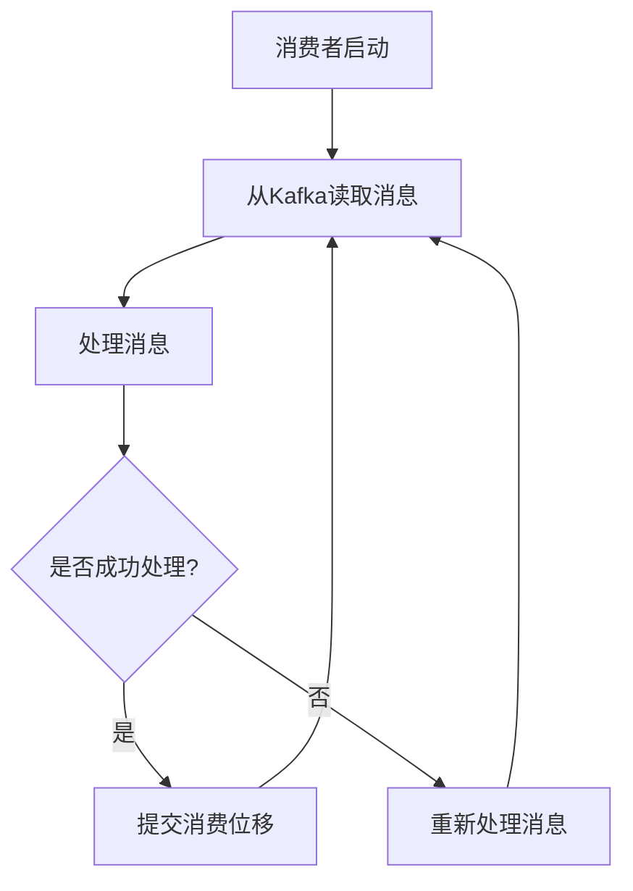

# Kafka 消费位移提交

在Kafka中，消费者从主题的分区中读取消息，并记录下一条要读取的消息的位置，这个位置被称为**消费位移**（Consumer Offset）。消费位移的提交是确保消费者在故障恢复后能够从正确的位置继续消费的关键机制。本文将详细介绍Kafka消费位移提交的概念、机制以及实际应用。

## 什么是消费位移？

消费位移是一个数字，表示消费者在某个分区中已经成功处理的消息的位置。Kafka使用这个位移来跟踪消费者在分区中的进度。当消费者处理完一条消息后，它会将消费位移提交到Kafka，以便在消费者重启或发生故障时，能够从上次提交的位移处继续消费。

## 消费位移提交的机制

Kafka提供了两种主要的消费位移提交方式：

1. **自动提交**：消费者在后台定期自动提交消费位移。
2. **手动提交**：消费者在代码中显式地提交消费位移。

### 自动提交

自动提交是Kafka消费者的默认行为。消费者会定期（默认每5秒）将消费位移提交到Kafka。这种方式简单易用，但可能会导致重复消费或消息丢失。

```java
Properties props = new Properties();
props.put("bootstrap.servers", "localhost:9092");
props.put("group.id", "test");
props.put("enable.auto.commit", "true");
props.put("auto.commit.interval.ms", "1000");
props.put("key.deserializer", "org.apache.kafka.common.serialization.StringDeserializer");
props.put("value.deserializer", "org.apache.kafka.common.serialization.StringDeserializer");

KafkaConsumer<String, String> consumer = new KafkaConsumer<>(props);
consumer.subscribe(Arrays.asList("my-topic"));

while (true) {
    ConsumerRecords<String, String> records = consumer.poll(Duration.ofMillis(100));
    for (ConsumerRecord<String, String> record : records) {
        System.out.printf("offset = %d, key = %s, value = %s%n", record.offset(), record.key(), record.value());
    }
}
```

:::note
自动提交虽然方便，但在某些情况下可能会导致消息重复消费或丢失。例如，如果消费者在处理消息时崩溃，而位移尚未提交，那么重启后可能会重新消费已经处理过的消息。
:::

### 手动提交

手动提交允许开发者在确保消息处理成功后再提交消费位移。这种方式可以避免自动提交带来的问题，但需要开发者编写更多的代码。

```java
Properties props = new Properties();
props.put("bootstrap.servers", "localhost:9092");
props.put("group.id", "test");
props.put("enable.auto.commit", "false");
props.put("key.deserializer", "org.apache.kafka.common.serialization.StringDeserializer");
props.put("value.deserializer", "org.apache.kafka.common.serialization.StringDeserializer");

KafkaConsumer<String, String> consumer = new KafkaConsumer<>(props);
consumer.subscribe(Arrays.asList("my-topic"));

try {
    while (true) {
        ConsumerRecords<String, String> records = consumer.poll(Duration.ofMillis(100));
        for (ConsumerRecord<String, String> record : records) {
            System.out.printf("offset = %d, key = %s, value = %s%n", record.offset(), record.key(), record.value());
        }
        consumer.commitSync(); // 手动提交位移
    }
} finally {
    consumer.close();
}
```

:::tip
手动提交位移可以确保消息处理的可靠性，但需要注意提交的频率和时机。频繁提交会增加Kafka的负载，而延迟提交则可能导致重复消费。
:::

## 实际应用场景

### 场景1：确保消息处理的可靠性

在一个订单处理系统中，消费者从Kafka中读取订单消息并进行处理。为了确保每个订单只被处理一次，消费者在处理完订单后手动提交消费位移。这样，即使消费者在处理过程中崩溃，重启后也能从上次提交的位移处继续消费，避免重复处理。

### 场景2：批量处理消息

在一个日志处理系统中，消费者从Kafka中读取日志消息并进行批量处理。为了提高处理效率，消费者在每批消息处理完成后手动提交消费位移。这样可以减少提交次数，降低Kafka的负载。

## 总结

Kafka消费位移提交是确保消息处理可靠性和一致性的关键机制。自动提交虽然方便，但在某些情况下可能会导致消息重复消费或丢失。手动提交则提供了更高的控制权，但需要开发者编写更多的代码。在实际应用中，开发者应根据具体需求选择合适的提交方式。

## 附加资源

- [Kafka官方文档](https://kafka.apache.org/documentation/)
- [Kafka消费者API文档](https://kafka.apache.org/28/javadoc/org/apache/kafka/clients/consumer/KafkaConsumer.html)
- [Kafka消费位移管理](https://www.confluent.io/blog/tutorial-getting-started-with-the-new-apache-kafka-0-9-consumer-client/)

## 练习

1. 修改上述自动提交的代码，使其每处理10条消息后手动提交一次位移。
2. 编写一个Kafka消费者，使用手动提交位移，并在处理每条消息后打印出当前的消费位移。


