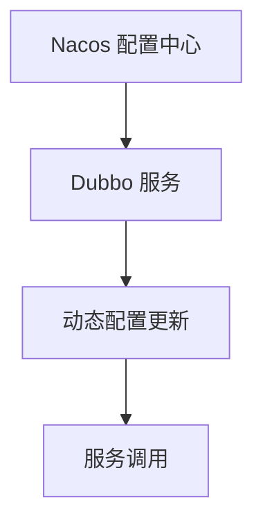

## 介绍

在现代微服务架构中，配置管理和服务发现是两个至关重要的组件。Nacos 是一个动态服务发现、配置和服务管理平台，而 Dubbo 是一个高性能的 RPC 框架。通过将 Nacos 与 Dubbo 集成，开发者可以轻松实现动态配置管理和服务发现，从而提高系统的灵活性和可维护性。

本文将详细介绍如何将 Nacos 配置中心与 Dubbo 集成，并提供实际的代码示例和应用场景。

## Nacos 配置中心简介

Nacos 配置中心是 Nacos 提供的一个功能，用于集中管理应用程序的配置。它支持动态配置更新，可以在不重启应用的情况下修改配置。Nacos 配置中心的主要特点包括：

- **动态配置**：支持配置的动态更新。
- **多环境支持**：支持不同环境（如开发、测试、生产）的配置管理。
- **配置版本控制**：支持配置的版本管理，方便回滚。

## Dubbo 简介

Dubbo 是一个高性能的 Java RPC 框架，主要用于构建分布式服务架构。Dubbo 提供了服务注册与发现、负载均衡、服务治理等功能。通过集成 Nacos，Dubbo 可以实现动态的服务发现和配置管理。

## Nacos 与 Dubbo 集成步骤

### 1. 安装和启动 Nacos

首先，你需要在本地或服务器上安装并启动 Nacos。你可以从 [Nacos 官方网站](https://nacos.io/) 下载最新版本的 Nacos。

```bash
# 下载 Nacos
wget https://github.com/alibaba/nacos/releases/download/2.0.3/nacos-server-2.0.3.tar.gz

# 解压
tar -xzf nacos-server-2.0.3.tar.gz

# 启动 Nacos
cd nacos/bin
sh startup.sh -m standalone
```

### 2. 配置 Dubbo 使用 Nacos 作为注册中心

在 Dubbo 项目中，你需要配置 Nacos 作为注册中心。以下是一个简单的配置示例：

```xml
<dubbo:registry address="nacos://127.0.0.1:8848" />
```

### 3. 配置 Dubbo 使用 Nacos 作为配置中心

接下来，你需要配置 Dubbo 使用 Nacos 作为配置中心。以下是一个配置示例：

```xml
<dubbo:config-center address="nacos://127.0.0.1:8848" />
```

### 4. 动态配置更新

Nacos 配置中心支持动态配置更新。你可以在 Nacos 控制台中修改配置，Dubbo 会自动感知并应用新的配置。以下是一个动态配置的示例：

```java
@DubboReference
private DemoService demoService;

public void updateConfig() {
    // 动态更新配置
    ConfigService configService = NacosFactory.createConfigService("127.0.0.1:8848");
    configService.publishConfig("demo-service", "DEFAULT_GROUP", "new-config-value");
}
```

## 实际应用场景

### 场景 1：动态调整服务超时时间

在微服务架构中，服务的超时时间可能会根据不同的环境或负载情况进行调整。通过 Nacos 配置中心，你可以动态调整 Dubbo 服务的超时时间，而无需重启服务。

```java
@DubboReference(timeout = 5000)
private DemoService demoService;

public void updateTimeout() {
    // 动态更新超时时间
    ConfigService configService = NacosFactory.createConfigService("127.0.0.1:8848");
    configService.publishConfig("demo-service-timeout", "DEFAULT_GROUP", "3000");
}
```

### 场景 2：多环境配置管理

在开发、测试和生产环境中，应用的配置可能会有所不同。通过 Nacos 配置中心，你可以为每个环境配置不同的参数，并在部署时自动加载相应的配置。

```xml
<dubbo:config-center address="nacos://127.0.0.1:8848" group="DEV" />
```

## 总结

通过将 Nacos 与 Dubbo 集成，开发者可以轻松实现动态配置管理和服务发现。Nacos 提供了强大的配置管理功能，而 Dubbo 则提供了高性能的 RPC 调用能力。两者的结合为构建灵活、可维护的微服务架构提供了强大的支持。

## 附加资源

- [Nacos 官方文档](https://nacos.io/zh-cn/docs/what-is-nacos.html)
- [Dubbo 官方文档](https://dubbo.apache.org/zh/docs/)
- [Nacos 与 Dubbo 集成示例](https://github.com/apache/dubbo-samples/tree/master/dubbo-samples-nacos)

## 练习

1. 尝试在本地启动 Nacos，并将其配置为 Dubbo 的注册中心和配置中心。
2. 编写一个简单的 Dubbo 服务，并使用 Nacos 动态更新其配置。
3. 探索 Nacos 的多环境配置管理功能，并尝试为不同的环境配置不同的参数。


