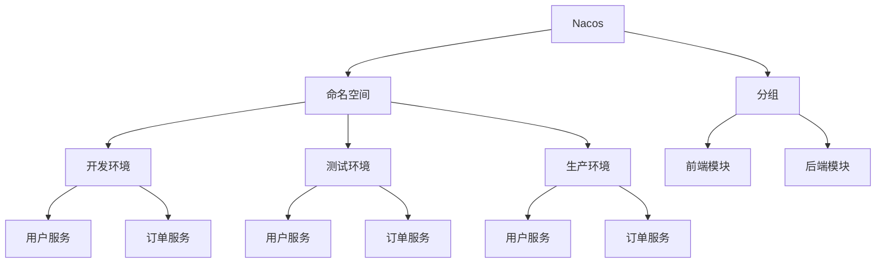

# Nacos 命名空间与分组策略

在Nacos中，命名空间（Namespace）和分组（Group）是两个非常重要的概念，它们帮助我们在复杂的微服务架构中更好地管理配置和服务。本文将详细介绍这两个概念，并通过实际案例展示它们的应用场景。

## 什么是命名空间？

命名空间是Nacos中用于隔离配置和服务的一种机制。通过命名空间，我们可以将不同的环境（如开发、测试、生产）或不同的项目隔离开来，避免配置和服务之间的冲突。

### 命名空间的创建

在Nacos中，命名空间可以通过控制台或API进行创建。以下是通过控制台创建命名空间的步骤：

1. 登录Nacos控制台。
2. 在左侧导航栏中选择“命名空间”。
3. 点击“新建命名空间”按钮。
4. 输入命名空间的名称和描述，然后点击“确定”。

### 命名空间的使用

在配置或服务中指定命名空间时，可以通过命名空间的ID或名称来引用。例如，在Spring Cloud Alibaba中，可以通过以下配置指定命名空间：

```yaml
spring:
  cloud:
    nacos:
      config:
        namespace: your-namespace-id
      discovery:
        namespace: your-namespace-id
```

## 什么是分组？

分组是Nacos中用于进一步细分配置和服务的机制。通过分组，我们可以在同一个命名空间内对配置和服务进行分类管理。

### 分组的创建

分组可以在创建配置或服务时指定。以下是通过Nacos控制台创建配置时指定分组的步骤：

1. 登录Nacos控制台。
2. 在左侧导航栏中选择“配置管理”。
3. 点击“新建配置”按钮。
4. 在“分组”字段中输入分组名称，然后填写其他配置信息，点击“发布”。

### 分组的使用

在配置或服务中指定分组时，可以通过分组的名称来引用。例如，在Spring Cloud Alibaba中，可以通过以下配置指定分组：

```yaml
spring:
  cloud:
    nacos:
      config:
        group: your-group-name
      discovery:
        group: your-group-name
```

## 命名空间与分组的实际应用

### 场景一：多环境配置管理

假设我们有一个项目需要在开发、测试和生产三个环境中运行。我们可以通过命名空间来隔离不同环境的配置：

- 开发环境：`dev` 命名空间
- 测试环境：`test` 命名空间
- 生产环境：`prod` 命名空间

在每个命名空间内，我们可以使用分组来进一步细分配置。例如，在开发环境中，我们可以为不同的微服务创建不同的分组：

- 用户服务：`user-service` 分组
- 订单服务：`order-service` 分组

### 场景二：多项目配置管理

假设我们有两个项目：`project-a` 和 `project-b`。我们可以通过命名空间来隔离这两个项目的配置：

- `project-a` 命名空间
- `project-b` 命名空间

在每个命名空间内，我们可以使用分组来管理不同模块的配置。例如，在`project-a`中，我们可以为不同的模块创建不同的分组：

- 前端模块：`frontend` 分组
- 后端模块：`backend` 分组

## 总结

命名空间和分组是Nacos中非常重要的概念，它们帮助我们更好地管理配置和服务。通过命名空间，我们可以隔离不同的环境或项目；通过分组，我们可以在同一个命名空间内对配置和服务进行分类管理。

在实际应用中，合理使用命名空间和分组可以大大提高配置和服务的可管理性和可维护性。

## 附加资源

- [Nacos官方文档](https://nacos.io/zh-cn/docs/what-is-nacos.html)
- [Spring Cloud Alibaba Nacos配置管理](https://spring-cloud-alibaba-group.github.io/github-pages/hoxton/en-us/index.html#_spring_cloud_alibaba_nacos_config)

## 练习

1. 在Nacos控制台中创建一个新的命名空间，并在其中创建两个分组。
2. 使用Spring Cloud Alibaba配置Nacos客户端，指定不同的命名空间和分组，观察配置的加载情况。


