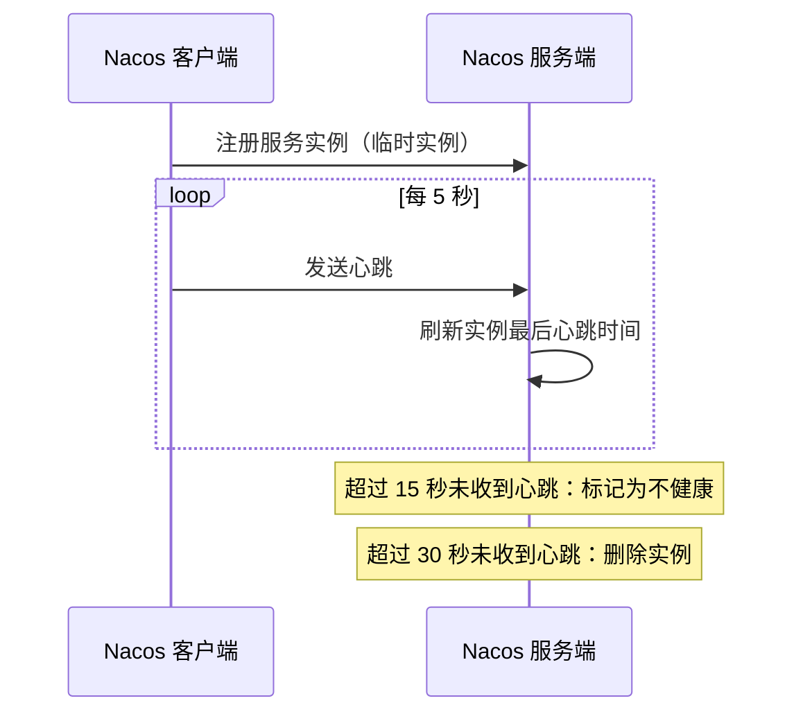

# Nacos 心跳机制实现

## 介绍

Nacos是一个动态服务发现、配置管理和服务管理平台。在Nacos中，客户端与服务端之间的通信是通过心跳机制来维持的。心跳机制是确保客户端与服务端保持连接的重要手段，它能够及时检测到客户端的健康状态，并在客户端异常时进行相应的处理。

本文将详细介绍Nacos心跳机制的工作原理、实现方式以及实际应用场景，帮助初学者更好地理解这一概念。

## 心跳机制的工作原理

心跳机制的核心思想是客户端定期向服务端发送心跳包，以表明自己仍然存活。服务端在接收到心跳包后，会更新客户端的状态信息。如果服务端在一定时间内没有收到客户端的心跳包，则会认为客户端已经下线，并将其从服务列表中移除。

### 心跳机制的流程



上图展示的是 Nacos 1.x 中临时实例的典型流程，其中涉及三个关键时间参数：

| 参数 | 默认值 | 含义 |
| --- | --- | --- |
| `preserved.heart.beat.interval` | 5000 ms | 客户端发送心跳的间隔 |
| `preserved.heart.beat.timeout` | 15000 ms | 超过该时间未收到心跳，实例被标记为不健康 |
| `preserved.ip.delete.timeout` | 30000 ms | 超过该时间未收到心跳，实例被删除 |

## 临时实例与持久化实例

Nacos 中的实例分为两类，它们的健康检查方式不同：

- **临时实例（ephemeral = true，默认）**：由客户端主动上报心跳，服务端被动检测。实例下线后会被自动剔除。
- **持久化实例（ephemeral = false）**：客户端不发送心跳，由服务端主动探测（如 TCP、HTTP、MySQL 检查）。实例不健康时只会被标记，不会被删除。

## 心跳机制的实现方式

### Nacos 1.x：基于 HTTP 的定时心跳

在 Nacos 1.x 中，客户端注册临时实例后，`BeatReactor` 会为该实例创建一个定时任务，按照心跳间隔调用服务端的 `/nacos/v1/ns/instance/beat` 接口。服务端收到心跳后更新实例的最后心跳时间；服务端的健康检查任务会定期扫描所有实例，根据最后心跳时间判断实例是否超时。

### Nacos 2.x：基于 gRPC 长连接

Nacos 2.x 引入了 gRPC 长连接。临时实例的存活状态与客户端连接绑定，不再为每个实例单独发送 HTTP 心跳：

- 客户端与服务端之间维持一条长连接，并定期发送健康检查请求来确认连接可用。
- 服务端会检测长时间没有活动的连接并进行探测，探测失败时断开连接。
- 连接断开后，该连接上注册的所有临时实例会被立即移除。

这种方式减少了大量心跳请求带来的开销，同时让实例下线的感知更加及时。

## 代码示例

### 注册临时实例

使用 Nacos Java SDK 注册实例时，客户端会自动维持心跳，无需手动编写心跳逻辑：

```java
import com.alibaba.nacos.api.naming.NamingFactory;
import com.alibaba.nacos.api.naming.NamingService;
import com.alibaba.nacos.api.naming.pojo.Instance;

public class HeartbeatDemo {
    public static void main(String[] args) throws Exception {
        NamingService namingService = NamingFactory.createNamingService("127.0.0.1:8848");

        Instance instance = new Instance();
        instance.setIp("192.168.1.10");
        instance.setPort(8080);
        instance.setEphemeral(true); // 临时实例，依赖客户端心跳

        namingService.registerInstance("order-service", instance);
        System.out.println("实例已注册，客户端将自动维持心跳");

        // 保持进程运行，以便持续发送心跳
        Thread.currentThread().join();
    }
}
```

### 自定义心跳参数（Nacos 1.x）

在 Nacos 1.x 中，可以通过实例元数据调整心跳相关的时间参数：

```java
import java.util.HashMap;
import java.util.Map;

import com.alibaba.nacos.api.common.PreservedMetadataKeys;

Map<String, String> metadata = new HashMap<>();
metadata.put(PreservedMetadataKeys.HEART_BEAT_INTERVAL, "3000");   // 心跳间隔 3 秒
metadata.put(PreservedMetadataKeys.HEART_BEAT_TIMEOUT, "9000");    // 9 秒未收到心跳标记为不健康
metadata.put(PreservedMetadataKeys.IP_DELETE_TIMEOUT, "18000");    // 18 秒未收到心跳删除实例
instance.setMetadata(metadata);
```

在 Spring Cloud Alibaba 中，也可以在配置文件中设置同样的元数据：

```yaml
spring:
  cloud:
    nacos:
      discovery:
        server-addr: 127.0.0.1:8848
        metadata:
          preserved.heart.beat.interval: 3000
          preserved.heart.beat.timeout: 9000
          preserved.ip.delete.timeout: 18000
```

:::caution
缩短心跳间隔可以更快发现故障实例，但会增加服务端压力。在实例数量很大的集群中，应谨慎调整这些参数。
:::

## 实际应用场景

### 场景：服务实例宕机后的自动摘除

假设订单服务部署了 3 个实例，其中一个实例所在的机器突然断电：

1. 该实例无法再发送心跳（或其 gRPC 连接断开）。
2. Nacos 服务端在超时后将该实例标记为不健康，并最终移除。
3. 服务端将实例变更推送给订阅了订单服务的消费者。
4. 消费者更新本地服务列表，后续请求只会发往剩下的 2 个健康实例。

整个过程不需要人工干预，这正是心跳机制在服务发现中的核心价值。

## 总结

- 心跳机制用于判断临时实例是否存活，是 Nacos 服务发现的基础。
- Nacos 1.x 使用 HTTP 定时心跳，默认 5 秒发送一次，15 秒标记不健康，30 秒删除实例。
- Nacos 2.x 改为基于 gRPC 长连接维持实例状态，连接断开后临时实例会被立即移除。
- 持久化实例不依赖客户端心跳，而是由服务端主动进行健康检查。

## 附加资源

- [Nacos 官方文档](https://nacos.io/zh-cn/docs/what-is-nacos.html)

## 练习

1. 使用 Java SDK 注册一个临时实例，然后强制结束进程，在 Nacos 控制台观察实例状态的变化。
2. 分别注册一个临时实例和一个持久化实例，对比它们在进程停止后的表现。
3. 在 Nacos 1.x 环境中修改心跳相关的元数据，观察实例被标记为不健康所需的时间。
