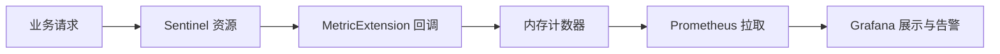

# Sentinel 自定义监控指标

Sentinel是阿里巴巴开源的一款轻量级流量控制组件，广泛应用于微服务架构中。除了内置的监控指标外，Sentinel还允许用户定义自定义监控指标，以便更灵活地监控和管理应用程序的性能和行为。

## 什么是自定义监控指标？

自定义监控指标是用户根据业务需求定义的特定指标，用于监控应用程序的某些特定行为或性能。例如，您可能希望监控某个接口的调用次数、响应时间、错误率等。通过自定义监控指标，您可以更精确地了解应用程序的运行状况，并及时发现潜在问题。

## 如何定义自定义监控指标？

在Sentinel中，您可以通过实现 `MetricExtension` 扩展接口来定义自定义监控指标。以下是一个简单的示例，展示如何定义一个监控接口调用次数的自定义指标。

### 示例代码

:::note
该接口的完整类名是 `com.alibaba.csp.sentinel.metric.extension.MetricExtension`。Sentinel 在资源通过、被限流、成功、异常、记录响应时间以及线程数变化时，都会回调所有已注册的 `MetricExtension` 实现。下面的示例基于这个扩展点。
:::

```java
package com.example.metrics;

import java.util.Map;
import java.util.concurrent.ConcurrentHashMap;
import java.util.concurrent.atomic.LongAdder;

import com.alibaba.csp.sentinel.metric.extension.MetricExtension;
import com.alibaba.csp.sentinel.slots.block.BlockException;

public class CallCountMetricExtension implements MetricExtension {

    // 每个资源的通过次数
    private static final Map<String, LongAdder> PASS_COUNT = new ConcurrentHashMap<>();
    // 每个资源被限流的次数
    private static final Map<String, LongAdder> BLOCK_COUNT = new ConcurrentHashMap<>();
    // 每个资源的业务异常次数
    private static final Map<String, LongAdder> EXCEPTION_COUNT = new ConcurrentHashMap<>();
    // 每个资源的累计响应时间（毫秒）
    private static final Map<String, LongAdder> TOTAL_RT = new ConcurrentHashMap<>();

    private static LongAdder counter(Map<String, LongAdder> map, String resource) {
        return map.computeIfAbsent(resource, k -> new LongAdder());
    }

    @Override
    public void addPass(String resource, int n, Object... args) {
        counter(PASS_COUNT, resource).add(n);
    }

    @Override
    public void addBlock(String resource, int n, String origin,
                         BlockException blockException, Object... args) {
        counter(BLOCK_COUNT, resource).add(n);
    }

    @Override
    public void addSuccess(String resource, int n, Object... args) {
        // 本示例不单独统计成功次数
    }

    @Override
    public void addException(String resource, int n, Throwable throwable) {
        counter(EXCEPTION_COUNT, resource).add(n);
    }

    @Override
    public void addRt(String resource, long rt, Object... args) {
        counter(TOTAL_RT, resource).add(rt);
    }

    @Override
    public void increaseThreadNum(String resource, Object... args) {
    }

    @Override
    public void decreaseThreadNum(String resource, Object... args) {
    }

    public static long getPassCount(String resource) {
        LongAdder adder = PASS_COUNT.get(resource);
        return adder == null ? 0 : adder.sum();
    }

    public static long getBlockCount(String resource) {
        LongAdder adder = BLOCK_COUNT.get(resource);
        return adder == null ? 0 : adder.sum();
    }

    public static double getAverageRt(String resource) {
        long pass = getPassCount(resource);
        LongAdder rt = TOTAL_RT.get(resource);
        return (pass == 0 || rt == null) ? 0 : (double) rt.sum() / pass;
    }
}
```

### 注册扩展

Sentinel 通过 SPI 机制加载 `MetricExtension`。在 `src/main/resources/META-INF/services/` 目录下创建名为 `com.alibaba.csp.sentinel.metric.extension.MetricExtension` 的文件，内容为实现类的全限定名：

```text
com.example.metrics.CallCountMetricExtension
```

### 使用自定义指标

注册完成后，只要通过 Sentinel 访问资源，指标就会被自动采集：

```java
import com.alibaba.csp.sentinel.Entry;
import com.alibaba.csp.sentinel.SphU;
import com.alibaba.csp.sentinel.slots.block.BlockException;

import com.example.metrics.CallCountMetricExtension;

public class Demo {
    public static void main(String[] args) {
        for (int i = 0; i < 100; i++) {
            Entry entry = null;
            try {
                entry = SphU.entry("getOrder");
                // 业务逻辑
            } catch (BlockException e) {
                // 被限流
            } finally {
                if (entry != null) {
                    entry.exit();
                }
            }
        }

        System.out.println("通过次数: " + CallCountMetricExtension.getPassCount("getOrder"));
        System.out.println("限流次数: " + CallCountMetricExtension.getBlockCount("getOrder"));
        System.out.println("平均RT(ms): " + CallCountMetricExtension.getAverageRt("getOrder"));
    }
}
```

如果没有为 `getOrder` 配置任何限流规则，输出类似：

```text
通过次数: 100
限流次数: 0
平均RT(ms): 0.0
```

:::caution
`MetricExtension` 的回调位于请求处理的主链路上，实现中应避免阻塞操作（如同步写数据库、远程调用），只做轻量的内存计数，再由其他线程定期导出。
:::

## 实际案例：将自定义指标导出到监控系统

在实际项目中，内存中的计数通常需要导出到外部监控系统。常见的做法是：

1. 在 `MetricExtension` 中只更新内存计数器（或 Micrometer 等指标库的 Counter、Timer）。
2. 通过 Prometheus 等系统定期拉取这些指标。
3. 在 Grafana 中为关键资源建立面板，例如“每分钟限流次数”和“平均响应时间”。
4. 为限流次数突增等情况配置告警。



例如，在电商系统中，可以单独统计下单接口被限流的次数。当这个数字在短时间内迅速上升时，说明流量已超出系统承载能力，运维人员可以及时扩容或调整限流规则。

## 总结

- Sentinel 通过 `MetricExtension` 扩展点支持自定义监控指标。
- 实现类需要通过 SPI 文件注册，Sentinel 会在资源通过、限流、异常和记录 RT 时回调它。
- 回调中只做轻量计数，再将数据导出到 Prometheus、Grafana 等系统进行展示和告警。

## 附加资源

- [Sentinel 官方文档](https://sentinelguard.io/zh-cn/docs/introduction.html)

## 练习

1. 实现一个 `MetricExtension`，统计每个资源的成功次数和异常次数，并计算异常率。
2. 为某个资源配置 QPS 限流规则，用压测工具发送请求，观察自定义的限流次数指标。
3. 尝试使用 Micrometer 将自定义指标暴露给 Prometheus，并在 Grafana 中创建对应的面板。
