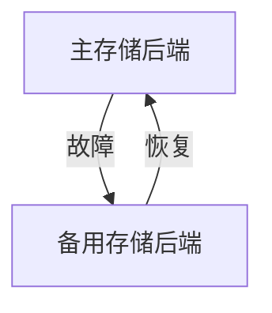

# 存储后端高可用

在现代分布式系统中，高可用性（High Availability, HA）是一个至关重要的概念。它确保系统在面对硬件故障、网络问题或其他意外情况时，仍能持续提供服务。对于 Grafana Alloy 这样的监控和日志收集系统，存储后端的高可用性尤为重要，因为它直接关系到数据的完整性和系统的可靠性。

## 什么是存储后端高可用？

存储后端高可用是指通过冗余和故障转移机制，确保存储系统在部分组件失效时仍能继续运行。在 Grafana Alloy 中，存储后端通常是指用于存储监控数据、日志和其他时间序列数据的数据库或分布式存储系统。

### 为什么需要存储后端高可用？

1. **数据安全**：确保数据不会因为单点故障而丢失。
2. **系统稳定性**：在硬件或网络故障时，系统仍能继续运行。
3. **业务连续性**：减少停机时间，确保业务不受影响。

## 实现存储后端高可用的关键步骤

### 1. 选择高可用的存储系统

首先，选择一个支持高可用的存储系统是关键。常见的选项包括：

- **Prometheus with Thanos**：通过 Thanos 实现 Prometheus 的高可用和长期存储。
- **Cortex**：一个多租户、高可用的 Prometheus 兼容系统。
- **Mimir**：Grafana Labs 推出的高可用 Prometheus 兼容系统。

### 2. 配置冗余和复制

在存储系统中配置冗余和复制是实现高可用的基础。例如，在 Prometheus 中，可以通过以下方式实现：

```yaml
global:
  external_labels:
    replica: A

scrape_configs:
  - job_name: 'node'
    static_configs:
      - targets: ['localhost:9100']
```

在这个配置中，`replica` 标签用于区分不同的副本。你可以运行多个 Prometheus 实例，每个实例都有不同的 `replica` 标签，从而实现数据的冗余。

### 3. 配置故障转移

故障转移是指在主节点失效时，自动切换到备用节点的机制。在 Grafana Alloy 中，可以通过配置多个存储后端来实现故障转移。例如：

```yaml
storage:
  backend:
    - url: "http://primary-storage:9090"
      priority: 1
    - url: "http://secondary-storage:9090"
      priority: 2
```

在这个配置中，`primary-storage` 是主存储后端，`secondary-storage` 是备用存储后端。当主存储后端不可用时，系统会自动切换到备用存储后端。

### 4. 监控和告警

实现高可用后，监控和告警是必不可少的。通过监控存储系统的健康状态，可以及时发现并解决问题。例如，可以使用 Grafana 来监控 Prometheus 的健康状态：

```yaml
alerting:
  alertmanagers:
    - static_configs:
        - targets: ['alertmanager:9093']
```

## 实际案例

假设你正在运行一个电商平台，使用 Grafana Alloy 来监控系统的性能和日志。为了确保监控数据的高可用性，你配置了以下存储后端：

1. **主存储后端**：运行在 AWS 上的 Prometheus 实例。
2. **备用存储后端**：运行在 Google Cloud 上的 Prometheus 实例。

当 AWS 出现网络故障时，系统会自动切换到 Google Cloud 上的备用存储后端，确保监控数据不会丢失，系统仍能正常运行。

## 总结

存储后端高可用是确保 Grafana Alloy 系统稳定性和数据安全性的关键。通过选择高可用的存储系统、配置冗余和复制、实现故障转移以及设置监控和告警，你可以构建一个高可用的监控和日志收集系统。

## 附加资源

- [Prometheus 官方文档](https://prometheus.io/docs/)
- [Thanos 官方文档](https://thanos.io/)
- [Cortex 官方文档](https://cortexmetrics.io/)
- [Mimir 官方文档](https://grafana.com/oss/mimir/)

## 练习

1. 在你的本地环境中配置一个高可用的 Prometheus 实例，并测试故障转移功能。
2. 使用 Grafana 监控你的存储后端，并设置告警规则，确保在存储后端出现问题时能及时收到通知。


