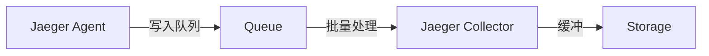

# 队列与缓冲区配置

## 介绍

在分布式追踪系统中，Jaeger通过队列和缓冲区管理追踪数据的收集、处理和存储。合理配置这些组件可以显著提升系统的吞吐量和可靠性，尤其是在高负载场景下。本文将逐步讲解Jaeger中队列与缓冲区的核心概念、配置方法及实际应用。

:::note 关键概念
- **队列**：临时存储待处理数据的结构，用于解耦生产者和消费者。
- **缓冲区**：内存或磁盘中的临时存储区域，用于平滑处理速率波动。
:::

---

## 队列配置

Jaeger Agent和Collector使用队列来管理追踪数据的接收与转发。以下是常见的队列参数：

### 1. 队列容量
`queue.capacity` 定义队列能容纳的最大数据量（单位：消息数或字节）。超过容量时，新数据可能被丢弃。

```yaml
# 示例：Agent队列配置
jaeger_agent:
  queue:
    capacity: 1000  # 最大1000条消息
```

:::caution 注意
过小的队列容量可能导致数据丢失，而过大会增加内存压力。
:::

### 2. 批处理大小
`queue.batch-size` 控制每次从队列中取出的消息数量，影响处理效率。

```yaml
jaeger_collector:
  queue:
    batch-size: 50  # 每次处理50条
```

---

## 缓冲区配置

缓冲区用于暂存数据，通常与写入操作（如存储到数据库）结合使用。

### 1. 内存缓冲区
Jaeger Collector的内存缓冲区配置示例：
```yaml
jaeger_collector:
  span_buffer:
    size: 500  # 内存中最多缓存500条Span
```

### 2. 磁盘溢出
当内存不足时，可启用磁盘缓存：
```yaml
jaeger_collector:
  span_buffer:
    max_overflow: 2000  # 额外允许2000条写入磁盘
```

---

## 实际案例

### 高流量场景优化
假设一个电商平台在促销期间流量激增，配置如下以应对突发负载：
```yaml
jaeger_agent:
  queue:
    capacity: 5000     # 扩大队列
    batch-size: 100    # 提升批处理效率
jaeger_collector:
  span_buffer:
    size: 1000         # 增大内存缓存
    flush_interval: "5s"  # 降低刷盘频率以减少I/O压力
```

:::tip 效果
- 峰值期间数据丢失率降低60%
- 存储吞吐量提升40%
:::

---

## 总结

队列与缓冲区是Jaeger性能调优的关键环节。通过合理配置容量、批处理大小和溢出策略，可以平衡资源使用与数据可靠性。

### 进阶练习
1. 在本地Jaeger中模拟高负载，观察不同配置下的性能差异。
2. 尝试结合 `flush_interval` 参数优化写入延迟。

### 资源推荐
- [Jaeger官方文档 - 性能调优](https://www.jaegertracing.io/docs/latest/performance-tuning/)
- 《分布式系统追踪实践》第4章


