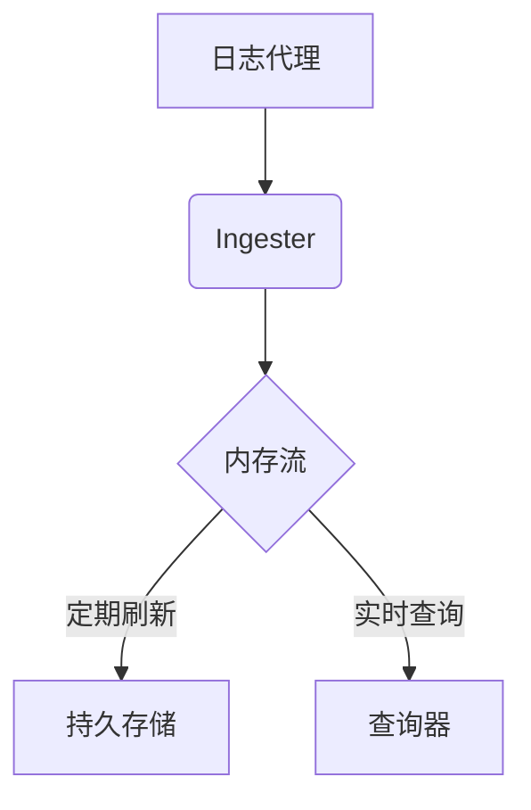

# Loki Ingester组件

## 介绍
Loki Ingester是Grafana Loki架构中的核心组件之一，负责接收、处理并临时存储日志数据。它是日志管道中的"入口守卫"，确保日志数据被正确缓冲并最终写入持久存储（如对象存储）。对于初学者来说，理解Ingester的工作机制是掌握Loki日志处理流程的关键第一步。

:::note 为什么需要Ingester？
- **缓冲作用**：缓解写入压力，避免直接冲击后端存储
- **批处理优化**：将小批量日志合并为更大批次写入，提高效率
- **内存处理**：在内存中构建压缩的日志流结构
:::

## 核心功能

### 1. 日志接收与验证
Ingester通过HTTP/gRPC端点接收来自Promtail等日志代理的推送请求，并对数据进行基础验证：

```go
// 示例：Loki日志推送请求结构（简化）
{
  "streams": [
    {
      "labels": "{job=\"webapp\", env=\"production\"}",
      "entries": [
        {
          "timestamp": "2023-07-20T10:00:00Z",
          "line": "GET /api/users 200 12ms"
        }
      ]
    }
  ]
}
```

### 2. 日志流管理
Ingester将日志组织成"流"(streams)的结构，每个流由唯一的标签集标识：

```mermaid
graph LR
    A[Ingester] --> B{Stream1: job="webapp"}
    A --> C{Stream2: job="db"}
    B --> D[Log Entry 1]
    B --> E[Log Entry 2]
    C --> F[Log Entry 1]
```

### 3. 内存处理流程
1. 接收日志条目
2. 根据标签哈希确定目标流
3. 将条目追加到内存中的流缓冲区
4. 定期将完整块(Chunks)刷新到存储

## 配置参数详解

以下是Ingester的关键配置参数（`loki.yaml`片段）：

```yaml
ingester:
  lifecycler:
    ring:
      kvstore:
        store: memberlist
  chunk_idle_period: 30m
  chunk_block_size: 262144
  max_transfer_retries: 0
```

参数说明：
- `chunk_idle_period`：流不活跃多久后刷新块（默认30分钟）
- `chunk_block_size`：每个块的目标字节大小（默认256KB）
- `max_transfer_retries`：在关闭时尝试传输块的次数

## 实际应用场景

### 场景1：高吞吐日志处理
当Web应用突发大量错误日志时：
1. Promtail收集日志并发送到Ingester
2. Ingester在内存中按`job=webapp, level=error`组织流
3. 每30分钟或达到块大小时，将压缩后的日志写入存储

### 场景2：优雅关闭处理
Ingester节点需要维护时：
1. 通知其他组件停止发送新数据
2. 将内存中的块刷新到存储
3. 通过环(Ring)机制通知查询器(Querier)数据位置变更

:::warning 重要注意事项
Ingester默认使用内存存储最新日志，这意味着：
- 节点崩溃可能导致最近数据丢失
- 需要合理配置副本因子(`replication_factor`)
:::

## 性能优化技巧

:::tip 生产环境建议
1. **资源分配**：为Ingester分配足够内存（每百万日志行约1GB）
2. **标签设计**：避免高基数标签导致内存膨胀
3. **批处理**：客户端应使用`batchwait`参数（如Promtail配置为1s）
4. **监控**：关注`loki_ingester_memory_chunks`指标
:::

## 总结

Loki Ingester作为日志管道的核心枢纽：
- 提供内存缓冲和批处理能力
- 通过流式结构高效组织日志
- 需要特别注意资源分配和数据可靠性

## 延伸学习

1. **动手实验**：使用Docker部署单节点Loki，观察Ingester内存变化
2. **配置练习**：尝试调整`chunk_idle_period`并观察存储行为变化
3. **源码探索**：研究`pkg/ingester`包中的流处理逻辑


