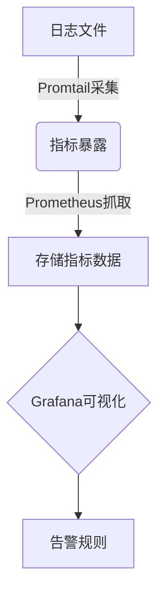

# Promtail指标与监控

## 介绍

Promtail是Grafana Loki生态中的日志收集代理，负责从本地文件、系统日志等来源采集日志并发送到Loki。监控Promtail的运行指标至关重要，它能帮助您及时发现日志管道中的问题（如丢包、延迟），并优化资源使用。本章将介绍Promtail的关键指标、如何配置监控，以及常见问题的排查方法。

:::note 核心概念
- **指标类型**：Promtail暴露的指标包括计数器（如日志行数）、仪表盘（如队列大小）和直方图（如处理延迟）。
- **数据来源**：指标通过Prometheus格式暴露，可直接被Prometheus抓取。
:::

---

## Promtail的关键指标

### 1. 日志采集指标
- `promtail_files_added_total`：已发现的日志文件总数。
- `promtail_read_bytes_total`：从日志文件读取的总字节数。
- `promtail_lines_sent_total`：成功发送到Loki的日志行数。

### 2. 处理状态指标
- `promtail_file_bytes_total`：当前监控文件的总大小（按标签`path`区分）。
- `promtail_positions_errors_total`：文件位置记录失败的次数。

### 3. 管道性能指标
- `promtail_sent_entries_total`：按日志流标签统计的发送条目数。
- `promtail_dropped_entries_total`：因错误（如标签无效）丢弃的日志条目数。

:::tip 指标示例
通过`curl`查看Promtail指标（默认端口`9080`）：
```bash
curl http://localhost:9080/metrics
```
输出示例：
```
# HELP promtail_files_added_total Total files added.
# TYPE promtail_files_added_total counter
promtail_files_added_total 42
```
:::

---

## 配置Prometheus监控Promtail

### 步骤1：启用Promtail指标端点
在Promtail配置文件`promtail-config.yml`中确保以下配置：
```yaml
server:
  http_listen_port: 9080
  metrics_prefix: promtail_  # 指标前缀（可选）
```

### 步骤2：添加Prometheus抓取任务
在Prometheus的`prometheus.yml`中添加：
```yaml
scrape_configs:
  - job_name: 'promtail'
    static_configs:
      - targets: ['localhost:9080']
```

### 步骤3：验证数据
在Prometheus UI中查询`promtail_files_added_total`，确认数据已录入。

---

## 实际案例：监控日志丢失

### 场景描述
用户发现部分日志未出现在Loki中，需通过指标定位问题。

### 排查步骤
1. 检查丢弃条目指标：
   ```promql
   sum(rate(promtail_dropped_entries_total[1m])) by (reason)
   ```
2. 若`reason=invalid_labels`，可能是标签格式错误。
3. 检查队列积压：
   ```promql
   promtail_queue_entries_total
   ```
   若持续增长，可能是Loki写入性能不足。

:::warning 常见问题
- **指标无数据**：确认Promtail的`server`配置和Prometheus抓取地址正确。
- **高丢弃率**：检查日志标签是否符合Loki规范（如不含空格）。
:::

---

## 总结

通过监控Promtail指标，您可以：
- 实时掌握日志采集状态。
- 快速定位管道瓶颈（如文件读取延迟、网络问题）。
- 优化资源配置（如调整批处理大小）。

---

## 扩展练习
1. **实践任务**：部署Promtail和Prometheus，配置基础监控面板。
2. **深入学习**：探索Grafana仪表盘中的[Loki数据源](https://grafana.com/docs/loki/latest/)。
3. **问题模拟**：故意配置错误标签，观察`dropped_entries_total`的变化。


