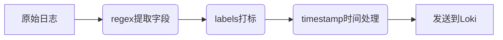

# Promtail动作

## 介绍

Promtail是Loki日志系统的日志收集代理，其核心功能是通过**流水线（Pipeline）**处理日志行。在流水线中，**动作（Actions）**是执行实际转换操作的组件，每个动作会对日志内容进行特定处理（如提取字段、修改标签等）。本文将详细介绍Promtail支持的各类动作及其应用场景。

:::note 关键概念
- **动作**：流水线中的最小处理单元，每个动作完成一项具体任务
- **执行顺序**：动作按配置顺序依次执行，前一个动作的输出是下一个动作的输入
:::

---

## 基础动作类型

### 1. 日志解析（`regex`）

使用正则表达式从日志行提取字段：

```yaml
pipeline_stages:
  - regex:
      expression: '^(?P<time>\\d{4}-\\d{2}-\\d{2}) (?P<level>\\w+) (?P<msg>.*)'
```

**输入日志**：
```
2023-07-20 ERROR Disk quota exceeded
```

**输出结构**：
```json
{
  "time": "2023-07-20",
  "level": "ERROR",
  "msg": "Disk quota exceeded"
}
```

:::tip 正则提示
使用命名捕获组（`?P<name>`）可生成结构化字段
:::

### 2. 标签操作（`labels`）

将提取的字段转换为标签（注意：标签键必须符合Prometheus命名规范）：

```yaml
- labels:
    level: ""
```

### 3. 时间戳处理（`timestamp`）

解析日志时间并替换默认采集时间戳：

```yaml
- timestamp:
    source: time
    format: "2006-01-02"
```

---

## 高级动作类型

### 4. 日志重写（`replace`）

替换日志内容中的特定模式：

```yaml
- replace:
    source: "msg"
    expression: "quota"
    replace: "storage limit"
```

**效果**：
```
Before: "Disk quota exceeded"
After:  "Disk storage limit exceeded"
```

### 5. JSON解析（`json`）

直接解析JSON格式日志：

```yaml
- json:
    expressions:
      user: "user.name"
      status: "response.status"
```

**输入日志**：
```json
{"user": {"name": "Alice"}, "response": {"status": 404}}
```

### 6. 多行合并（`multiline`）

合并多行日志为单个事件（如Java异常堆栈）：

```yaml
- multiline:
    firstline: '^\$$\\d{4}-\\d{2}-\\d{2}'
    max_wait_time: "3s"
```

---

## 实际案例

### 案例：Nginx访问日志处理

**原始日志**：
```
192.168.1.1 - alice [20/Jul/2023:10:12:34 +0000] "GET /api/users HTTP/1.1" 200 1234
```

**流水线配置**：
```yaml
pipeline_stages:
  - regex:
      expression: '^(?P<ip>\\S+) \\S+ (?P<user>\\S+) \$$(?P<time>[^\$$]+)\$$ "(?P<method>\\w+) (?P<path>[^\\s]+)'
  - labels:
      method: ""
      path: "/api/users"
  - timestamp:
      source: time
      format: "02/Jan/2006:15:04:05 -0700"
```

**处理结果**：
- 生成标签：`method="GET"`, `path="/api/users"`
- 提取字段：`ip="192.168.1.1"`, `user="alice"`
- 正确设置日志时间戳

---

## 总结

Promtail动作提供了灵活的日志处理能力，主要分为：
1. **提取类动作**（regex/json） - 从日志获取结构化数据
2. **转换类动作**（replace/labels） - 修改日志内容和元数据
3. **增强类动作**（timestamp/multiline） - 改善日志的时序性和可读性

:::warning 注意事项
- 标签数量会影响Loki性能，避免过度使用
- 复杂正则表达式可能增加CPU开销
:::

## 延伸学习

1. 尝试为你的应用日志设计一个处理流水线
2. 比较`regex`与`json`解析器的适用场景
3. 阅读[官方文档](https://grafana.com/docs/loki/latest/clients/promtail/stages/)了解完整动作列表


