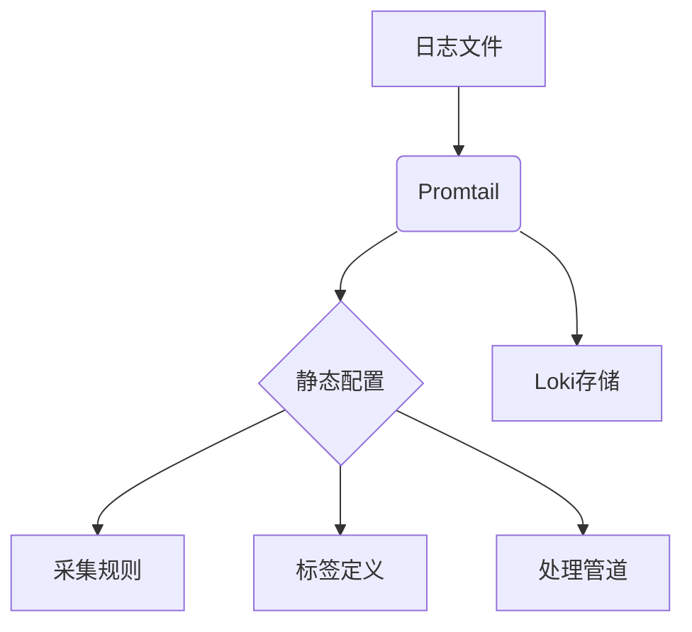

# Promtail静态配置

## 介绍

Promtail是Loki生态系统中专为日志收集设计的代理工具，它以静态配置文件的方式定义日志采集规则。静态配置适合固定不变的日志源场景，是初学者理解Promtail工作原理的最佳起点。

## 配置文件结构

Promtail的静态配置文件采用YAML格式，主要包含以下核心部分：

```yaml
server:
  http_listen_port: 9080
  grpc_listen_port: 0

positions:
  filename: /tmp/positions.yaml

clients:
  - url: http://loki:3100/loki/api/v1/push

scrape_configs:
  - job_name: system
    static_configs:
      - targets: [localhost]
        labels:
          job: varlogs
          __path__: /var/log/*log
```

:::note 关键组件说明
- **server**: 定义Promtail服务的监听端口
- **positions**: 记录文件读取位置的持久化存储
- **clients**: 配置Loki服务器的连接信息
- **scrape_configs**: 定义日志采集任务的核心配置
:::

## 配置详解

### 1. 基础服务器配置

```yaml
server:
  http_listen_port: 9080  # 管理接口端口
  grpc_listen_port: 0     # 禁用gRPC时设为0
```

### 2. 文件位置追踪

```yaml
positions:
  filename: /tmp/positions.yaml  # 记录文件读取进度
```

### 3. Loki连接配置

```yaml
clients:
  - url: http://loki:3100/loki/api/v1/push
    batchwait: 1s       # 批量发送前等待时间
    batchsize: 1048576  # 批量大小(字节)
```

### 4. 日志采集配置

```yaml
scrape_configs:
  - job_name: 'apache'
    static_configs:
      - targets: [localhost]
        labels:
          job: apache
          env: production
          __path__: /var/log/apache/*.log
    pipeline_stages:
      - regex:
          expression: '^(?P<ip>\\S+) \\S+ \\S+ \$$(?P<timestamp>[\\w:/]+\\s[+\\-]\\d{4})\$$'
      - timestamp:
          format: '02/Jan/2006:15:04:05 -0700'
          source: timestamp
```

## 实际案例

### 案例1：收集Nginx日志

```yaml
scrape_configs:
  - job_name: nginx
    static_configs:
      - targets: [localhost]
        labels:
          job: nginx
          __path__: /var/log/nginx/access.log
    pipeline_stages:
      - json:
          expressions:
            remote_addr: client_ip
            request: request
            status: status
```

### 案例2：多目录日志收集

```yaml
scrape_configs:
  - job_name: multi-path
    static_configs:
      - targets: [localhost]
        labels:
          job: app_logs
          __path__: /opt/app/**/*.log
```

## 配置验证

使用以下命令验证配置文件语法：

```bash
promtail --config.file=promtail.yaml --dry-run
```

:::tip 最佳实践
1. 使用`**`递归匹配子目录
2. 为不同应用分配独立的`job_name`
3. 通过`labels`添加环境标识(dev/staging/prod)
4. 定期清理旧的`positions`文件
:::

## 总结

Promtail静态配置提供了简单直接的日志收集方案，适合：
- 固定不变的日志源
- 单机部署场景
- 需要快速验证的POC环境

## 延伸学习

1. 尝试为你的个人项目配置日志收集
2. 比较静态配置与动态配置的区别
3. 研究`pipeline_stages`的高级日志处理功能
4. 了解如何添加自定义标签(label)


