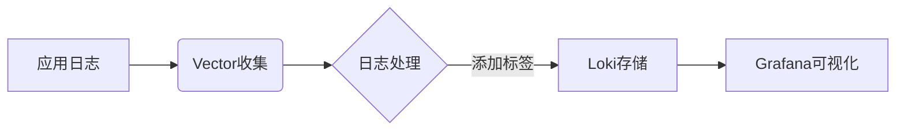

# Vector与Loki集成

## 简介

Vector是一个高性能的日志、指标和事件收集工具，支持多种输入源和输出目标。Grafana Loki则是一个专为日志聚合设计的系统，专注于低成本存储和高效查询。将Vector与Loki集成，可以实现从多种来源收集日志并集中存储到Loki中，便于后续分析和可视化。

本指南将逐步介绍如何配置Vector将日志发送到Loki，适合初学者理解核心概念和操作步骤。

---

## 前置条件

在开始之前，请确保：
1. 已安装并运行Vector（[安装指南](https://vector.dev/docs/setup/installation/)）
2. 已部署Grafana Loki服务（[Loki文档](https://grafana.com/docs/loki/latest/)）
3. 基本了解YAML配置格式

---

## 基础配置

### 1. 配置Vector的Loki输出

在Vector的配置文件（如`vector.toml`或`vector.yaml`）中添加Loki输出目标。以下是YAML格式的示例：

```yaml
sources:
  my_app_logs:
    type: file
    include: ["/var/log/myapp/*.log"]

transforms:
  parse_logs:
    type: remap
    inputs: ["my_app_logs"]
    source: |
      .loki_labels = {"app": "myapp", "env": "production"}

sinks:
  to_loki:
    type: loki
    inputs: ["parse_logs"]
    endpoint: "http://localhost:3100"
    labels:
      app: "{{ app }}"
      env: "{{ env }}"
```

:::note 关键字段说明
- `sources`: 定义日志来源（如文件、syslog等）
- `transforms`: 可选的处理步骤（如添加Loki标签）
- `sinks`: 指定输出到Loki的配置
:::

### 2. 标签的重要性

Loki通过标签（labels）组织日志数据，良好的标签设计能显著提升查询效率：
- 避免高基数标签（如用户ID、IP地址）
- 使用固定范围的维度（如环境、应用名称）

---

## 进阶配置

### 1. 日志批处理与压缩

优化网络传输和Loki存储效率：
```yaml
sinks:
  to_loki:
    # ...其他配置...
    encoding:
      codec: json
    compression: gzip
    batch:
      max_bytes: 1048576 # 1MB
      timeout_secs: 5
```

### 2. 多租户支持

如果Loki启用了多租户，添加`X-Scope-OrgID`头：
```yaml
sinks:
  to_loki:
    # ...其他配置...
    healthcheck: false
    request:
      headers:
        X-Scope-OrgID: "team-1"
```

---

## 实战案例

### 场景：收集Nginx访问日志

```yaml
sources:
  nginx_access:
    type: file
    include: ["/var/log/nginx/access.log"]

transforms:
  nginx_parser:
    type: remap
    inputs: ["nginx_access"]
    source: |
      parsed = parse_nginx_log!(.message)
      .timestamp = to_timestamp(parsed.timestamp)
      .loki_labels = {"service": "nginx", "method": parsed.method}

sinks:
  to_loki:
    type: loki
    inputs: ["nginx_parser"]
    endpoint: "http://loki:3100"
    labels:
      service: "{{ service }}"
      method: "{{ method }}"
```

:::tip 日志解析
使用Vector的VRL语言（Vector Remap Language）可以灵活解析原始日志格式，提取出结构化字段作为Loki标签。
:::

---

## 验证与调试

1. 检查Vector状态：
```bash
vector validate --config /etc/vector/vector.yaml
vector top
```

2. 查询Loki确认日志接收：
```logsql
{service="nginx"} |= "GET"
```

3. 常见问题排查：
- 标签值包含非法字符（如空格）
- Loki服务端点不可达
- 时间戳格式不匹配

---

## 总结

通过本指南，你已学会：
- Vector与Loki集成的核心配置方法
- 如何设计有效的Loki标签策略
- 实际应用场景中的配置技巧

---

## 扩展资源

1. [Vector官方文档 - Loki输出](https://vector.dev/docs/reference/configuration/sinks/loki/)
2. [Loki最佳实践](https://grafana.com/docs/loki/latest/best-practices/)
3. 练习任务：尝试从Docker容器收集日志并发送到Loki


