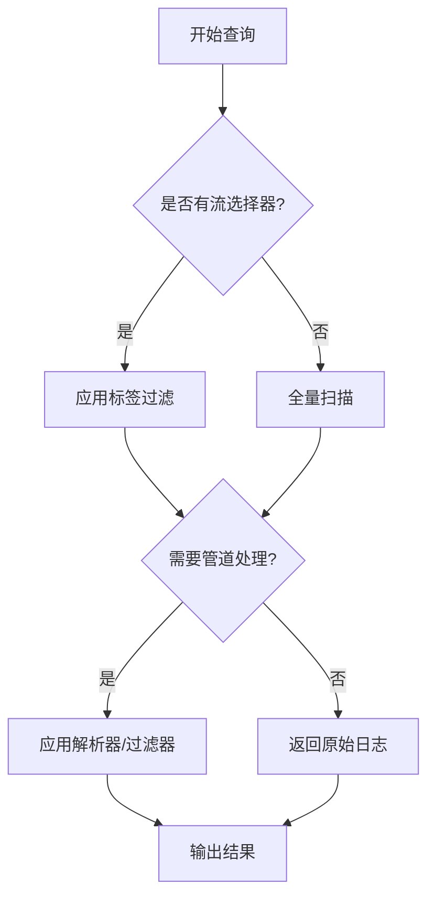

# LogQL查询语言介绍

LogQL是Grafana Loki专用的日志查询语言，其设计灵感来自PromQL（Prometheus查询语言）。它允许用户通过类似SQL的语法对日志数据进行高效检索、过滤和分析。作为Loki生态系统的核心组件，LogQL既支持简单的日志行匹配，也能实现复杂的聚合运算。

## 基础查询结构

LogQL查询由两个主要部分组成：
1. **日志流选择器**：确定要查询的日志流
2. **日志管道**（可选）：对选定的日志进行过滤和处理

基本语法格式：
```logql
{流选择器} | 日志管道
```

### 1. 流选择器
通过标签键值对筛选日志流，语法与PromQL相同：

```logql
{job="api-server", namespace="production"}
```

### 2. 日志管道
包含多个处理阶段的表达式：

```logql
{job="nginx"} 
  | json 
  | line_format "{{.status}}" 
  | status >= 400
```

## 核心操作符详解

### 匹配运算符
- `=`：完全匹配
- `!=`：不等于
- `=~`：正则匹配
- `!~`：正则不匹配

示例：
```logql
{cluster=~"us-east-1.*"}  # 匹配所有以us-east-1开头的集群
```

### 过滤表达式
在日志管道中使用：
- `|~ "error"`：包含"error"
- `!~ "debug"`：不包含"debug"

```logql
{service="auth"} |~ "login failed" |~ "user="
```

## 解析器（Parsers）

LogQL提供多种日志解析方式：

### JSON解析器
```logql
{app="frontend"} | json
```

输入日志：
```json
{"level":"error","msg":"Failed to connect","time":"2023-01-01T12:00:00Z"}
```

解析后可访问字段：
```logql
{app="frontend"} | json | level="error"
```

### Logfmt解析器
```logql
{app="payment"} | logfmt | duration > 500ms
```

### 正则表达式解析器
```logql
{service="backend"} 
  | regexp `(?P<ip>\\d+.\\d+.\\d+.\\d+) (?P<path>/\\S+)` 
  | path = "/api/v1/users"
```

## 指标查询

LogQL可以将日志数据转换为时序指标：

### 计数日志条目
```logql
count_over_time(
  {job="mysql"}
    |~ "connection timeout"
    [5m]
)
```

### 提取速率指标
```logql
rate(
  {namespace="prod"}
    | json
    | status >= 500
    [1m]
)
```

## 实际案例

### 案例1：监控HTTP错误率
```logql
sum(rate(
  {job="web-server"}
    | json
    | status >= 400
    [1m]
)) by (service)
```

### 案例2：查找高频错误消息
```logql
topk(3,
  sum by (message) (
    count_over_time(
      {env="production"}
        | json
        | level="error"
        [15m]
    )
  )
)
```

## 性能优化技巧

:::tip 查询优化
1. **尽可能缩小时间范围**：使用`[5m]`而非`[1h]`
2. **优先使用标签过滤**：`{app="api"}`比`|~ "api"`更高效
3. **避免过度使用正则**：复杂正则会显著降低查询速度
:::

## 总结

LogQL作为Loki的查询语言，提供了：
- 灵活的日志流选择机制
- 强大的文本处理能力
- 丰富的指标转换功能
- 类似PromQL的聚合操作

## 延伸学习

推荐练习：
1. 编写查询找出所有包含`Timeout`错误的Nginx日志
2. 计算不同HTTP方法的请求速率
3. 分析日志中高频出现的异常模式


