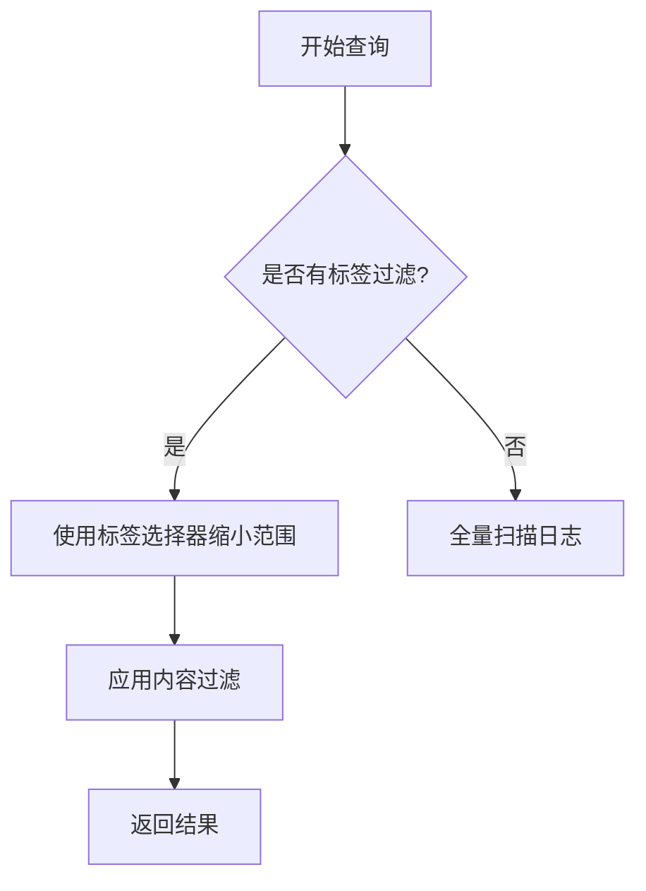

# LogQL标签过滤

## 介绍

LogQL是Grafana Loki的查询语言，它允许你通过标签（Labels）对日志数据进行高效过滤和检索。标签是键值对形式的元数据，附加在日志流上，能够帮助你快速定位特定日志。本文将详细介绍如何使用LogQL的标签过滤功能，包括基本语法、操作符和实际应用场景。

## 基本语法

LogQL的标签过滤主要通过 `{}` 包裹的标签选择器实现。基本结构如下：

```logql
{标签名="值"}
```

### 示例1：精确匹配

查询所有来自 `app=nginx` 的日志：

```logql
{app="nginx"}
```

输出结果将仅包含标签 `app` 值为 `nginx` 的日志流。

---

## 操作符类型

LogQL支持多种标签过滤操作符：

| 操作符 | 说明               | 示例                  |
|--------|--------------------|-----------------------|
| `=`    | 完全匹配           | `{app="nginx"}`       |
| `!=`   | 不等于             | `{env!="production"}` |
| `=~`   | 正则表达式匹配     | `{pod=~"web-\d+"}`    |
| `!~`   | 正则表达式不匹配   | `{service!~"db-.*"}`  |

:::tip
正则表达式需遵循 [RE2语法](https://github.com/google/re2/wiki/Syntax)。<br />
例如 `=~"error|warn"` 可匹配包含 `error` 或 `warn` 的标签值。
:::

---

## 多标签组合

通过逗号分隔多个标签条件，实现更精确的过滤：

```logql
{app="nginx", env="production", pod=~"frontend-.*"}
```

此查询会匹配所有满足以下条件的日志：
1. `app` 标签值为 `nginx`
2. `env` 标签值为 `production`
3. `pod` 标签符合正则表达式 `frontend-.*`

---

## 实际案例

### 场景1：过滤特定环境的错误日志

假设你需要查找生产环境中 `payment-service` 服务的错误日志：

```logql
{service="payment-service", env="production"} |= "ERROR"
```

### 场景2：排除测试环境的日志

忽略所有 `env` 为 `test` 或 `staging` 的日志：

```logql
{env!~"test|staging"}
```

---

## 性能优化建议

1. **优先使用标签过滤**：标签过滤比日志内容过滤（如 `|= "text"`）更高效。
2. **避免过度正则**：复杂的正则表达式会增加查询开销。
3. **合理设计标签**：遵循 [Loki标签最佳实践](https://grafana.com/docs/loki/latest/best-practices/#labels)。

:::caution
避免使用高基数标签（如 `user_id`）作为过滤条件，可能导致查询性能下降。
:::

---

## 总结

LogQL的标签过滤功能是定位日志数据的关键工具。通过本文你学会了：
- 基础标签选择器语法
- 多种操作符的使用场景
- 多标签组合查询技巧
- 实际应用案例

## 下一步

1. 在Loki中尝试组合不同操作符的查询
2. 阅读 [官方LogQL文档](https://grafana.com/docs/loki/latest/logql/)
3. 练习：编写一个查询，找出非生产环境中所有名称以 `api-` 开头的Pod的警告日志


