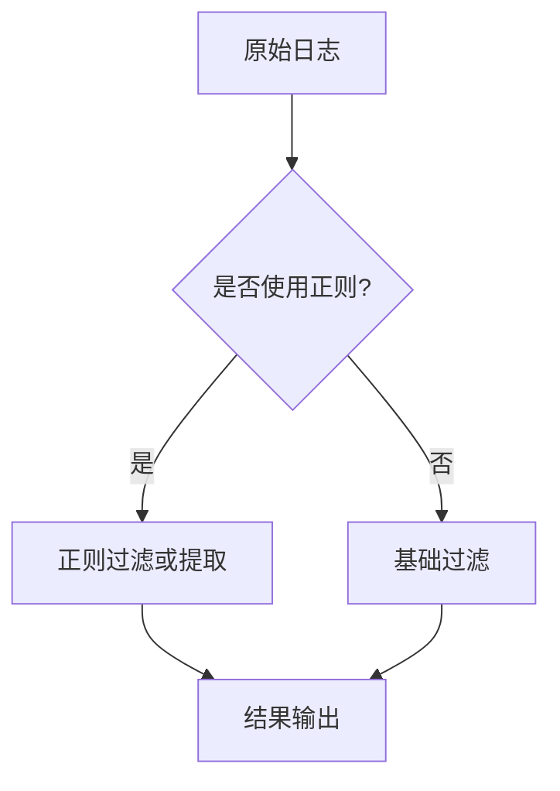

# LogQL正则表达式

正则表达式（Regular Expression）是处理文本的强大工具，在LogQL中可用于日志行的模式匹配、字段提取和过滤。本文将介绍如何在LogQL中结合正则表达式实现灵活的日志分析。

## 正则表达式基础

正则表达式是由特殊字符和普通字符组成的模式，用于匹配字符串。LogQL支持[RE2语法](https://github.com/google/re2/wiki/Syntax)，以下为常用元字符：

| 字符 | 说明                  | 示例            |
|------|---------------------|-----------------|
| `.`  | 匹配任意单个字符         | `a.c` → "abc"   |
| `*`  | 前导字符出现0次或多次     | `a*b` → "b", "aab" |
| `+`  | 前导字符出现1次或多次     | `a+b` → "ab", "aab" |
| `\d` | 匹配数字（0-9）          | `\d+` → "123"   |
| `\w` | 匹配字母数字或下划线       | `\w+` → "user_1" |
| `[]` | 字符集合               | `[aeiou]` → "e" |
| `()` | 捕获组                 | `(err)` → 提取"err" |

:::tip
在LogQL中正则表达式需要放在管道符 `|` 后，且必须用双引号包裹
:::

## LogQL中的正则应用

### 1. 日志行过滤（line filter）

使用 `|~` 表示正则匹配，`!~` 表示正则不匹配：

```logql
{job="nginx"} |~ "error [0-9]{3}"
```
匹配示例输入：
```
2023-01-01 error 500: Internal server error
2023-01-01 error 404: Not found
```
不匹配示例：
```
2023-01-01 info: User logged in
```

### 2. 标签提取（label extraction）

通过正则捕获组从日志内容中提取标签：

```logql
{job="apache"} 
| regexp "(?P<ip>\\d+.\\d+.\\d+.\\d+) .*? \"(?P<method>\\w+) (?P<path>/[^ ]*)"
| label_format method=method, path=path
```
输入日志：
```
192.168.1.1 - - [01/Jan/2023] "GET /api/users HTTP/1.1" 200
```
提取结果：
- 新增标签 `method="GET"`, `path="/api/users"`

### 3. 模式替换

使用 `replace` 函数进行正则替换：

```logql
{namespace="prod"} 
|~ "password=\\w+" 
| replace "password=(\\w+)" "password=***"
```
替换前：
```
user=admin password=12345 login=true
```
替换后：
```
user=admin password=*** login=true
```

## 实际案例

### 案例1：HTTP状态码分析

统计不同HTTP状态码出现的频率：

```logql
{job="nginx-access"} 
| regexp "HTTP/1.\\d\" (?P<status>\\d{3})" 
| rate() by (status)
```

### 案例2：提取JSON字段

从非结构化日志中提取JSON字段：

```logql
{app="order-service"} 
| json 
| line_format "{{.message}}" 
| regexp "\\{\"order_id\":\"(?P<order_id>[^\"]+)\".*\"amount\":(?P<amount>\\d+)"
```

## 性能优化建议

:::caution
正则表达式可能影响查询性能，请遵循：
1. 尽量在标签过滤（`{}`部分）后使用正则
2. 优先使用简单的字符串匹配（`|=`, `!=`）
3. 避免使用贪婪匹配（如`.*`）
:::

## 总结

LogQL正则表达式提供了强大的日志处理能力，主要应用于：
- 复杂模式匹配（`|~`, `!~`）
- 结构化字段提取（`regexp` + 捕获组）
- 日志内容转换（`replace`）

## 练习

尝试完成以下查询：
1. 从日志中提取所有IPv4地址
2. 匹配包含日期格式"YYYY-MM-DD"的日志行
3. 将日志中的信用卡号替换为"****-****-****-****"


