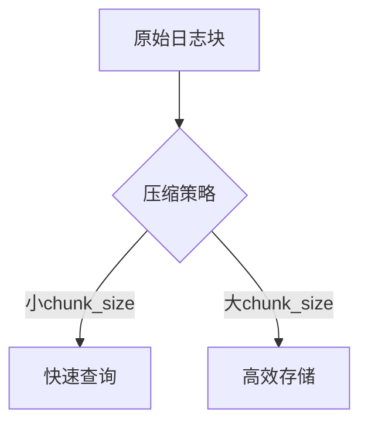

# 压缩策略设置

## 介绍

在Grafana Loki中，**压缩策略**是优化日志存储性能和资源利用率的关键机制。通过合理配置压缩策略，可以减少存储空间占用、加速查询速度，并平衡计算资源消耗。本文将逐步介绍Loki的压缩原理、配置方法及实际案例。

:::note 什么是压缩？
压缩是将多个小的日志块（chunks）合并为更大的块，并移除重复或过期数据的过程。Loki使用压缩来降低存储成本和提高查询效率。
:::

---

## 压缩策略基础

### 1. 压缩的触发条件
Loki的压缩由以下参数控制：
- **`compactor`**：负责执行压缩的组件。
- **`retention_period`**：日志保留时间，超期的数据会被清理。
- **`chunk_size`**：目标压缩块大小（默认`150MB`）。

### 2. 配置示例
在Loki的配置文件（`loki.yaml`）中定义压缩策略：

```yaml
compactor:
  working_directory: /tmp/loki/compactor
  shared_store: s3
  compaction_interval: 10m
  retention_enabled: true
  retention_delete_delay: 2h
  retention_delete_worker_count: 10
```

:::tip 参数说明
- `working_directory`：临时工作目录。
- `compaction_interval`：压缩任务执行间隔。
- `retention_*`：控制保留策略的清理行为。
:::

---

## 进阶配置

### 1. 按时间分片压缩
Loki支持按时间范围分片压缩，避免大范围数据操作。例如，按天分片：

```yaml
compactor:
  split_and_merge_shards: 3
  split_series_by_age: 24h
```

### 2. 压缩块大小调优
调整`chunk_size`可平衡查询速度和存储效率：
- **较小值**（如`50MB`）：查询更快，但存储开销高。
- **较大值**（如`250MB`）：存储更高效，但查询可能变慢。

```yaml
limits_config:
  max_chunk_size: 250MB
```

---

## 实际案例

### 场景：电商日志优化
某电商平台每天产生`10TB`日志，配置如下：
1. **高频日志**（如订单跟踪）：使用`50MB`块大小，保留7天。
2. **低频日志**（如审计日志）：使用`200MB`块大小，保留30天。

```yaml
compactor:
  split_series_by_age: 12h  # 订单日志分片更频繁
limits_config:
  max_chunk_size: 50MB
```

:::warning 注意
过小的`compaction_interval`会增加后台负载，建议根据数据量测试后调整。
:::

---

## 总结

- **压缩策略**直接影响Loki的存储效率和查询性能。
- 关键参数包括`chunk_size`、`compaction_interval`和分片配置。
- 实际场景中需根据日志类型和访问模式调整策略。

### 附加资源
1. [Loki官方文档 - 压缩](https://grafana.com/docs/loki/latest/operations/storage/compaction/)
2. 练习：在测试环境中修改`chunk_size`，观察查询延迟变化。


