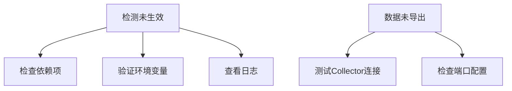

# OpenTelemetry 自动检测故障排除

## 介绍

OpenTelemetry的**自动检测（Auto-Instrumentation）**功能允许开发者无需手动修改代码即可收集应用的遥测数据（如追踪、指标和日志）。然而，在实际部署中，可能会遇到配置错误、数据丢失或性能问题。本文将帮助你识别和解决这些常见问题。

:::note 关键概念
自动检测通过**字节码增强**或**运行时挂钩**自动注入遥测逻辑，适用于Java、Python、Node.js等语言。
:::

---

## 常见问题及解决方案

### 1. 检测未生效
**症状**：应用未生成预期的追踪或指标数据。

**排查步骤**：
1. **验证依赖项**：确保已正确安装自动检测库。例如，在Python中：
   ```bash
   pip install opentelemetry-instrumentation-flask
   ```
2. **检查环境变量**：自动检测通常依赖环境变量启用：
   ```bash
   export OTEL_SERVICE_NAME=my-service
   export OTEL_TRACES_EXPORTER=console
   ```
3. **日志分析**：启动应用时检查日志中是否有OpenTelemetry初始化错误。

:::warning
Java应用需通过`-javaagent`参数加载agent，遗漏此步骤会导致检测失败：
```bash
java -javaagent:opentelemetry-javaagent.jar -jar app.jar
```
:::

---

### 2. 数据未导出到收集器
**症状**：数据生成但未到达OpenTelemetry Collector或后端（如Jaeger）。

**解决方案**：
1. **验证Collector配置**：确保Collector的端点（endpoint）和端口正确：
   ```yaml
   # OpenTelemetry Collector配置示例
   exporters:
     otlp:
       endpoint: "otel-collector:4317"
   ```
2. **网络连通性**：使用`telnet`或`curl`测试与Collector的连接：
   ```bash
   telnet otel-collector 4317
   ```

---

### 3. 性能开销过高
**症状**：应用响应变慢或资源使用率激增。

**优化建议**：
- **采样率调整**：降低追踪数据的采样频率：
  ```bash
  export OTEL_TRACES_SAMPLER=parentbased_traceidratio
  export OTEL_TRACES_SAMPLER_ARG=0.1  # 10%采样率
  ```
- **禁用非必要检测**：例如，仅启用数据库检测：
  ```bash
  export OTEL_INSTRUMENTATION_HTTP_ENABLED=false
  ```

---

## 实际案例

### 案例：Python Flask应用无追踪数据
**问题描述**：Flask应用部署后，Jaeger中无追踪数据。

**解决过程**：
1. 发现未设置`OTEL_EXPORTER_OTLP_ENDPOINT`环境变量。
2. 添加配置后仍无效，最终发现需显式初始化检测：
   ```python
   from opentelemetry.instrumentation.flask import FlaskInstrumentor
   FlaskInstrumentor().instrument_app(app)
   ```

---

## 总结

自动检测简化了遥测数据的收集，但需注意依赖项、环境变量和网络配置。通过日志分析和逐步排查，可以快速定位问题。

### 附加资源
- [OpenTelemetry官方文档](https://opentelemetry.io/docs/)
- 练习：尝试在本地启动一个Spring Boot应用，并配置自动检测导出到Jaeger。


